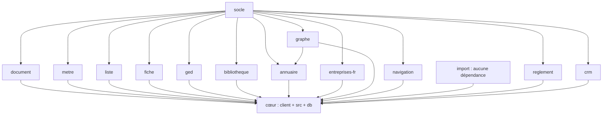

# LogiBTP – carte des modules

Vue d'ensemble des modules et de leurs liens. Le détail de chaque partie est dans son `CLAUDE.md` :
[socle](socle/CLAUDE.md) · [document](modules/document/CLAUDE.md) · [metre](modules/metre/CLAUDE.md) ·
[liste](modules/liste/CLAUDE.md) · [fiche](modules/fiche/CLAUDE.md) · [ged](modules/ged/CLAUDE.md) ·
[bibliotheque](modules/bibliotheque/CLAUDE.md) · [annuaire](modules/annuaire/CLAUDE.md) ·
[entreprises-fr](modules/entreprises-fr/CLAUDE.md) · [graphe](modules/graphe/CLAUDE.md) ·
[navigation](modules/navigation/CLAUDE.md) · [import](modules/import/CLAUDE.md) · [edition](modules/edition/CLAUDE.md) · [reglement](modules/reglement/CLAUDE.md) · [crm](modules/crm/CLAUDE.md) · [authentification](modules/authentification/CLAUDE.md) · [calendrier](modules/calendrier/CLAUDE.md) · [notification](modules/notification/CLAUDE.md) · [oauth](modules/oauth/CLAUDE.md) · [mail](modules/mail/CLAUDE.md) · [execution](modules/execution/CLAUDE.md) · [pointage](modules/pointage/CLAUDE.md) · [planning](modules/planning/CLAUDE.md) · cœur : [client](client/CLAUDE.md),
[src](src/CLAUDE.md), [db](db/CLAUDE.md).

## Couches et dépendances

Règle : socle (sans métier) → modules (classes mères, méthode patron) → cœur (`src/`, `client/`, `db/`) qui spécialise.
Un module ne dépend jamais du cœur ni, sauf exception ci-dessous, d'un autre module : les liens entre modules passent
par le cœur.

| Module | JS (`@logibtp/…`) dépend de | .NET | Scripts SQL | Utilisé directement par |
|---|---|---|---|---|
| socle | decimal.js, immer | `LogiBTP.Socle`, `LogiBTP.Socle.Web` | — | tous (sauf import) |
| document | socle | `LogiBTP.Documents(.Web)` → Socle(.Web) | `modules/document/db` 010–013 | cœur (`LogiBTP.Domaine` hérite de `Document`) |
| metre | socle | `LogiBTP.Metres` → Socle | 020 | cœur (moteur BTP, page document, fiche élément) |
| liste | socle | `LogiBTP.Listes(.Web)` | 030–032 | cœur |
| fiche | socle | `LogiBTP.Fiches(.Web)` | 040 | cœur |
| ged | socle, msgreader, postal-mime ; PdfPig (C#, texte des PDF) | `LogiBTP.Ged(.Web)` | 050, 051 | cœur |
| bibliotheque | socle | `LogiBTP.Bibliotheque(.Web)` | 060–062 | cœur |
| annuaire | socle, **graphe** | `LogiBTP.Annuaire(.Web)` | 070 | cœur |
| entreprises-fr | socle | `LogiBTP.EntreprisesFr.Web` | — | cœur |
| graphe | socle | — (JS seul) | — | annuaire, cœur |
| navigation | socle | — (JS seul) | — | cœur (client) |
| import | — | — (JS seul) | — | cœur (client) |
| edition | socle, pdf-lib, @pdf-lib/fontkit, qrcode-generator ; polices Inter et Libre Barcode 39 (`js/polices`) | `LogiBTP.Editions` (Jint : même moteur JS que le navigateur), `LogiBTP.Editions.Web` | 090 | cœur (aperçu, paramétrage, source « document ») |
| reglement (facultatif) | socle | `LogiBTP.Reglements(.Web)` → Socle(.Web) | 080 | cœur (échéances des pièces, page Règlements) |
| crm (facultatif) | socle | `LogiBTP.Crm(.Web)` → Socle(.Web), HtmlSanitizer | 095 | cœur (éléments, individus, services ; écrans Suivi) |
| notification | — (.NET seul) | `LogiBTP.Notifications.Web` → Socle.Web | 008 | cœur (sources du planificateur, cloche, boîte) |
| mail | — (règles seules) | `LogiBTP.Mail(.Web)` → Socle(.Web), MailKit, HtmlSanitizer | 007–007c | cœur (comptes, envoi depuis les éléments, GED, suivi ; `/mail`, `/parametres/mail`) |
| oauth | — (.NET seul) | `LogiBTP.OAuth(.Web)` → Socle(.Web) | 004 | cœur (connexions sortantes, `IFournisseurJeton` du socle pour le Mail ; `/parametres/connexions`) |
| execution (facultatif) | — (règles seules) | `LogiBTP.Execution(.Web)` → Socle.Web | 085 | cœur (services, chantiers, ordres de la famille E ; synthèse, parcours) |
| pointage (facultatif) | — (règles seules) | `LogiBTP.Pointage(.Web)` → Socle.Web | 086 | cœur (salariés, chantiers et chantiers internes, natures MO, ordres ; saisie hebdomadaire) |
| planning (facultatif) | socle | `LogiBTP.Planning(.Web)` → Socle.Web | 089 | cœur (ressources, plages des calendriers, équipes, chantiers, budgets ; page `/planning`) |
| calendrier | — (règles seules) | `LogiBTP.Calendrier(.Web)` → Socle.Web | 006 | cœur (calendriers des services et ressources, `/parametres/calendriers`) |
| authentification | — (règles seules) | `LogiBTP.Authentification(.Web)` → Socle.Web | 005 | cœur (personne liée = individu d'un salarié ou d'un intérimaire ; pages Connexion et Mon compte) |

Liaisons croisées des modules facultatifs (Exécution, Planning, Pointage, CRM) : portées par le cœur (`Btp/LiaisonsBtp.cs`, spécialisations, `db/202`), jamais d'un module vers un autre.

Branchement serveur : `src/LogiBTP.Api/Program.cs` (`AddModule…` / `MapModule…` de chaque module, sociétés par
sous-domaine via `AddSocietes`). `LogiBTP.Calcul` (moteur BTP) → `LogiBTP.Domaine` → `LogiBTP.Documents` + `LogiBTP.Metres`.

## Spécialisation de chaque module par le cœur

| Module | Client | Serveur | SQL du cœur |
|---|---|---|---|
| document | `editeur-btp.js` (`EditeurDevisBtp`, `ReglesBtp`, `PressePapiersBtp`), `panneaux-btp.js`, `calcul/moteur-btp.js` + `colonnes-btp.js` + `controles-btp.js`, `vues-document.js`, `pages/document.js`, `documents/*` | `SpecialisationBtp`, `DocumentBtp`, `DocumentLigneBtp`, `DocumentCompletBtp`, `LogiBtpContext`, `MoteurDevisBtp` | 100, 110, 150, 160, 162 |
| metre | `DictionnaireBtp`, hôte de `PanneauMetre` (page document, fiche élément) | `MoteurDevisBtp`, compléments de `SpecialisationBtp` | 100 (FK vers les lignes) |
| liste | `vues-liste.js` (`SOURCES_LISTE`, `THEMES_LISTE`, `VUES_LISTE`), `pages/liste.js`, `structure/filtre-rattachement.js` | `SpecialisationListeBtp` | 120, 121 (+ vues de 115, 140, 160) |
| fiche | `fiches/*` (`definitions.js` : `TYPES_FICHE`, `DROITS_FICHE`), `pages/fiche.js` | `SpecialisationFicheBtp` | 130, 131 |
| ged | `ged/ged.js`, `ged/arborescence.js` (`ArborescenceBtp`), `ExplorateurGed` (page GED, fiches, onglet Pièces) | `SpecialisationGedBtp`, `GET /api/structure/documents/{id}/descendants` | catégories 115, 140 ; `f_ged_element_existe` 164 |
| bibliotheque | `bibliotheque/*` (appel, envoi, données), `fiches/fiche-element.js` | `SpecialisationBibliothequeBtp`, `ElementsBibliotheque` | 115, 116 |
| annuaire | `annuaire/*`, `fiches/fiche-annuaire.js`, `pages/graphe.js`, `pages/parametres-annuaire.js` | `ServiceAnnuaire` via `SpecialisationFicheBtp`, `SalariesAnnuaire` | 140, 141, 142 |
| entreprises-fr | `creerFournisseurEntreprises` (`annuaire/annuaire.js`), fiche personne | `AddModuleEntreprisesFr` | — |
| graphe | `structure/graphe-structure.js` (`VueGrapheStructure`) | — | — |
| navigation | `application.js`, `navigation/menus.js`, `navigation/widgets.js`, `pages/*` (`PageBase`) | — | — |
| notification | cloche du bandeau (`Application.majNotifications`), `pages/notifications.js` (`/notifications`, `/parametres/notifications`) | `NotificationsBtp.cs` : `SourceRappelsCrm`, `SourceHabilitations` | — |
| planning | `pages/planning.js` (`VuePlanningBtp`, panneau à planifier et tâche), `pages/planning-prototype.js` | `SpecialisationPlanningBtp` (calendriers par `CalendriersBtp`, contexte HTTP) | 201 (activation, service des tâches) |
| execution | `pages/execution.js` (`/execution/synthese`, `/execution/chantier/:id`, `/parametres/execution`), `execution/execution.js` (panneau des ordres, lot 1) | `SpecialisationExecutionBtp`, `ExecutionBtp.cs` (ordres, lot 1) | 197, 198 |
| pointage | `pages/pointage.js` (`/pointage/saisie`, `/parametres/pointage`), liste `pointages` (vues 1010 à 1012) | `SpecialisationPointageBtp` | 199 (clés étrangères, `cha_interne` et chantiers internes, `v_liste_pointages`) |
| mail | `pages/mail.js` (`/mail`, `/mail/nouveau`, `/mail/message/:id`), `pages/parametres-mail.js`, bouton 📧 Envoyer de la page document | `SpecialisationMailBtp` (`Btp/MailBtp.cs` : document → variables, destinataires, pièces « à envoyer » ; pièces GED ; après envoi : GED, statut ENVOYE, note du CRM ; signaux → notifications `mail`) | 206 (clé étrangère OAuth, compte de service `mail_fond`) |
| oauth | `pages/parametres-connexions.js` (`/parametres/connexions`), widget `oauth-alertes` | `SpecialisationOAuthBtp` (`Btp/OAuthBtp.cs` : services de l'utilisateur, destinataires des droits, signaux → notifications `oauth`) | — |
| calendrier | `pages/parametres-calendriers.js` (`@logibtp/calendrier` : contrôles, aperçu des fériés) | `SpecialisationCalendrierBtp` (utilisations), `CalendriersBtp` (calendrier effectif d'un salarié ou d'un matériel, fermetures de son service) | 196 (`srv_cal_id`, `sal_cal_id`, `mat_cal_id`) |
| authentification | `pages/connexion.js`, `pages/compte.js`, session de `Application` (`session`, `deconnecter`, 401 → `/connexion`) | `SpecialisationAuthentificationBtp` (`salarie` → individu, `ind_utilisateur`) | — |
| crm | `crm/*` (`PanneauSuivi` : onglet Suivi des documents et des fiches), `pages/crm.js`, `crm-note.js`, `crm-suivi.js`, `parametres-crm.js`, menu Suivi | `SpecialisationCrmBtp` | 194 (élément GED `crm_note`, catégorie `crm`) |
| reglement | `pages/reglements.js` (`/reglements?sens=E|D&tiers=`), colonnes réglé / reste de l'onglet Gestion (`fiche-structure.js`) | `SpecialisationReglementBtp` (échéances `document_echeance`) | 175 (clé étrangère des pointages) |
| edition | `editions/modeles.js` (modèles fournis → `db/191`), `editions/polices.js`, `pages/edition.js` (`/edition`), `pages/parametres-editions.js`, bouton 🖨 Aperçu de la page document | `SpecialisationEditionBtp`, `SourceDocumentEdition`, `MapEditionsBtp` (mentions) | 190, 191 |
| import | `import/*` (`formats.js`, `devis-importe.js`, `devis-a-verifier.js`, `depot-import.js`, `rapport-import.js`), `pages/import-optim.js` | — (origine enregistrée par le module Document) | — |

## Liens transverses (fonctionnels)

- **Authentification ↔ tout** : l'intergiciel de session (`UseAuthentificationSession`, après `UseSocietes`) pose l'utilisateur de la requête (`Utilisateur.Poser` → `Utilisateur.Depuis` du socle) ; toutes les routes `/api` exigent une session sauf `/api/sante`, `/api/societe` et les routes publiques de `/api/auth` ; un compte de personne se lie à l'individu d'un salarié ou d'un intérimaire actif, son pseudo est recopié dans `ind_utilisateur` (lu par le CRM).
- **Mail ↔ Document / GED / CRM** (cœur) : envoi depuis un document (pièces `dge_a_envoyer` jointes, courriel `.eml` rangé avec l'élément, étape ENVOI des pièces, statut ENVOYE du document approuvé, note du suivi si le CRM est actif) ; signaux du Mail publiés en notifications.
- **OAuth ↔ consommateurs** (Mail) : contrat du socle `IFournisseurJeton` (jeton d'accès valable, `CONNEXION_A_RECONNECTER`) et `IUtilisationsConnexion` (utilisations d'une connexion) ; aucun module ne dépend de l'autre, le cœur branche les deux.
- **Notifications ↔ modules** : chaque module publie par le cœur (source `ISourceNotifications` du planificateur ou `ServiceNotification.PublierAsync`) ; une boîte par compte ; les notifications d'un module désactivé sont masquées.
- **Référentiel des ressources** (cœur, `db/195`) : salariés, intérimaires et leurs missions, matériels (identifiés ou par nombre), équipes à compositions datées, habilitations des salariés et des matériels, motifs typés, natures de main-d'œuvre → service ; fourni aux modules Planning, Pointage et Exécution par leurs spécialisations (aucun module ne lit ces tables).
- **Activation des modules** (`db/193`, `module_societe`) : `IModulesActifs` / `ExigeModule` du socle, `ModulesSociete` du cœur, `app.moduleActif` côté client (menus, onglets) ; modules facultatifs : Règlements, CRM.
- **CRM ↔ tout** (facultatif) : notes rattachées par (`type_element`, `id_element`) aux tiers, contacts, structure et documents (groupe d'indices), décrits par `SpecialisationCrmBtp` ; responsables, destinataires = individus de notre société, services de `db/193` ; pièces jointes et courriels en GED (élément `crm_note`).

- **Document ↔ Règlements** (facultatif) : échéancier des pièces validées (`document_echeance`, module Document) fourni
  au module Règlements par `SpecialisationReglementBtp` ; pointage par règlements et cautions (retenues de garantie) ;
  une échéance pointée ne se modifie plus (`db/175`, `ECHEANCES_POINTEES`).

- **Document ↔ Structure des affaires** (cœur, `db/160`) : `ent_projet_id`, `ent_affaire_id`, `ent_chantier_id`,
  `ent_marche_id` ; parents complétés (`completerRattachement` ↔ `PUT /api/structure/documents/{id}/rattachement`) ;
  marché proposé à la validation d'une commande ; listes filtrées par rattachement (`v_liste_documents`) ; graphe des
  fiches de la structure (module Graphe, `POST /api/structure/documents`).
- **Document ↔ Annuaire** : intervenants du document (`ent_intervenants`, tiers = première ligne, `ent_tiers_id`) et de
  la structure (table `intervenant`, `db/162`, `v_intervenants`) ; rédacteur `ent_redacteur_id` = individu de notre
  société (`individusSociete`).
- **Document ↔ GED** : onglet Pièces (`type_element` = code du type, `id_element` = `ent_groupe_id ?? ent_id`),
  pièces à envoyer (`dge_a_envoyer`, module Mail à venir) ; fichier source d'un import (catégorie `import`).
- **Structure / Document ↔ GED** : arborescence de l'explorateur (`ArborescenceBtp`) : Projet › Affaire › Chantier ›
  Marché › Ventes / Achats / Stock › type de document › documents (dossiers virtuels pour la famille et le type ; dossiers
  liés aux pièces de chaque document, rangés sous le rattachement le plus précis) ; dans
  un regroupement, liens symboliques vers les documents enfants ; depuis un document, ses enfants imbriqués
  (`document_lien`, route `descendants`). Un dépôt dans un dossier lie la pièce à l'élément de ce dossier.
- **Document ↔ Bibliothèque** : appel par code, `BIB:CODE`, F3 ou glisser-déposer entre fenêtres (`AppelBibliotheque`,
  `lig_art_id`) ; envoi des lignes vers la bibliothèque (`EnvoiBibliotheque`, écritures par la fiche `element`) ;
  ouvrages et ensembles de la bibliothèque calculés par le moteur de devis (`calculerOuvrage` ↔
  `ElementsBibliotheque.CalculerOuvrage`).
- **Document ↔ Métré** : `lig_mtr_id`, `lig_qte_source = 'M'`, variables `$$` / `$` / `@@` / `@` (`Portees`,
  `evaluerScriptMetre` : script du métré, `Renvoyer` = quantité) dans le moteur BTP ; la ligne SECTION porte les variables du document.
- **Document ↔ Import** : devis importé vérifié dans `/document/import?jeton=` puis créé ; origine
  (`PUT /api/documents/{id}/origine`, `document_origine`) et onglet Traçabilité (`GET /api/documents/{id}/tracabilite`,
  « Réutiliser l'import » = page du format `?ged=<id>`).
- **Liste ↔ Fiche** : les listes ouvrent les fiches (`app.ouvrirElement`, `ficheDeLigne`), copie `/fiche/<type>/<id>?copie=1` ;
  saisie dans les listes salariés / matériels refusée si la fiche est verrouillée (`FICHE_EN_MODIFICATION`).
- **Fiche ↔ Annuaire / Structure / Bibliothèque** : champs gérés (`gere: true`) délégués à `ServiceAnnuaire`
  (coordonnées, rattachements, liens), à `Intervenants.cs` (intervenants), à `ElementsBibliotheque.AvantEcriture` (prix).
- **Annuaire ↔ salariés** : `salarie.sal_ind_id`, synchronisation `SalariesAnnuaire.Synchroniser` ↔ `synchroniserSalarie`.
- **Annuaire ↔ Entreprises françaises** : la fiche personne importe une entreprise (`rechercherEntreprise`), doublon par
  `parSiret` ; le module Entreprises ne connaît pas l'Annuaire.
- **Bibliothèque ↔ Annuaire** : tarifs fournisseurs (`tarif_fournisseur.tfo_tiers_id` → `personne`).
- **Navigation ↔ tout le client** : routes (`pages/index.js`), `app.naviguer(url, { nouvelleFenetre })`, diffusion entre
  fenêtres `app.publier('enregistre', …)` (canal `logibtp-fenetres`) qui rafraîchit les listes.

## Règles répliquées JS ↔ C# (jeux de cas partagés)

| Partie | JS | C# | Jeux |
|---|---|---|---|
| socle | expressions | `Expression` | `socle/tests/expressions.json` |
| document | `moteur-document.js` | `MoteurDocument.cs` | `modules/document/tests/cas` |
| cœur BTP | `moteur-btp.js` | `MoteurDevisBtp.cs` | `tests/cas` (+ `tests/resultats-js`) |
| metre | évaluateur | `LogiBTP.Metres` | `modules/metre/tests/cas` |
| liste | `requete.js`, `normaliser.js` | `ConstructeurRequete.cs`, `f_sans_accent` | `modules/liste/tests/cas` |
| fiche | `validation.js` | `ValidationFiche.cs` | `modules/fiche/tests/cas` |
| ged | `coffre.js`, `versions.js`, `recherche.js`, `retention.js`, `classification.js`, `acces.js` | `ChaineCoffre.cs`, `RegleVersions.cs`, `NormalisationGed.cs`, `RegleRetention.cs`, `ClassificationGed.cs`, `AccesGed.cs` | `01`–`06` |
| bibliotheque | `calcul.js` | `CalculElement.cs`, `CoefficientsElement.cs` | `01_calcul`, `02_coefficients` |
| annuaire | `identifiants.js`, `coordonnees.js`, `graphe.js` | `Identifiants.cs`, `PlanCoordonnees.cs`, `GrapheAnnuaire.cs` | `01`–`03` |
| entreprises-fr | `correspondance.js` | `Correspondance.cs` | `01_correspondance` |
| crm | `notes.js`, `rappels.js`, `demandes.js`, `validations.js` | `ReglesNote.cs`, `ReglesRappel.cs`, `ReglesDemande.cs`, `ReglesValidation.cs` | `01_note` à `04_validations` |
| authentification | `regles.js` | `ReglesCompte.cs` | `01_pseudo` à `04_compte` |
| calendrier | `calendrier.js` | `ReglesCalendrier.cs` | `01_feries`, `02_travail` |
| mail | `reconnaissance.js` | `ReconnaissanceMail.cs` | `01_reconnaissance` |
| execution | `etats.js` | `ReglesEtats.cs` | `01_etats` |
| planning | `calcul.js`, `charge.js`, `dependances.js` | `ReglesPlanning.cs`, `ReglesCharge.cs`, `ReglesDependances.cs` | `01_calcul`, `02_charge`, `03_dependances` |
| pointage | `controles.js`, `validation.js`, `paie.js` | `ReglesPointage.cs`, `ReglesValidation.cs`, `ReglesPaie.cs` | `01_controles`, `02_validation`, `03_paie` |
| cœur : ressources | `client/src/app/ressources/regles.js` | `LogiBTP.Domaine/Ressources/ReglesRessources.cs` | `tests/ressources` (`01_habilitations`, `02_missions`) |

Les tests de chaque côté lisent les mêmes fichiers (`@logibtp/socle/testing` ↔ `LogiBTP.Socle.Testing.CasPartages`).

## Modifier plusieurs modules : ordre conseillé

1. Socle ou module (règle générique, classe mère, point d'accroche) avec son jeu de cas JS et C#.
2. Cœur : spécialisation (client et serveur), colonnes BTP (`colonnes-btp.js` ↔ entités), scripts `db/`.
3. Données générées : sources JS puis `npm run generer-vues-liste --workspace client` (116, 121, 131, 141, 150, 161, 163).
4. Bases existantes : appliquer les scripts modifiés à `logibtp` et `logibtp_demo` ; base neuve : volumes de
   `docker-compose.yml`.
5. `npm test`, `npm run exporter-resultats`, arrêt de l'API, `dotnet build LogiBTP.slnx`,
   `LOGIBTP_TEST_PG=… dotnet test LogiBTP.slnx --no-build`.
