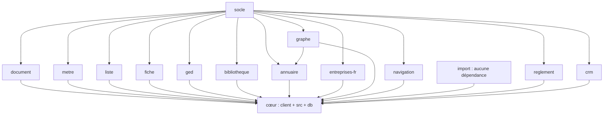

# Wiki LogiBTP

Ce wiki synthétise l'architecture et les responsabilités du projet LogiBTP à partir des fichiers `MODULES.md` et des `CLAUDE.md` présents dans les dossiers racine, `socle/`, `client/`, `src/`, `db/` et dans chaque module.

## 1. Vue d'ensemble

LogiBTP est une application ERP open source pour le BTP, structurée en couches :

- `socle/` : composants génériques, sans métier ; fondations techniques et utilitaires.
- `modules/<nom>/` : modules fonctionnels avec classes mères et logique patron.
- `client/` : application web du cœur.
- `src/` : backend .NET du cœur.
- `db/` : scripts SQL du cœur.

Les modules ne dépendent pas du cœur ; les liens inter-modules passent par le cœur. La règle de base est :

- socle → modules → cœur

Le cœur spécialise chaque module pour le BTP et fournit les intégrations métier.

## 2. Architecture et dépendances

### 2.1 Couches

### 2.2 Règles de conception

- Le socle ne connaît pas le métier.
- Les modules fournissent des classes mères et une logique réutilisable.
- Le cœur apporte la spécialisation BTP.
- Les règles métier sont souvent répliquées JS ↔ C# avec des jeux de cas partagés.
- Les scripts SQL sont applicatifs et réexécutables ; pas de migrations EF en production.
- Les colonnes du DDL suivent les conventions `snake_case` préfixé, avec correspondance automatique vers les propriétés .NET en PascalCase.
- Les codes (statuts, natures, erreurs, états) ne sont jamais en dur : ils sont centralisés dans les fichiers `codes.js` et `Codes.cs` avec des tests de parité.

## 3. Modules principaux

### 3.1 Socle

Le socle contient les éléments techniques et génériques réutilisés par tous les modules (hors import).

Principales responsabilités :
- outils de base, expressions, normalisation, validation, sécurité,
- utilitaires partagés,
- constantes et paramètres communs du système,
- accès aux notifications, rôles, droits et confidentialité.

### 3.2 Document

Rôle : document commercial générique, avant spécialisation BTP.

Responsabilités :
- entête, lignes, pied, TVA par catégorie,
- numérotation et statuts,
- validations et transformations,
- historique, copies, verrouillage, traçabilité,
- moteur de calcul document répliqué JS / C#.

Points notables :
- cycle de vie principal : BROUILLON → APPROUVE (si activé) → ENVOYE → VALIDE,
- les indices A, B… sont gérés par groupe,
- un document corrigé après envoi ou validation crée un nouvel indice,
- le statut affiché correspond au statut le plus avancé,
- le document validé affiche le résultat enregistré et ne recalcul plus ses montants de manière active.

### 3.3 Métré

Rôle : gestion des métrés et quantités dans les documents.

Responsabilités :
- scripts de mesure,
- variables liées aux métrés,
- saisie de quantités source,
- intégration dans le document et le moteur de devis BTP.

Points notables :
- le module Métré ne dépend pas du module Document,
- le moteur de métier est dupliqué entre JS et .NET,
- les lignes de type SECTION portent les variables du document.

### 3.4 Liste

Rôle : affichage et navigation de données structurées en listes.

Responsabilités :
- recherche, filtres, colonnes, segments, tri, curseur,
- vues, thèmes, indicateurs, totaux, bandeaux,
- intégration des listes de documents, fiches et ressources,
- agrégats calculés en base.

Points notables :
- la sémantique des requêtes est répliquée entre `modules/liste/js/src/requete.js` et `ConstructeurRequete.cs`,
- les vues par défaut sont définies dans `client/src/app/vues-liste.js`,
- les indicateurs de document calculés dans la base sont disponibles dès qu'un filtre est posé,
- les documents et ordres utilisent les colonnes `statut_code` et `etat`.

### 3.5 Fiche

Rôle : gestion unitaire des fiches métier (personnes, structures, équipements, etc.).

Responsabilités :
- validation de champs,
- paramétrage RGPD,
- champs supplémentaires,
- types de fiches et droits,
- chronologie / code à chrono,
- gestion des champs gérés par le cœur.

Points notables :
- validation JS ↔ C# répliquée,
- champs supplémentaires stockés en JSONB,
- comportement par type de fiche configuré dans le cœur.

### 3.6 GED

Rôle : gestion documentaire et arborescence des pièces jointes et dossiers.

Responsabilités :
- stockage, versioning, classification,
- règles de conservation et rétention,
- exploration arborescente des documents et groupes,
- pièces associées aux éléments et documents.

Points notables :
- chargement de PDF et traitement du texte,
- références et pièces reçues ou envoyées,
- intégration avec les documents et l'arborescence du cœur.

### 3.7 Bibliothèque

Rôle : référentiel de composants et éléments de coût.

Responsabilités :
- éléments de bibliothèque,
- calcul des ouvrages / coefficients,
- référentiel de prix et de ressources,
- relations avec les documents et l'annuaire.

### 3.8 Annuaire

Rôle : gestion des personnes, entreprises, intervenants et relations.

Responsabilités :
- référentiel des tiers / intervenants,
- coordonnées, graphes, identifiants,
- synchronisation des salariés,
- intégration avec le cœur et les groupes de structure.

### 3.9 Entreprises FR

Rôle : intégration avec les entreprises françaises (SIRET, etc.).

Responsabilités :
- import / rapprochement d'entreprises,
- traitement spécifique aux données françaises,
- composition des fiches de fournisseur et de personne.

### 3.10 Graphe

Rôle : représentation des relations structurelles et organisationnelles.

Responsabilités :
- visualisation de structures,
- dépendances et liens entre éléments,
- support aux vues et pages d'annuaire.

### 3.11 Navigation

Rôle : moteur de navigation applicative général.

Responsabilités :
- routes, fenêtres multiples,
- session restaurable,
- préférences navigateur,
- menus et panneaux,
- navigation entre pages et fenêtre d'application.

### 3.12 Personnalisation

Rôle : textes, thèmes et images de l'application.

Responsabilités :
- `fr.json`, thèmes et icônes,
- fichiers statiques par couche à surcharger,
- personnalisation visuelle et libellés sans toucher au code.

### 3.13 Import

Rôle : import de devis / fichiers externes.

Responsabilités :
- lecture de fichiers d'autres logiciels,
- conversion en devis neutre,
- correspondances, normalisation et formatage,
- support de `OptimBTP` aujourd'hui.

### 3.14 Édition

Rôle : génération de documents et impression.

Responsabilités :
- modèles d'édition,
- calcul de documents de sortie,
- polices, QR codes, libellés, PDF,
- affichage et prévisualisation des éditions.

### 3.15 Règlements

Rôle : gestion des règlements et échéances.

Responsabilités :
- paiements, soldes, échéances,
- sensibilisation sur les pièces validées,
- intégration aux documents et aux structures BTP.

### 3.16 CRM

Rôle : suivi de relations, notes, rappels et demandes.

Responsabilités :
- notes attachées aux éléments,
- rappels, demandes et validations,
- suivi fonctionnel sur documents, fiches et structures.

### 3.17 Notification

Rôle : gestion des notifications système.

Responsabilités :
- rappels, alertes, planificateur,
- source des notifications et boîte de réception utilisateur,
- intégration avec les modules métier.

### 3.18 Mail

Rôle : messagerie système de l'application.

Responsabilités :
- comptes SMTP / IMAP / OAuth,
- envoi de courriels depuis les éléments,
- récupération des messages entrants,
- reconnaissance de courriels et rattachement.

Points notables :
- le module ne connaît pas le métier directement ; tout passe par `SpecialisationMail` du cœur,
- HTML est nettoyé côté serveur,
- la réception ne modifie pas les courriels distants,
- les règles de reconnaissance sont répliquées JS ↔ C#.

### 3.19 OAuth

Rôle : intégration de fédérations OAuth et fournisseurs de jetons.

Responsabilités :
- connexions sortantes,
- gestion des jetons,
- intégration avec le mail et les comptes de service.

### 3.20 Exécution

Rôle : gestion des exécutions, services et chantiers.

Responsabilités :
- synthèse d'exécution,
- ordres, services,
- plans de travail,
- intégration avec les écrans de chantier.

### 3.21 Rentabilité

Rôle : analyse de la rentabilité et des faits chantiers.

Responsabilités :
- faits de chantier, rapprochement, coûts,
- synthèse de rentabilité,
- facturation, planning, stock et ressources.

### 3.22 Pointage

Rôle : saisie et validation des heures de main-d'œuvre.

Responsabilités :
- pointage d'heures,
- contrôles, validation, variables de paie,
- congés et absences,
- borne de pointage avec sécurité plus poussée.

### 3.23 Planning

Rôle : planification des ressources et des activités.

Responsabilités :
- calendriers, équipes, ressources,
- plages de travail,
- charge et dépendances,
- ordre de planification.

### 3.24 Comptabilité

Rôle : gestion des comptes, TVA et ventilation.

Responsabilités :
- plan comptable,
- tiers et comptes associés,
- règles de ventilation,
- paramètres comptables.

### 3.25 Stock

Rôle : gestion du stock dans les chantiers et structures.

Responsabilités :
- lieux, articles, mouvements,
- mouvements validés sur pièces,
- intégration avec les éléments et les documents.

### 3.26 Calendrier

Rôle : gestion des calendriers et jours ouvrés.

Responsabilités :
- jours fériés,
- calendriers de services et ressources,
- dépendances de travail et d'absence.

### 3.27 Authentification

Rôle : gestion de la session et des comptes utilisateurs.

Responsabilités :
- connexion, déconnexion,
- profils associées à des individus,
- session et accès du client.

### 3.28 Installation

Rôle : installation de l'application et de la base.

Responsabilités :
- scripts d'installation,
- configuration de la base et des sociétés,
- préparation initiale de l'environnement.

### 3.29 Droits

Rôle : sécurité et gestion des droits applicatifs.

Responsabilités :
- droits sur vues, pages, objets, modules,
- catalogue des nœuds et routes,
- contrôle sur les éléments et les pages.

## 4. Cœur applicatif

### 4.1 Client web

`client/` est l'application web principale. Elle :
- branche les modules JS,
- spécialise les modules pour le BTP,
- sert d'interface utilisateur,
- travaille en mode PWA / hors ligne,
- appelle l'API ASP.NET Core via `/api`.

### 4.2 Serveur .NET

`src/` contient le cœur .NET :
- `LogiBTP.Domaine` : entités BTP,
- `LogiBTP.Calcul` : moteur de calcul du devis BTP,
- `LogiBTP.Api` : hôte, routes, spécialisation des modules.

Le fichier `Program.cs` branche tous les modules et configure les sociétés / bases via `AddSocietes` et `UseSocietes`.

### 4.3 Scripts SQL du cœur

`db/` contient les scripts SQL du cœur, exécutés après les scripts SQL des modules. Les scripts créent les colonnes métier spécifiques au BTP ainsi que les vues, référentiels et paramètres d'usage.

Exemples de fichiers connus :
- `100_btp.sql`
- `110_reference.sql`
- `115_bibliotheque.sql`
- `120_listes.sql`
- `121_listes_parametrage.sql`
- `130_fiches.sql`
- `131_fiches_parametrage.sql`

## 5. Règles répliquées JS ↔ C#

Le projet impose une forte parité entre le code JavaScript et le code C# pour les règles métier. Les jeux de cas partagés sont utilisés dans les tests.

Exemples :
- socle : expressions,
- document : `moteur-document.js` ↔ `MoteurDocument.cs`,
- cœur BTP : `moteur-btp.js` ↔ `MoteurDevisBtp.cs`,
- liste : `requete.js` ↔ `ConstructeurRequete.cs`,
- fiche : `validation.js` ↔ `ValidationFiche.cs`,
- GED : règles de coffre, versions, personnalisation, etc.,
- mail : reconnaissance,
- CRM : notes, rappels, demandes, validations,
- calendrier : jours fériés et règles de travail,
- planning : calcul de charge et dépendances.

## 6. Règles de développement

### 6.1 Quand on modifie une règle métier

Le projet impose la méthode suivante :
1. modifier la règle dans le socle ou le module concerné,
2. mettre à jour le jeu de cas JS et C#,
3. adapter le cœur si la spécialisation BTP est concernée,
4. mettre à jour les scripts SQL du cœur si nécessaire,
5. relancer les tests et génération de données.

### 6.2 Règles spécifiques importantes

- `Number` ne doit pas être utilisé pour un montant côté JavaScript : on utilise `decimal.js`.
- Une seule fonction d'arrondi par moteur, avec règle de demi vers l'infini.
- Les codes doivent être définis via des constantes partagées, pas en dur dans le code fonctionnel.
- Les colonnes de base de données doivent rester en `snake_case` préfixé.
- Toute requête de données côté liste doit être exécutée en lecture seule.
- Les modules ne peuvent pas dépendre du cœur, sauf intégration par spécialisation explicite dans le cœur.

## 7. Liens transverses fonctionnels

- Authentification ↔ tout : l'utilisateur de la requête est injecté via l'intergiciel de session.
- Mail ↔ Document / GED / CRM : envoi et rattachement de pièces, journaux, envois automatiques.
- OAuth ↔ Mail : fournisseur de jetons et connexions.
- Notifications ↔ modules : toutes les sources publient vers la boîte de notification.
- Document ↔ Structure : rattachement de projet / affaire / chantier.
- Document ↔ Annuaire : intervenants et tiers.
- Document ↔ GED : pièces et dossiers associés.
- Document ↔ Bibliothèque : éléments calculés et importés.
- Liste ↔ Fiche : ouverture des fiches depuis les listes.
- Navigation ↔ tout le client : routes, fenêtre et refresh inter-fenêtres.

## 8. Fichiers de référence

Fichiers clés du projet :

- `MODULES.md` : carte des modules et de leurs liens.
- `CLAUDE.md` : contexte global du projet.
- `socle/CLAUDE.md` : contexte du socle.
- `client/CLAUDE.md` : contexte du client web.
- `src/CLAUDE.md` : contexte du serveur .NET.
- `db/CLAUDE.md` : contexte des scripts SQL du cœur.
- chaque `modules/*/CLAUDE.md` : contexte du module considéré.

## 9. Synthèse

LogiBTP est un ERP BTP modulaire, pensé comme un socle techniques partagé + modules fonctionnels + cœur métier BTP. Son design met l'accent sur :

- la séparation claire des rôles de couche,
- la conformité des règles JS ↔ C#, 
- la robustesse des scripts SQL et de la base,
- l'intégration fonctionnelle par le cœur,
- la traçabilité et les règles de validation métier.

Ce wiki est volontairement une synthèse de conception. Pour tout module ou besoin particulier, il faut aller consulter son `CLAUDE.md` ainsi que le code directement.

---

Source de génération : `MODULES.md` + `CLAUDE.md` des dossiers `socle/`, `client/`, `src/`, `db/` et modules de `modules/*/`.
