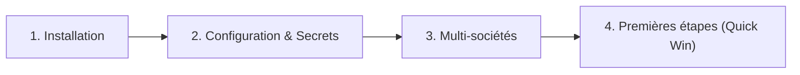

# Démarrage rapide (Getting Started)

Bienvenue dans le guide de démarrage rapide de **LogiBTP**. Cette section est conçue pour vous guider pas-à-pas depuis l'initialisation de votre environnement jusqu'à l'émission de votre premier devis BTP.

---

## 🧭 Feuille de route du démarrage

Pour mettre en place LogiBTP efficacement, nous vous recommandons de suivre ces étapes dans l'ordre :



1. **[Installation](/getting-started/installation)** :
   Installez l'infrastructure requise soit en local pour le développement et l'évaluation rapide, soit sur serveur d'entreprise (Windows ou Linux Debian 13) via nos scripts de déploiement Docker automatisés.
2. **[Configuration & Secrets](/getting-started/configuration)** :
   Maîtrisez le fichier `.env`, générez les clés de chiffrement de vos données et configurez les certificats SSL/TLS obligatoires.
3. **[Architecture Multi-sociétés](/getting-started/multi-societe)** :
   Découvrez comment LogiBTP isole chaque société dans sa propre base PostgreSQL et résout les contextes via les sous-domaines web.
4. **[Premières étapes (Quick Win)](/getting-started/premieres-etapes)** :
   Prenez en main l'interface utilisateur multi-fenêtres et réalisez votre premier scénario métier complet (Client → Chantier → Devis → Métré → Édition).

---

## 💻 Prérequis système

### Pour un environnement de développement local
- **Système d'exploitation** : Windows 10/11, macOS ou Linux.
- **Docker & Docker Compose** : Docker Desktop ou Docker Engine avec support compose.
- **Node.js** : Version 22 LTS (recommandée) ou ultérieure.
- **.NET SDK** : Version 9.0 ou ultérieure.
- **Navigateur moderne** : Chrome, Firefox, Edge, Safari (support Web Components et BroadcastChannel requis).

### Pour un déploiement serveur en production
- **Système d'exploitation hôte** :
  - **Windows Server** (2019, 2022 ou 2025) avec PowerShell 5.1/7 et Docker Desktop ou moteur Docker sous WSL2.
  - ou **Debian 13 (Trixie)** / Debian 12 avec Docker Engine officiel et systemd.
- **Ressources matérielles minimales** :
  - CPU : 2 cœurs vCPU minimum (4 cœurs recommandés pour les gros calculs de métré et éditions simultanées).
  - Mémoire vive (RAM) : 4 Go minimum (8 Go recommandés en cas de bases multiples).
  - Espace disque : 50 Go SSD minimum (prévoir davantage selon le volume de documents stockés dans la GED).
- **Réseau** :
  - Ports ouverts : `80` (redirection HTTP), `443` (HTTPS public), `8443` (port direct Kestrel API).

---

## ⚡ Envie de tester tout de suite ?

Si Docker est installé sur votre poste de travail, vous pouvez lancer LogiBTP en moins de 3 minutes avec la commande rapide :

```bash
# 1. Cloner le projet
git clone https://github.com/nerenos/LogiBTP.git
cd LogiBTP

# 2. Démarrer PostgreSQL (base de développement préconfigurée)
docker compose up -d

# 3. Installer les dépendances du client web
npm install

# 4. Lancer le client web
npm run dev
```

Rendez-vous ensuite sur `http://localhost:5173` pour explorer l'interface ! Rendez-vous sur la page **[Installation](/getting-started/installation)** pour les détails complets.
