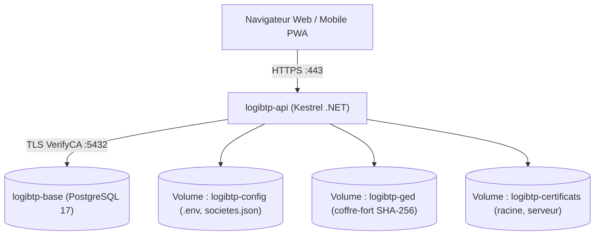

# Guide d'installation

LogiBTP propose deux modes d'installation selon vos objectifs :
1. **Environnement de développement** : idéal pour tester l'application, explorer le code source et contribuer au projet.
2. **Déploiement en production** : conteneurs Docker durcis, sauvegardes chiffrées automatiques, gestion stricte du HTTPS et isolation des bases par société.

---

## Mode 1 : Environnement de développement

Dans ce mode, la base de données PostgreSQL tourne dans un conteneur Docker local tandis que l'API .NET et le client web Vite s'exécutent directement sur votre machine hôte.

### 1. Cloner le dépôt et initialiser les sous-modules
```bash
git clone https://github.com/nerenos/LogiBTP.git
cd LogiBTP
```

### 2. Démarrer la base de données PostgreSQL
Le fichier `docker-compose.yml` à la racine est configuré pour monter la base sur le port hôte **5433** (évitant tout conflit avec une instance PostgreSQL locale existante sur 5432).

```bash
docker compose up -d
```

> [!NOTE] Initialisation automatique de la base de dev
> Au premier démarrage du volume `logibtp-data`, le script d'entrée `db/installation/initialiser-developpement.sh` applique automatiquement tous les scripts SQL définis dans `db/installation/scripts.txt` sur la base principale `logibtp` et sur la base de démonstration `logibtp_demo`.

Vérifiez que le conteneur est opérationnel avec :
```bash
docker compose ps
```

### 3. Installer les dépendances JavaScript
LogiBTP utilise les npm workspaces pour gérer l'ensemble des modules JS :

```bash
npm install
```

### 4. Valider l'environnement par les tests
Assurez-vous que l'ensemble des tests passent sans anomalie :

```bash
# Tests unitaires des modules JS et du cœur
npm test

# Tests .NET (C#)
dotnet test LogiBTP.slnx
```

### 5. Démarrer l'API serveur .NET
Dans un terminal dédié :

```bash
dotnet run --project src/LogiBTP.Api
```
L'API démarre et écoute sur les ports locaux définis dans `launchSettings.json` (ou `appsettings.Development.json`).

### 6. Démarrer le client web Vite
Dans un second terminal :

```bash
npm run dev
```

L'application est immédiatement accessible dans votre navigateur :
- Société principale : `http://localhost:5173`
- Société de démonstration : `http://demo.localhost:5173` *(nécessite que votre système ou navigateur résolve les sous-domaines de localhost, ce qui est le comportement standard des navigateurs modernes)*.

---

## Mode 2 : Déploiement en production (Docker)

En production, LogiBTP fonctionne sur une architecture à deux conteneurs Docker indépendants :
- **`logibtp-base`** : Conteneur PostgreSQL officiel (version 17), configuré avec TLS obligatoire (`hostssl` + authentification SCRAM).
- **`logibtp-api`** : Conteneur unique servant à la fois l'API C# Kestrel en HTTPS et les fichiers statiques du client web (SPA).

Les volumes de données (`logibtp-data`, `logibtp-config`, `logibtp-certificats`, `logibtp-ged`) sont **externes**, garantissant qu'un arrêt de conteneur (`docker compose down`) ne supprime jamais vos données d'entreprise.



---

### Déploiement automatisé sous Windows Server

Un script PowerShell complet et rejouable est fourni dans le dossier `modules/installation/windows/` :

```powershell
# Exécuter PowerShell en Administrateur
cd modules\installation\windows

.\Installer-LogiBTP.ps1 `
    -Domaine "logibtp.votre-entreprise.fr" `
    -Confiance "192.168.1.0/24" `
    -Administrateur "admin" `
    -Certificat LogiBTP
```

#### Ce que fait ce script :
1. Crée les réseaux Docker et les volumes persistants nécessaires.
2. Génère la clé de chiffrement des données et initialise le `.env` sécurisé.
3. Configure l'autorité de certification interne LogiBTP (ou intègre un certificat importé).
4. Applique l'ensemble des scripts SQL sous le rôle `logibtp_schema`.
5. Configure les règles de pare-feu Windows et enregistre les tâches planifiées de sauvegarde nocturne et de renouvellement de certificat.
6. Génère un rapport d'installation complet `INSTALLATION.txt` avec les entrées DNS requises.

---

### Déploiement automatisé sous Linux (Debian 13)

Pour les serveurs Linux Debian 13 (Trixie) ou Debian 12, utilisez les scripts bash situés dans `modules/installation/linux/` :

```bash
sudo su -
cd /chemin/vers/LogiBTP/modules/installation/linux

chmod +x *.sh
./installer-logibtp.sh \
    --domaine logibtp.votre-entreprise.fr \
    --confiance 192.168.1.0/24 \
    --certificat logibtp
```

Le script installe Docker officiel si demandé (`--installer-docker`), déploie les conteneurs sous `/opt/logibtp` avec des permissions strictes (`0700`), importe l'autorité dans le magasin système Linux (`update-ca-certificates`) et configure les minuteries systemd pour la maintenance automatique.

---

## 🛠️ Commandes CLI internes (`logibtp-installation`)

L'image Docker de LogiBTP intègre un utilitaire de ligne de commande `installation` permettant d'administrer le système sans accéder directement à la base de données :

```bash
docker compose -f docker/api/compose.yml run --rm logibtp-installation installation <COMMANDE> [OPTIONS]
```

### Principales commandes d'exploitation :

| Commande | Rôle |
| :--- | :--- |
| `preparer --domaine D` | Initialise les dossiers, génère les secrets et prépare l'environnement pour le domaine indiqué. |
| `base creer` | Crée la base de données principale et applique les rôles de sécurité (`logibtp_schema`, `logibtp_app`, etc.). |
| `societe ajouter CODE --libelle "Nom"` | Instancie une nouvelle société multi-tenant avec sa propre base de données dédiée. |
| `societes` | Liste l'ensemble des sociétés déclarées et l'état de leur base. |
| `scripts verifier` | Contrôle l'intégrité de tous les scripts SQL par rapport au manifeste officiel `scripts.txt`. |
| `base mettre-a-jour` | Applique les nouveaux scripts SQL non encore exécutés sur l'ensemble des bases. |
| `cle-donnees changer` | Effectue une rotation sécurisée de la clé de chiffrement des données avec rechiffrement en base. |
| `etat` | Affiche l'état global du système (connexion DB, TLS, certificats, versions). |

---

## 🔒 Gestion des Certificats HTTPS

LogiBTP exige HTTPS en production. Trois options sont supportées :

1. **Autorité LogiBTP (Recommandé pour réseau local d'entreprise) :**  
   L'installeur génère une autorité racine (RSA 3072, valable 10 ans) et un certificat serveur (RSA 2048, domaine et wildcard `*.domaine.fr`).  
   Une page d'amorce publique sur le port 8080 (`http://serveur:8080/certificat`) permet de télécharger le certificat racine et d'exécuter le script `Installer-Certificat-LogiBTP.ps1` sur les postes clients et tablettes de chantier.
2. **Let's Encrypt automatique :**  
   Via le client DNS `lego` intégré (`Certificat-LetsEncrypt.ps1`), pour les installations accessibles avec un nom de domaine public et une zone DNS gérée par API (OVH, Cloudflare, etc.).
3. **Certificat commercial / d'entreprise importé :**  
   Importez votre propre certificat au format PEM ou PKCS#12 via l'option `-Certificat Importer` ou la commande `installation certificat importer`.
