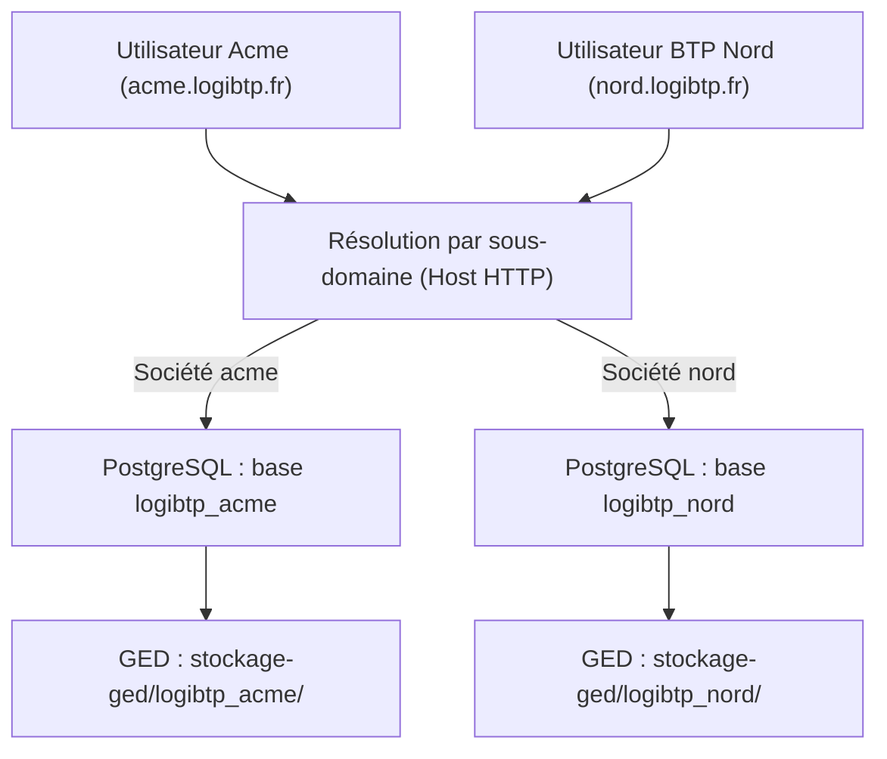

# Architecture Multi-sociétés

Contrairement aux ERP classiques qui partagent une table unique avec une colonne `tenant_id` (source fréquente d'erreurs et de fuites de données), **LogiBTP applique une règle stricte d'isolation : une base de données PostgreSQL dédiée par société**.

---

## 🏛️ Principes fondamentaux



### Avantages de cette architecture :
1. **Étanchéité totale :** Aucune requête SQL ne peut accidentellement croiser les données de deux sociétés.
2. **Sauvegardes et restaurations indépendantes :** Chaque filiale ou entité peut être archivée, sauvegardée ou restaurée individuellement via un simple `pg_dump`.
3. **Évolution modulaire différenciée :** Une société peut activer le module Avancé de Sous-traitance ou de Planning de charge tandis qu'une autre n'utilise que le devis et la facturation simple.
4. **Partitionnement physique de la GED :** Les fichiers et plans uploadés sont séparés physiquement par répertoire (`stockage-ged/<code_base>/`).

---

## 🌐 Résolution automatique par sous-domaine

L'API Kestrel et le client web identifient la société active en examinant l'en-tête HTTP `Host` de chaque requête :

| Environnement | URL d'accès | Société ciblée | Base de données |
| :--- | :--- | :--- | :--- |
| **Développement** | `http://localhost:5173` | Société Principale | `logibtp` |
| **Développement** | `http://demo.localhost:5173` | Société Démonstration | `logibtp_demo` |
| **Production** | `https://logibtp.mon-domaine.fr` | Société Principale | `logibtp` |
| **Production** | `https://sud.logibtp.mon-domaine.fr` | Filiale Sud | `logibtp_sud` |
| **Production** | `https://nord.logibtp.mon-domaine.fr` | Filiale Nord | `logibtp_nord` |

### En interne (C#) :
L'intergiciel de société (`UseSocietes`) extrait le sous-domaine par rapport au domaine de base configuré, charge les métadonnées de la société et injecte `SocieteCourante` dans le conteneur d'injection de dépendances pour toute la durée de la requête HTTP. Les contextes Entity Framework se connectent ainsi automatiquement à la bonne base.

---

## ➕ Déclarer et créer une nouvelle société

La création d'une nouvelle société s'effectue en une commande via l'outil d'installation interne :

```bash
docker compose -f docker/api/compose.yml run --rm logibtp-installation installation societe ajouter <CODE> --libelle "<NOM_SOCIETE>"
```

### Exemple pratique :
```bash
docker compose -f docker/api/compose.yml run --rm logibtp-installation installation societe ajouter btp_sud --libelle "Entreprise BTP Sud"
```

### Ce qui est exécuté automatiquement :
1. Création de la base PostgreSQL `logibtp_btp_sud` avec encodage UTF-8 et configuration TLS.
2. Attribution des privilèges stricts aux rôles techniques (`logibtp_schema`, `logibtp_app`, etc.).
3. Exécution séquentielle intégrale des scripts SQL ordonnés depuis le manifeste `db/installation/scripts.txt`.
4. Enregistrement de l'entrée dans le fichier de registre `societes.json` (situé dans le volume de configuration).
5. Création du répertoire de stockage GED isolé `stockage-ged/logibtp_btp_sud/`.

---

## 🎛️ Activation des modules par société

Chaque société dispose de sa propre table de paramétrage modulaire `module_societe` (initialisée par `db/193_modules_services.sql`).

Les modules peuvent être facultatifs :
- **Modules cœur (toujours actifs) :** Document, Métré, Fiches, Listes, Annuaire, GED, Bibliothèque.
- **Modules facultatifs (activables à la demande) :**
  - `REGLEMENT` : Gestion des échéances, retenues de garantie, pointages et cautions.
  - `CRM` : Fil d'actualité de chantier, mémos, rappels et demandes de prix.
  - `PLANNING` : Planification graphique des ressources, charges et dépendances.
  - `POINTAGE` : Feuilles d'heures hebdomadaires, validation hiérarchique et export paie.
  - `EXECUTION` : Ordres d'exécution (famille E), répartition et suivi d'avancement.
  - `SOUS_TRAITANCE` : Consultations ST, comparatifs d'offres et paiements directs.
  - `STOCK` : Gestion multi-magasins, mouvements, dotations EPI et PMP.
  - `RENTABILITE` : Analyse financière globale du chantier (clichés historiques, rapprochement engagé/réalisé).

### Contrôle côté client et serveur :
- Côté serveur : Les routes HTTP des modules facultatifs vérifient l'activation via l'interface `IModulesActifs` et retournent `403 FORBIDDEN` (`MODULE_NON_ACTIF`) si le module n'est pas souscrit pour la société courante.
- Côté client : L'application web interroge `app.moduleActif('code')` pour masquer dynamiquement les menus déroulants, les boutons d'action et les onglets concernés.
