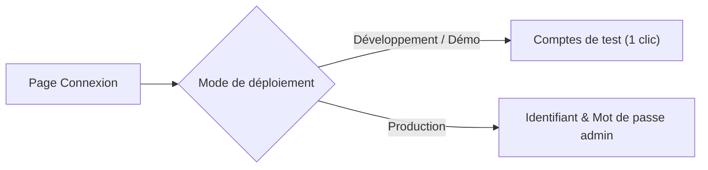

# Premières étapes (Quick Win)

Ce guide pratique vous accompagne dans vos premiers pas sur **LogiBTP**. En moins de 15 minutes, vous allez vous connecter à l'application, appréhender son ergonomie multi-fenêtres et réaliser votre premier cycle commercial complet : **de la création du client jusqu'à l'émission et l'impression d'un devis chiffré**.

---

## 🔑 1. Première connexion

Accédez à la page d'authentification sur votre instance (`http://localhost:5173/connexion` en local) :



- **En développement / démo :**  
  Un panneau « Comptes de test » s'affiche directement sous le formulaire. Cliquez simplement sur l'un des profils pour ouvrir une session instantanément sans mot de passe :
  - **`admin`** : Accès complet, paramétrage, administration système.
  - **`metreur`** : Accès études de prix, bibliothèque, métrés, devis.
  - **`conducteur`** : Accès chantiers, planning, ordres d'exécution.
  - **`terrain`** : Vue simplifiée pour pointage et suivi de chantier mobile.
- **En production :**  
  Renseignez le pseudo du compte administrateur créé lors de l'installation (défaut : `admin`) et le mot de passe défini lors de la commande `preparer` ou généré par l'installeur.

---

## 🖥️ 2. Ergonomie & Multi-fenêtrage

LogiBTP a été spécialement conçu pour l'efficacité des équipes de bureau d'études et de gestion de chantier :

```
┌────────────────────────────────────────────────────────────────────────┐
│ ☰ Fichier   Édition   Affichage   Devis   Chantiers   GED   Paramètres │
├────────────────────────────────────────────────────────────────────────┤
│ 📄 Devis n° DEV-2026-0042 [Brouillon]                 [🖨 Aperçu] [✓]  │
│                                                                        │
│  [+] Ajouter ligne   [F3] Bibliothèque   [📐] Métré                    │
│ ┌────────────────────────────────────────────────────────────────────┐ │
│ │ 1. TERRASSEMENT ET FONDATIONS                                      │ │
│ │   1.1 Décapage terre végétale (54 m²) ................ 1 240,00 €  │ │
│ │   1.2 Fouilles en rigole (28 m³) ..................... 3 150,00 €  │ │
│ └────────────────────────────────────────────────────────────────────┘ │
└────────────────────────────────────────────────────────────────────────┘
```

### Concepts clés de l'interface :
1. **Le Bandeau d'applications :**  
   Situé en haut de l'écran, il propose des menus déroulants inspirés des logiciels de bureau traditionnels pour un accès direct et rapide au clavier.
2. **Multi-fenêtrage synchronisé (BroadcastChannel) :**  
   Vous pouvez ouvrir plusieurs fenêtres du navigateur (ex: la fiche du chantier sur votre écran gauche et le devis sur votre écran droit). Toute modification enregistrée dans une fenêtre rafraîchit immédiatement les listes et indicateurs des autres fenêtres sans rechargement de page.
3. **Mémorisation des préférences (LocalStorage) :**  
   Les largeurs de colonnes de listes, les filtres appliqués, les panneaux repliés et le thème graphique (Clair / Sombre) sont conservés dans votre navigateur sans encombrer la base de données.

---

## 🏆 3. Tutoriel Quick Win : Créer et chiffrer mon premier devis BTP

Suivez ces 6 étapes simples pour maîtriser le cycle de chiffrage.

### Étape 1 : Créer le Tiers Client
1. Dans le menu haut, allez dans **Tiers & Contacts** › **Nouveau Tiers** (ou URL `/fiche/personne`).
2. Saisissez la raison sociale ou le nom commercial (ex: `SCI Les Oliviers`).
3. *(Optionnel)* Si vous disposez d'un numéro SIRET valide, le module **Entreprises françaises** autocomplète l'adresse, la forme juridique et le numéro de TVA intracommunautaire en un clic.
4. Dans l'onglet **Relations**, cochez la casquette **Client**.
5. Cliquez sur **Enregistrer** (raccourci `Ctrl+S`). Le code tiers (ex: `T000042`) est généré automatiquement.

---

### Étape 2 : Créer le Chantier
1. Allez dans **Structure** › **Nouveau Chantier** (URL `/fiche/chantier`).
2. Donnez un libellé au chantier : `Construction Villa R+1 - Lot Gros-Œuvre`.
3. Associez le client `SCI Les Oliviers` créé à l'étape précédente.
4. Affectez un chargé d'affaires et renseignez l'adresse du chantier (l'adresse bénéficie de l'autocomplétion officielle de l'API Adresse).
5. Cliquez sur **Enregistrer**.

---

### Étape 3 : Créer le Devis
1. Depuis la fiche chantier, cliquez sur le bouton **Nouveau Devis** (ou menu **Ventes** › **Nouveau Devis**).
2. L'éditeur de devis (`EditeurDevisBtp`) s'ouvre.
3. Renseignez l'objet du devis : `Travaux de gros-œuvre et maçonnerie générale`.
4. Le document démarre au statut initial **BROUILLON** à l'indice **A**.

---

### Étape 4 : Insérer des ouvrages depuis la Bibliothèque
1. Cliquez sur le bouton **Bibliothèque** ou appuyez sur la touche <kbd>F3</kbd>.
2. L'explorateur de bibliothèque s'ouvre dans un panneau latéral ou une fenêtre dédiée.
3. Recherchez les éléments ou glissez-déposez des ouvrages prédéfinis :
   - Par exemple : `OUV:BETON_FONDATIONS` (Béton de propreté et fondations).
   - Les déboursés élémentaires (fournitures, main d'œuvre, matériel) et coefficients de marge s'appliquent automatiquement selon la formule paramétrée.
4. Vous pouvez également saisir directement un code d'appel rapide dans la première colonne de la grille : `BIB:DALLE20`.

---

### Étape 5 : Utiliser le Panneau de Métré dynamique
1. Sélectionnez la ligne d'ouvrage créée et ouvrez le panneau **Métré** (icône 📐).
2. Passez la source de quantité de la ligne en mode **Métré** (`M`).
3. Définissez vos variables de chantier :
   ```
   $LONGUEUR = 14.50
   $LARGEUR = 8.20
   $EPAISSEUR = 0.20
   ```
4. Écrivez la formule de calcul de volume :
   ```
   Renvoyer $LONGUEUR * $LARGEUR * $EPAISSEUR
   ```
5. Le moteur de calcul miroir JS/C# évalue instantanément la formule et renseigne la quantité exacte (`23.78 m³`) ainsi que le montant total calculé.

---

### Étape 6 : Validation et Édition du Devis officiel
1. Vérifiez le pied de document : taux de TVA (ex: 20% ou autoliquidation 0%), retenue de garantie (ex: 5%) et échéances de paiement.
2. Cliquez sur **Valider le document**.
   - Le statut passe à **VALIDE**.
   - Les montants deviennent immuables pour garantir la traçabilité comptable.
3. Cliquez sur l'icône **🖨 Aperçu / Édition** :
   - Le moteur d'édition compile le document au format PDF vectoriel haute définition (avec en-tête d'entreprise, totaux en lettres, mentions légales et QR code de contrôle).
   - Une copie horodatée du PDF est automatiquement versée dans le **coffre-fort GED** rattaché au chantier sous l'empreinte SHA-256 du fichier.

---

## 🎯 Prochaines étapes

Félicitations, vous avez complété votre premier cycle sur LogiBTP !

Pour aller plus loin :
- **Transformer ce devis en Marché / Ordre d'exécution** pour lancer la phase chantier.
- **Paramétrer le planning d'équipe** et affecter vos compagnons aux tâches du chantier.
- **Activer la saisie d'heures sur tablette** pour suivre les heures réelles passées en face des heures prévues au devis.
- **Consulter l'analyse de rentabilité** pour comparer déboursé sec engagé vs facturé.
