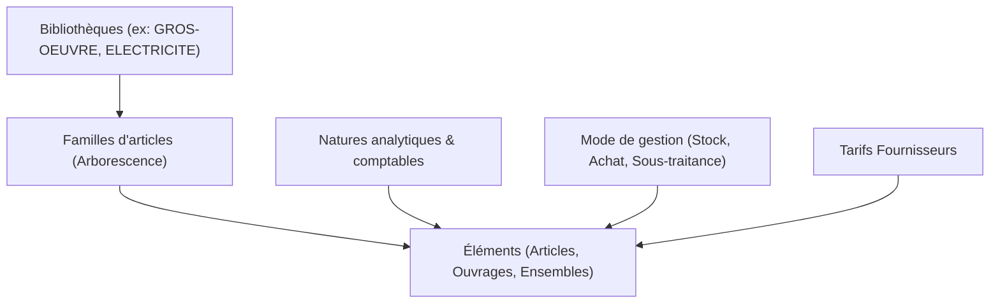
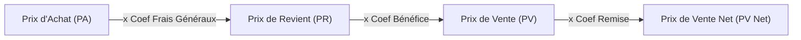

# Module Bibliothèque

Le **module Bibliothèque** constitue le référentiel central des prix, des articles et des ouvrages de l'entreprise. Il permet de capitaliser le savoir-faire technique des bureaux d'études, de négocier les tarifs fournisseurs et d'accélérer le chiffrage des devis.

---

## 📚 1. Organisation & Référentiels

Le module est structuré autour de 4 axes fondamentaux :

1. **Multi-bibliothèques :**  
   L'entreprise peut gérer plusieurs catalogues étanches (ex: une bibliothèque générale, une bibliothèque spécifique aux travaux de désamiantage, ou un catalogue spécialisé par métier). Chaque bibliothèque possède un code d'appel unique de 10 caractères au plus (ex: `GROS_OEUVRE`).
2. **Familles hiérarchiques :**  
   Arborescence illimitée de rubriques pour classer les éléments (ex: *Maçonnerie › Blocs béton › Blocs creux 20x20x50*).
3. **Natures comptables & analytiques :**  
   Chaque élément est rattaché à une nature qui porte son imputation dans le plan comptable général (achats 60x, ventes 70x) et son comportement analytique.
4. **Modes de gestion :**  
   - `STOCK` : Article géré en magasin avec tenue des quantités et inventaire.
   - `ACHAT` : Article commandé à la commande ou sur affaire sans stockage central.
   - `SOUS_TRAITANCE` : Prestation confiée à un tiers partenaire.
   - `NON_GERE` : Consommable ou fourniture courante sans suivi d'approvisionnement.

---

## 🧱 2. Types d'Éléments

Le catalogue gère 5 grandes catégories d'éléments :

| Type | Rôle | Caractéristiques principales |
| :--- | :--- | :--- |
| **`ARTICLE`** | Composant unitaire | Fourniture, matière première ou prestation de base disposant d'un prix d'achat et d'une unité de stock. |
| **`OUVRAGE`** | Assemblage de composants | Recette technique décomposée en fournitures, main d'œuvre et matériel (ex: *1 m² de mur en parpaings = 10 blocs + mortier + 0.65 h maçon*). |
| **`ENSEMBLE`** | Tranche paramétrée | Regroupement complet de plusieurs ouvrages avec métrés associés, prêt à être injecté en bloc dans un devis. |
| **`POSTE_PIED`** | Ligne de pied réutilisable | Ligne de remise, de compte prorata, d'acompte ou de retenue de garantie paramétrée d'avance. |
| **`TEXTE`** | Descriptif technique | Notice de pose, prescriptions de sécurité ou clauses administratives sans incidence financière directe. |

---

## 💶 3. Modèle de Calcul des Prix (6 décimales)

Les calculs de prix sont répliqués à parité stricte entre JavaScript (`modules/bibliotheque/js/src/calcul.js`) et .NET (`LogiBTP.Bibliotheque.CalculElement`).

### 1. Scénarios de Prix d'Achat (`SCENARIOS_PA`) :
Le prix d'achat pivot (`ele_pa`) est calculé dynamiquement selon la règle choisie sur la fiche article :
- `FIXE` : Saisi manuellement par l'utilisateur.
- `FOURNISSEUR_PRINCIPAL` : Calqué sur le tarif net du fournisseur désigné comme principal.
- `DERNIER_PA` : Dernier prix d'achat constaté lors de la dernière facture fournisseur enregistrée.
- `PMP` : Prix Moyen Pondéré calculé par les entrées en stock.
- `MIN` / `MAX` : Meilleur ou pire tarif parmi tous les fournisseurs référencés.

### 2. Cascades de Coefficients :
- **Prix de Revient (PR) :**  
  $$\text{PR} = \text{PA} \times \text{Coefficient Frais Généraux (FG)}$$
- **Prix de Vente (PV) :**  
  $$\text{PV} = \text{PR} \times \text{Coefficient Bénéfice}$$
- **Prix de Vente Net :**  
  $$\text{PV Net} = \text{PV} \times \text{Coefficient Remise}$$

### 3. Priorité des coefficients effectifs :
Si un coefficient n'est pas saisi explicitement sur la fiche de l'article, LogiBTP résout la valeur selon la cascade de priorité suivante :
$$\text{Imposé sur la fiche} \succ \text{Période en cours de la nature} \succ \text{Période globale d'entreprise} \succ \text{Défaut société}$$

---

## 📏 4. Multi-Unités & Données Techniques

Un matériau est souvent acheté en palettes, stocké au mètre carré et facturé au mètre linéaire. LogiBTP gère nativement ces conversions :

- **Unité de stock pivot (`ele_unt_stock`) :** C'est l'unité de référence pour les valorisations financières et le magasin (ex: `m²`).
- **Unités secondaires par formules (`ele_unites`) :**  
  Des correspondances dynamiques basées sur les caractéristiques physiques du produit :
  - Formule Palette : `1 pal = 48 m²`
  - Formule Poids : `1 m² = {{longueur}} * {{largeur}} * {{densite}} / 1000`
- **Données techniques normalisées :** Longueur (mm), largeur, épaisseur, densité, performance thermique ($R$), coefficient de transmission thermique ($U$), résistance acoustique.

---

## 🏷️ 5. Tarifs Fournisseurs & Importations CSV

Chaque article peut être rattaché à plusieurs fournisseurs dans la table `tarif_fournisseur` :
- Référence catalogue fournisseur propre.
- Prix public brut et **remises en cascade** :  
  $$\text{Prix Net HT} = \text{Prix Public} \times (1 - \text{Remise}_1) \times (1 - \text{Remise}_2)$$
- Code-barres (EAN13) et délai de livraison en jours (utilisé par le calcul des approvisionnements de chantier).

### Import automatique de mercuriales :
L'API expose un point d'entrée (`POST /api/bibliotheque/tarifs/import`) permettant de téléverser des fichiers CSV de plusieurs milliers d'articles avec simulation préalable des écarts de prix avant validation définitive.

---

## 🕒 6. Historique des Prix & Traçabilité

Toute modification de prix d'achat, de coefficient ou de prix de vente est automatiquement consignée dans la table `historique_prix_element` via des **triggers PostgreSQL** dédiés :
- Date et heure exacte de la modification (UTC).
- Identifiant de l'utilisateur ayant opéré la mise à jour (`ele_maj_par`).
- Commentaire explicatif facultatif (`ele_commentaire_prix`).
- Cliché JSONB complet des valeurs avant et après changement.

---

## 🤝 7. Interactions Devis ↔ Bibliothèque

L'utilisation de la bibliothèque dans l'éditeur de devis est fluide et optimisée pour la vitesse de saisie :

1. **Appel rapide par raccourci <kbd>F3</kbd> :**  
   Ouvre la palette de recherche contextuelle. La saisie filtre simultanément sur le code, le libellé, les mots-clés et les codes-barres.
2. **Appel direct par code d'appel :**  
   Saisissez directement `BIB:CODE` ou simplement `CODE` dans la colonne de référence pour importer instantanément l'élément.
3. **Glisser-déposer multi-écrans :**  
   Faites glisser un ouvrage depuis la fenêtre de la bibliothèque vers la grille du devis.
4. **Capitalisation vers la bibliothèque :**  
   Un métreur crée un ouvrage complexe directement dans un devis ? Un clic droit lui permet d'exporter cet ouvrage vers la bibliothèque pour le rendre disponible à tous les collaborateurs de l'entreprise.
