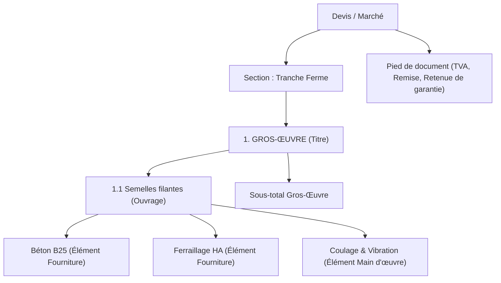
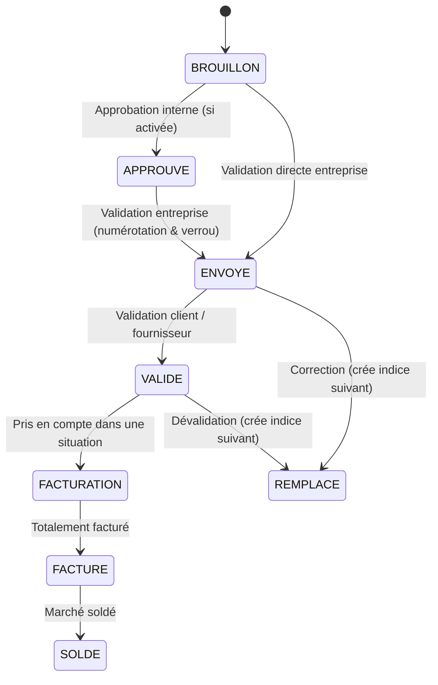
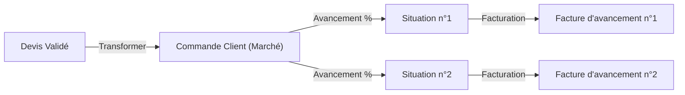

# Module Document

Le **module Document** constitue le cœur fonctionnel et commercial de LogiBTP. Il gère l'ensemble des pièces écrites de l'entreprise (devis, commandes clients et fournisseurs, bons de livraison, situations de travaux, factures d'avancement et avoirs).

Il est conçu selon le principe de **classe mère générique** : le module fournit les structures, le moteur de calcul de base, le cycle de vie et les transformations, tandis que le cœur applicatif de LogiBTP le spécialise pour les spécificités du BTP (`DocumentBtp`, `EditeurDevisBtp`, `MoteurDevisBtp`).

---

## 🏛️ 1. Principes & Arborescence des Lignes

Un document LogiBTP n'est pas une simple liste à plat : c'est un **arbre structuré hiérarchique** (géré en base de données via le type PostgreSQL `LTREE` sur la colonne `lig_chemin`).

### Types de Lignes (`TL`)

Chaque ligne dispose d'un type (`lig_tyl_id`) avec des identifiants immuables :

| Code | Libellé | Rôle & Particularités |
| :--- | :--- | :--- |
| `TITRE` | Titre / Chapitre | Organise l'arborescence. Peut porter un taux de TVA hérité par ses enfants et un type de prix. |
| `OUVRAGE` | Ouvrage composé | Élément complexe décomposé en sous-éléments (fournitures, MO, matériel). Un ouvrage sans composante devient à la validation un élément de nature Prestation (`PRE`). |
| `ELEMENT` | Élément simple | Ligne de prix élémentaire liée ou non à la bibliothèque. |
| `TEXTE` | Ligne de texte | Descriptif technique, clauses ou précisions sans impact chiffré. |
| `SOUS_TOTAL`| Sous-total | Total partiel de la tranche ou du chapitre parent. |
| `SECTION` | Section source | Utilisée à la racine pour isoler des tranches fermes/conditionnelles ou des documents d'origine distincts lors d'une facturation groupée. |
| `PIED_HT` | Ligne de pied HT | Remise globale, compte prorata (ventes uniquement). |
| `PIED_TTC` | Ligne de pied TTC| Retenue de garantie (ex: 5%), paiement direct sous-traitant, acompte trésorerie déduit. |
| `TVA` | Ligne de TVA | Ventilation automatique par catégorie et taux de TVA. |

### Types de Prix (`lig_type_prix`)

Toute ligne de chiffrage possède une qualification commerciale :
- **`V` (Vendu) :** Inclus normalement dans le montant total HT du marché.
- **`O` (Option) :** Chiffré pour information du client, non inclus dans le montant total contractuel.
- **`M` (Mémoire) :** Prestation dont le prix sera arrêté ultérieurement en cours de chantier.
- **`A` (Avenant) :** Ajout contractuel en cours d'exécution du chantier.
- **`F` (Frais annexes) :** Frais généraux, installation de chantier ou quote-part administrative ventilée sur les prix de vente (réservé aux ventes).

---

## 🔄 2. Cycle de vie, Statuts & Indices

LogiBTP assure une traçabilité comptable et juridique totale. Aucune pièce validée ne peut être écrasée.

### Règles clés du cycle de vie :

1. **Validation Entreprise (`ENVOYE`) :**  
   C'est l'étape où le document reçoit son **numéro officiel définitif**, son verrouillage en écriture, son échéancier de paiement et son inscription au marché.
2. **Validation Tiers (`VALIDE`) :**  
   Marque l'accord formel du client ou du fournisseur. **Il n'existe pas de statut REJETE** : un refus du client est consigné dans l'historique d'audit avec son motif, et la pièce conserve son statut `ENVOYE`.
3. **Indices (`A`, `B`, `C`...) :**  
   Toute correction apportée à un document déjà envoyé ou validé génère automatiquement un **nouvel indice** au sein du même groupe (`ent_groupe_id`). L'indice précédent bascule au statut terminal `REMPLACE` (consultable pour l'historique mais exclu des calculs d'avancement).
4. **Dévalidation contrôlée :**  
   Réservée aux utilisateurs disposant du droit `DEVALIDER`. Elle crée l'indice suivant qui devient la nouvelle référence active et retire l'ancienne version des déductions d'avancement. Une pièce déjà transmise en comptabilité générale ne peut plus être dévalidée.
5. **Résultat figé à la validation :**  
   Un document validé affiche strictement les **montants enregistrés en base** lors de sa validation. Le moteur de calcul ne recalcule rien à l'affichage pour garantir la conformité à l'euro et au centime près dans le temps.

---

## 🧮 3. Moteur de calcul miroir JS / C#

Pour éviter toute divergence entre ce que voit le métreur dans son navigateur et ce que génère le serveur lors de la validation ou de l'impression PDF, LogiBTP utilise deux implémentations jumelles :
- Côté client : `modules/document/js/src/moteur-document.js` et `client/src/calcul/moteur-btp.js`
- Côté serveur : `LogiBTP.Documents.Calcul.MoteurDocument` et `LogiBTP.Calcul.MoteurDevisBtp`

### Principes d'arrondi et précision :
- **Zéro `Number` flottant IEEE 754 en JavaScript :** Tous les calculs monétaires utilisent `decimal.js` côté client et le type `decimal` (128 bits) en C#.
- **Règle d'arrondi universelle :** Arrondi bancaire standard à 2 décimales pour les totaux (demi vers l'infini), et conservation de 6 décimales pour les déboursés et quantités intermédiaires.
- **Répartition des écarts d'arrondi :** Les centimes d'arrondi sur les répartitions de TVA ou de remises sont systématiquement imputés sur la dernière ligne selon des règles strictes testées en miroir.

---

## 📦 4. Transformations & Achats

La transformation permet de propager les lignes d'un document amont vers un document aval :
- Devis commercial → Commande client
- Commande client → Situation de travaux / Facture d'avancement
- Demande de prix fournisseur → Commande d'achat → Bon de Livraison (BL) → Facture fournisseur

### Mécanique des restes et des soldes :
- **Reste à solder :** Calculé automatiquement selon la formule :  
  $$\text{Reste} = \text{Quantité Parent} - \sum \text{Quantités Transformées}$$
- **Seuils de solde :** Si le reliquat d'une commande d'achat ou d'un devis est inférieur au seuil configuré (en montant ou pourcentage), la ligne est automatiquement clôturée (`lig_solde`).
- **Gestion des Acomptes :**
  - *Acompte en trésorerie :* Demande d'acompte sans TVA, la totalité de la TVA est déclarée sur les situations d'avancement.
  - *Acompte en chiffre d'affaires :* Facture d'acompte comptable avec TVA au taux du marché, déduite au prorata de l'avancement sur chaque situation.

---

## 🔌 5. Référence API & Modèle de Données

Les données du module Document sont exposées sous le préfixe `/api/documents`.

### Tables PostgreSQL principales :
- `document` (`ent_*`) : Entête de la pièce (numéro, date, objet, tiers, montants totaux HT/TTC, statut, indice, verrou).
- `document_ligne` (`lig_*`) : Lignes de chiffrage (parent, chemin `LTREE`, type de ligne, quantité, PV, remise, type de prix, TVA).
- `document_tva` : Récapitulatif ventilé des bases HT et montants de taxe par taux.
- `document_lien` : Relations de filiation (`TRANSFORMATION` ou `COPIE`) entre pièces.
- `document_echeance` : Échéancier de règlement des pièces validées.
- `document_historique` : Journal d'audit horodaté avec instantanés de modification compressés.

### Endpoints HTTP majeurs :

| Méthode | Route | Description |
| :--- | :--- | :--- |
| `GET` | `/api/documents/{id}` | Charge l'entête et l'arbre complet des lignes d'un document. |
| `POST`| `/api/documents` | Initialise un nouveau document à l'état BROUILLON. |
| `PUT` | `/api/documents/{id}` | Enregistre les modifications (entête, lignes, métrés). |
| `POST`| `/api/documents/{id}/valider` | Valide le document (numérotation continue, verrou, échéances). |
| `POST`| `/api/documents/{id}/indice` | Crée un nouvel indice pour modifier un document déjà validé. |
| `POST`| `/api/documents/{id}/transformer` | Génère un document aval (ex: devis vers commande). |
| `GET` | `/api/documents/{id}/avertissements` | Contrôle les seuils de gestion avant validation (marge, encours, remise max). |
