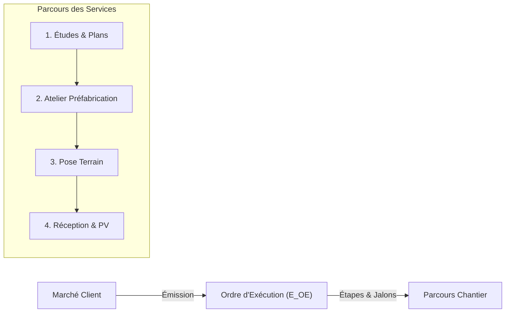
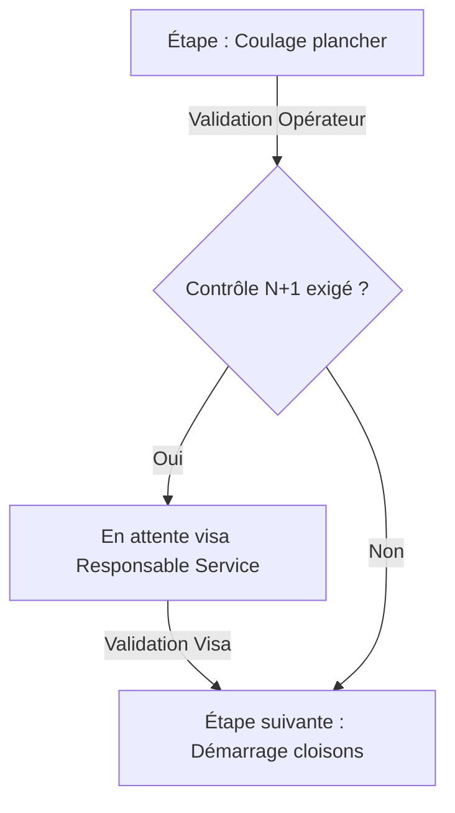

# Module Exécution

Le **module Exécution** assure le pilotage opérationnel des travaux et le suivi d'avancement des chantiers. Il structure la transition entre le bureau d'études (devis, marché) et la réalité des opérations de production en atelier ou sur le terrain.

---

## 🏗️ 1. Principes & Architecture

Le module s'articule autour de deux concepts complémentaires :
1. **Les Ordres d'Exécution :** Ce sont des documents de la famille `E` (gérés par le module Document et spécialisés par le cœur `ExecutionBtp.cs`). Ils fixent le périmètre technique, les budgets d'heures et les dates d'intervention.
2. **Le Parcours des Services :** Il modélise la chaîne de passage séquentielle d'un chantier entre les différents services de l'entreprise (ex: Bureau d'études › Atelier de préfabrication › Équipes de pose › Service Réception & Contrôle).

---

## 📋 2. Ordres d'Exécution (Famille E)

Chaque ordre est obligatoirement rattaché à **un seul et unique chantier** (`EXE_CHANTIER_UNIQUE`) :

| Type d'Ordre | Libellé | Usage principal |
| :--- | :--- | :--- |
| **`E_OE`** | Ordre d'Exécution principal | Lancé depuis la fiche du marché validé. Fige le **budget d'heures et de fournitures de référence**. |
| **`E_OI`** | Ordre Interne | Travaux préparatoires, fabrications spéciales ou prestations internes. |
| **`E_RP`** | Réparation & SAV | Reprise de réserves ou interventions sous garantie après réception. |
| **`E_DAP`** | Demande d'Approvisionnement | Déclenchement anticipé des commandes de matières premières pour la production. |

### Découplage documentaire :
Bien qu'un ordre soit un document officiel figé après validation, ses dates prévues, ses ressources affectées et son avancement restent modifiables sans dévalider la pièce financière via l'API dédiée `/api/execution/documents/{id}`. Tout blocage opérationnel exige la saisie d'un motif et alerte immédiatement le conducteur de travaux via une notification CRM.

---

## 🗺️ 3. Modèles de Parcours & États des Services

Pour éviter les goulots d'étranglement, le module surveille l'avancement global du chantier à travers un parcours type (`exe_parcours_modele`) :

### États calculés d'un service :
L'état de chaque service sur le chantier est déduit dynamiquement d'après ses étapes amonts et ses ordres en cours :
- **`SANS_OBJET` :** Le service n'intervient pas sur ce type de chantier.
- **`A_VENIR` :** Le service devra intervenir ultérieurement, mais les étapes préalables ne sont pas achevées.
- **`EN_ATTENTE` :** Les étapes amonts sont terminées ; le service peut démarrer ses opérations.
- **`EN_COURS` :** Au moins un ordre est en phase de réalisation active.
- **`BLOQUE` :** Un aléa technique, administratif ou de sécurité empêche la poursuite des travaux.
- **`TERMINE` :** L'ensemble des prestations et contrôles du service ont été validés.

---

## 🎯 4. Étapes des Ordres & Contrôle N+1

Chaque ordre d'exécution est découpé en étapes de travail (`exe_ordre_etape`) caractérisées par :
- **Une nature d'étape :** `TACHE` (opération avec durée), `JALON` (date clé instantanée), `ATTENTE` (délai technique incompressible comme le séchage du béton).
- **Une unité de temps :** Heures travaillées, Jours ouvrés ou Jours calendaires.

### Le Contrôle N+1 hiérarchique :
Pour les étapes critiques (sécurité, étanchéité, coulage structurel), le type d'ordre peut exiger un **contrôle hiérarchique N+1** :
- La validation finale de l'étape est bloquée tant que le responsable de service (ou son délégué expressément habilité via `delegation_controle`) n'a pas apposé son visa technique.
- La délégation de contrôle permet de transférer ce pouvoir de visa à un conducteur de travaux référent en cas d'absence.

---

## 📱 5. Écran Tactile d'Atelier (`EcranEtapesAtelier`)

LogiBTP propose une interface simplifiée pour tablettes murales en atelier (`@logibtp/execution/ui`) :
- Présentation plein écran adaptée aux gants de travail.
- Scan d'un ordre par son code-barres ou saisie du numéro d'ordre.
- Affichage clair de l'étape active et bouton tactile « **✓ Étape terminée** ».
- Déclenchement automatique de la synchronisation avec le planning et notification du service suivant.

---

## 🔌 6. Référence API & Modèle de Données

Les routes sont exposées sous le préfixe `/api/execution` :

| Méthode | Route | Description |
| :--- | :--- | :--- |
| `GET` | `/api/execution/synthese` | Tableau de bord consolidé de l'avancement des chantiers par service. |
| `GET` | `/api/execution/elements/{type}/{id}` | Détail du parcours et des ordres d'un chantier particulier. |
| `GET` | `/api/execution/ordres/{id}/etapes` | Liste ordonnée des étapes, statuts et contrôles d'un ordre d'exécution. |
| `PUT` | `/api/execution/ordres/{id}/etapes/{code}` | Enregistre l'avancement, la date réelle ou le visa de contrôle d'une étape. |
| `POST`| `/api/execution/ordres/{id}/etapes/recalculer`| Réévalue les dates prévisionnelles suite à un décalage amont. |
