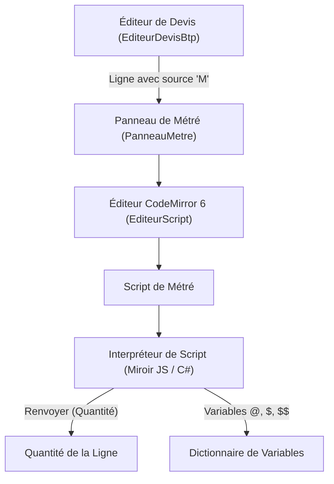

# Module Métré

Le **module Métré** fournit le moteur de calcul des quantités de LogiBTP. Il permet aux métreurs et chiffreurs d'exprimer des formules de calcul complexes, des liaisons dimensionnelles et des scripts géométriques pour déterminer automatiquement les quantités des lignes d'un devis.

---

## 📐 1. Architecture & Découplage

Une force majeure de la conception de LogiBTP réside dans l'indépendance totale du module Métré :
- **Le module Métré ignore tout du module Document :** Il ne connaît pas les devis, les commandes ni les factures. Il manipule uniquement un contexte abstrait de portées, d'évaluateurs et de variables.
- **Spécialisation par le cœur :** C'est le cœur applicatif de LogiBTP (`SpecialisationBtp`, `MoteurDevisBtp`) qui fait le pont entre les lignes de devis (`document_ligne`), les identifiants de métrés (`lig_mtr_id`) et l'évaluateur de script.



---

## 📝 2. Le Langage de Script des Métrés

LogiBTP intègre son propre langage de script dédié au BTP, interprété de façon strictement identique en JavaScript et en C#.

### Caractéristiques du langage :
1. **Insensible aux accents et à la casse :** `longueur`, `Longueur` et `LONGUEUR` désignent la même variable.
2. **Typage strict à 3 types :** Décimal (haute précision), Chaîne de caractères, Booléen (`Vrai` / `Faux`).
3. **Mots-clés structurés en français :** Faciles à lire et à relire pour les bureaux d'études.
4. **Zéro boucle infinie :** Limité à 10 000 itérations par boucle et 100 000 instructions par exécution.

### Exemple de script complet :

```
// Déclaration des paramètres modifiables
local epaisseur = 0.20
local perte_beton = 1.05

// Calcul de la surface utile depuis les dimensions
local surface_brute = $LONGUEUR * $LARGEUR
local surface_tremie = 2.50 * 1.80
local surface_nette = surface_brute - surface_tremie

// Application d'une condition technique
Si surface_nette > 100 Alors
    local volume = surface_nette * epaisseur * perte_beton
Sinon
    local volume = surface_nette * epaisseur * 1.02
Fin

// Publication de variables de ligne réutilisables
@SURFACE_DALLE = surface_nette

// Renvoyer arrête le script et injecte la quantité finale dans la ligne
Renvoyer volume
```

### Structures de contrôle :

- **Conditionnelle :**
  ```
  Si <condition> Alors
      ...
  SinonSi <autre_condition> Alors
      ...
  Sinon
      ...
  Fin
  ```
- **Répétitive :**
  ```
  Pour i De 1 A 10 Faire
      ...
      Si i == 5 Alors Sortir Fin
  Fin
  ```

---

## 🌐 3. Variables & Portées Dynamiques

Le système de variables hiérarchiques permet de propager des cotes du chantier à l'ensemble du devis.

| Préfixe | Portée | Description & Exemple |
| :--- | :--- | :--- |
| `$$` | **Document** | Variable globale à tout le dossier (ex: `$$HAUTEUR_SOUS_PLAFOND = 2.50`, `$$ZONE_SISMIQUE = 3`). Portée par la ligne de section. |
| `$` | **Titre / Chapitre** | Variable partagée au sein d'un lot ou d'une tranche (ex: `$PERIMETRE_BATIMENT = 48.0`). |
| `@@` | **Ouvrage** | Variable locale à un ouvrage composé, accessible par toutes ses composantes (fournitures et main d'œuvre). |
| `@` | **Ligne** | Variable propre à la ligne courante, publiée par son propre script de métré. |

### Opérations d'affectation :
- `=` : Définit ou remplace la valeur d'une variable dans sa portée.
- `+=` : Cumule une valeur sur une variable déjà déclarée dans un titre ou au niveau global (ex: `$TOTAL_SURFACE_ISOLATION += surface_piece`).

---

## 🧰 4. Fonctions Intégrées & Métier BTP

Le langage met à disposition des fonctions standards et des fonctions spécifiques enrichies par le cœur BTP :

### Fonctions mathématiques :
- `Abs(x)` : Valeur absolue.
- `Arrondi(x; decimales)` : Arrondi au nombre de décimales choisi.
- `Plafond(x)` / `Plancher(x)` : Entier supérieur ou inférieur le plus proche.
- `Racine(x)` : Racine carrée (déclenche une erreur explicite si négatif).
- `Min(a; b; ...)` / `Max(a; b; ...)` : Valeur minimale ou maximale d'une liste de nombres.

### Fonctions BTP (`FONCTIONS_BTP`) :
- `Conditionnements(quantite; contenance)` :  
  Détermine le nombre exact d'unités de conditionnement nécessaires en tenant compte de l'arrondi supérieur (ex: `Conditionnements(125; 25)` renvoie `5` sacs).

---

## 💻 5. Interface & Éditeur CodeMirror 6

La saisie des métrés est assistée par un composant d'édition moderne :

```
┌──────────────────────────────────────────────────────────────┐
│ 📐 Métré de la ligne : Dalle béton armé 20cm                │
├──────────────────────────────────────────────────────────────┤
│ 1 │ // Calcul de volume de dalle                             │
│ 2 │ local surf = $LONGUEUR * $LARGEUR                        │
│ 3 │ Renvoyer surf * 0.20                                     │
├──────────────────────────────────────────────────────────────┤
│ Résultat calculé : 23.40 m³                                  │
│ Variables produites : @SURF = 117.00                         │
│ [Dictionnaire F4] [Insérer fonction] [Masquer panneau]       │
└──────────────────────────────────────────────────────────────┘
```

- **Coloration syntaxique complète :** Mots-clés, variables typées, nombres et commentaires.
- **Auto-complétion intelligente :** Propose les variables accessibles selon la position de la ligne dans l'arborescence du devis.
- **Indentation automatique :** Aligne instantanément les blocs `Si`, `Pour` et `Fin`.
- **Diagnostic en temps réel :** Soulignement des erreurs de syntaxe ou de division par zéro sans jamais bloquer l'enregistrement du devis.
- **Notifications non bloquantes :** Le tiroir des notifications répertorie les avertissements géométriques sans interrompre la navigation du chiffreur.

---

## 🗄️ 6. Modèle de Données & Évolution

- `metre` (`mtr_*`) : Enregistre le script (`mtr_script`), le libellé du métré, la variable résultante et la valeur numérique calculée (`mtr_resultat`).
- `variable_definition` (`var_*`) : Consigne les variables issues de l'évaluation avec leur portée, leur formule et leur type (numérique, texte, booléen).

> [!NOTE] Fin des anciens métrés tabulaires
> L'ancienne table `metre_ligne` (sous-détails en lignes) a été totalement supprimée. Les anciennes bases sont automatiquement migrées vers la syntaxe script au démarrage de l'API via `ConversionMetresBases`.
