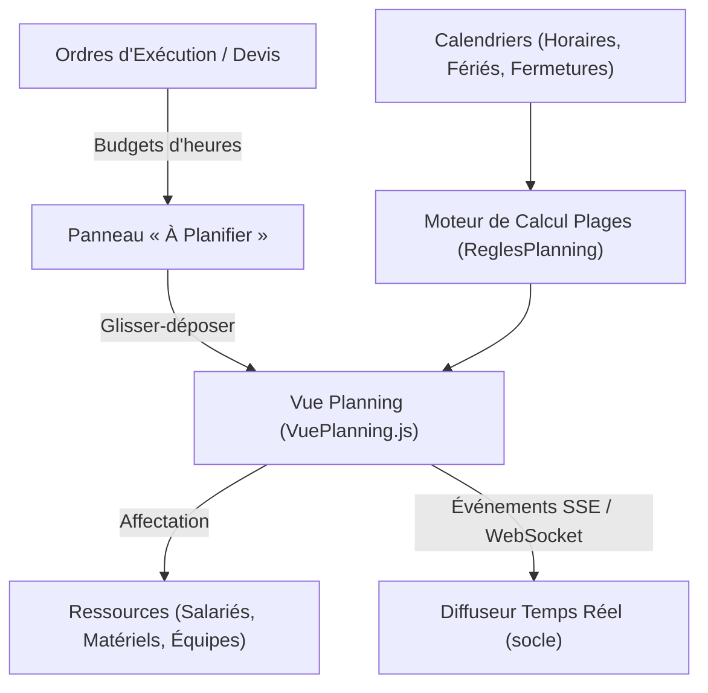

# Module Planning

Le **module Planning** est le moteur de planification des ressources et des opérations de LogiBTP. Il permet d'ordonnancer les tâches des chantiers et des services sur des salariés, intérimaires, matériels et équipes, en tenant compte des calendriers de travail, des charges de service et des dépendances d'enchaînement.

---

## 🏛️ 1. Architecture & Principes

Le module Planning est conçu selon des règles d'ingénierie strictes garantissant sa modularité et sa performance :
- **Indépendance métier :** Le composant planning ignore les notions de chantier ou d'ordre ; il manipule un référentiel générique de tâches, de plages de disponibilité et d'affectations fourni par `SpecialisationPlanningBtp`.
- **Temps universel en minutes UTC :** Tous les calculs temporels s'opèrent en minutes depuis l'époque 1970 UTC, excluant toute ambiguïté liée aux changements d'heure (fuseaux horaires).
- **Parité stricte JS / .NET :** Le calcul des durées selon les calendriers (`01_calcul`), la projection de charge (`02_charge`) et la propagation des dépendances (`03_dependances`) sont implémentés en miroir avec des jeux de tests partagés.

---

## 📅 2. Tâches, Affectations & Calendriers

Une tâche de planning (`pla_tache`) peut être :
- **Théorique :** Positionnée sur une plage de dates sans ressource affectée (besoin de main-d'œuvre à pourvoir).
- **Affectée :** Rattachée à un ou plusieurs intervenants (salariés, intérimaires, sous-traitants) ou matériels.
- **Tâche d'équipe :** Lorsqu'une équipe est affectée, le système déploie automatiquement les membres de l'équipe tout en conservant le lien d'ensemble.

### Modes de calcul par les calendriers (`calcul.js` ↔ `ReglesPlanning.cs`) :
Le planning ne compte jamais de temps mort (week-ends, jours fériés ou plages de fermeture) :
1. **Mode 1 (Fin calculée) :** L'utilisateur indique la date de début et la durée en heures travaillées. Le système projette la fin exacte en consommant les plages d'ouverture du calendrier de la ressource.
2. **Mode 2 (Heures calculées) :** L'utilisateur cale le début et la fin sur la grille. Le système calcule la capacité d'heures réelles correspondante.
3. **Mode 3 (Ventilation) :** Un volume d'heures global est réparti équitablement sur la période entre les ressources affectées.

---

## ⚡ 3. Temps Réel & Synchronisation Multi-Postes

Grâce au composant de diffusion du socle (`Diffuseur`), le planning est collaboratif en temps réel :
- **Verrouillage optimiste (`tac_version`) :** Tout conflit de modification concurrente retourne une erreur HTTP `409 PLA_VERSION` pour empêcher l'écrasement silencieux.
- **Flux temps réel :** Dès qu'un conducteur déplace une tâche, un événement serveur est diffusé via Server-Sent Events (`/api/diffusion?sujets=planning`). Les écrans des autres utilisateurs s'actualisent immédiatement.
- **Modes de synchronisation paramétrables :** L'utilisateur peut choisir son mode de rafraîchissement (Temps réel, Intervalle régulier, ou Pause pour figer sa vue lors d'une saisie complexe).

---

## 📊 4. Gestion de la Charge & Alertes

Le `ServiceCharge` calcule en permanence l'adéquation entre la charge planifiée et la capacité disponible :
- **Barres de capacité par service :** Visualisation par jour et par semaine des effectifs mobilisés face aux effectifs présents.
- **Alertes automatiques :**
  - `SUROCCUPATION` : Une ressource est affectée au-delà de son horaire contractuel sur la journée.
  - `SOUSOCCUPATION` : Sous-charge identifiée sur une équipe ou un service.
  - `MATERIEL` : Conflit de réservation sur un engin de chantier ou un véhicule indisponible.
  - `HABILITATION` : Une tâche exige une habilitation (ex: CACES, électrique) non détenue par le compagnon planifié.
  - `EQUIPE` : La composition effective de l'équipe a évolué depuis la création de la tâche.

---

## 🔗 5. Dépendances, Séries & Jalons

- **Liaisons logiques (`pla_dependance`) :**  
  Support des liaisons **FD** (Fin à Début) et **DD** (Début à Début) avec décalage en jours ouvrés ou calendaires.
- **Propagation en cascade :**  
  Les dépendances de type `FIXE` répercutent automatiquement tout retard d'une tâche amont sur ses tâches avals. Les cycles de dépendance sont strictement détectés et refusés à la saisie.
- **Jalons clés (`pla_jalon`) :**  
  Jalons contractuels saisis manuellement ou jalons automatiques calculés par le cœur BTP (date de livraison du chantier, fin d'un ordre d'exécution).

---

## 🔌 6. Référence API & Modèle de Données

Les endpoints du module sont regroupés sous `/api/planning` :

| Méthode | Route | Rôle |
| :--- | :--- | :--- |
| `GET` | `/api/planning/donnees` | Charge la grille des tâches et affectations sur une période donnée. |
| `POST`| `/api/planning/taches` | Crée une nouvelle tâche avec calcul automatique des plages. |
| `POST`| `/api/planning/taches/{id}/deplacer` | Décale une tâche dans le temps ou change sa ressource. |
| `POST`| `/api/planning/taches/{id}/scinder` | Scinde une tâche en deux pour contourner une interruption de chantier. |
| `GET` | `/api/planning/charge` | Retourne le bilan de charge et de sur-occupation par service. |
| `GET` | `/api/planning/a-planifier` | Liste les reliquats d'heures prévues aux devis restant à positionner. |
