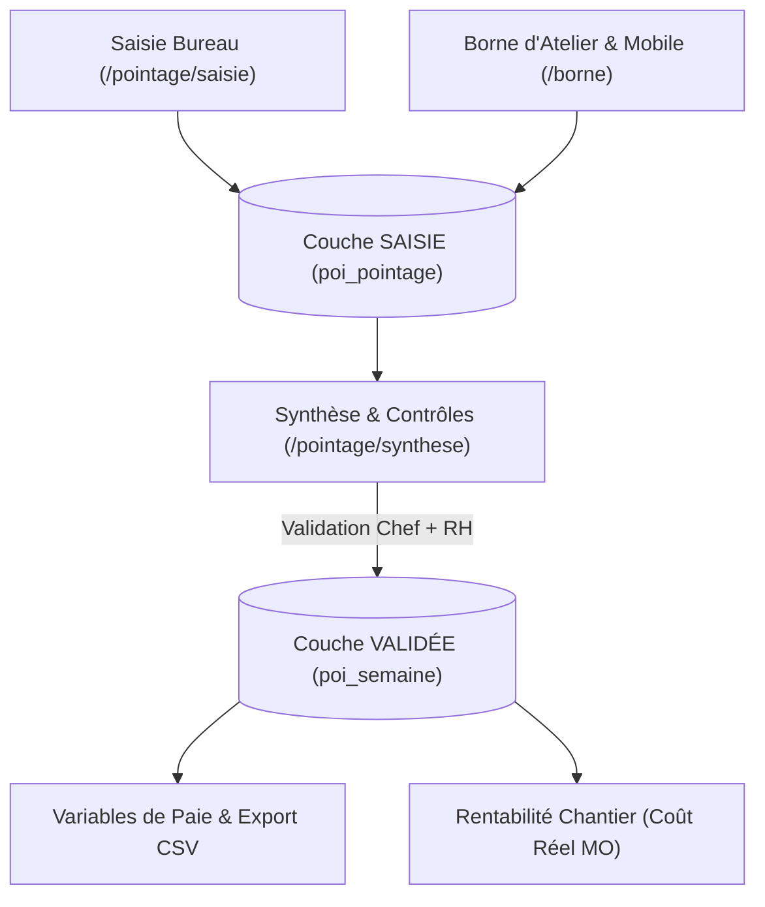

# Module Pointage

Le **module Pointage** assure la collecte, le contrôle, la validation et la valorisation des heures de main-d'œuvre réalisées par les salariés et les intérimaires. Il fait le lien entre la réalité du chantier, le suivi analytique des coûts de main-d'œuvre et la préparation des variables de paie.

---

## ⏱️ 1. Principes & Architecture

Le module applique des règles rigoureuses pour concilier simplicité de saisie et conformité sociale :
- **Toujours rattaché à un chantier :** Aucune heure ne peut flotter sans affectation. Pour les heures hors chantier (formation, atelier, intempéries, maintenance dépôt), le pointage est imputé sur un **chantier interne** (`cha_interne`).
- **Deux couches étanches (Saisie vs Validé) :**  
  La couche de **SAISIE** initiale n'est jamais écrasée. Lors de la validation hiérarchique, le système crée une couche **VALIDÉE** (`poi_semaine`) qui fige les heures retenues. Tout jour validé est verrouillé en écriture (HTTP `409 POI_VALIDE`).
- **Préparation de la paie, jamais de calcul de salaire :**  
  Le module produit des variables d'activité certifiées (heures normales, majorations 25%/50%, paniers, trajets, intempéries) prêtes pour l'export vers le logiciel de paie de l'entreprise (Sage, Silae, etc.).

---

## 🏢 2. Saisie au Bureau & Saisie sur Borne

LogiBTP propose deux interfaces adaptées aux différents profils :

### 1. La grille hebdomadaire au bureau (`/pointage/saisie`)
- Pensée pour les conducteurs de travaux et chefs de chantier saisissant pour leurs équipes.
- Fonction « **Compléter la ligne** » : déduit automatiquement le temps de travail prévu au calendrier du salarié moins les heures déjà saisies.
- Raccourcis clavier fluides pour naviguer d'un jour ou d'un chantier à l'autre sans toucher à la souris.

### 2. La Borne d'Atelier tactile (`/borne`)
- Fonctionne sur des tablettes partagées en atelier ou à l'entrée du dépôt, sans session utilisateur Windows/Active Directory.
- **Sécurité matérielle :** Chaque appareil possède son certificat et son jeton `X-Borne-Jeton`.
- **Authentification par code PIN :** Code PIN haché en PBKDF2 (blocage automatique de 15 minutes après 5 échecs consécutifs).
- **Parcours ultra-rapide (moins de 20 secondes) :**
  1. Le compagnon tape son PIN.
  2. Le chantier du jour est pré-sélectionné d'après le planning d'équipe.
  3. L'activité de main-d'œuvre est validée d'un clic.
  4. Saisie d'équipe possible par le chef de chantier pour pointer tous ses compagnons en un seul geste (`poi_groupe`).

---

## 🍽️ 3. Gestion des Repas & Déplacements

Le module prend en charge les spécificités de la convention collective du BTP :
- **Repas au restaurant (`poi_repas`) :**  
  Un salarié peut déclarer un repas pris au restaurant pour un chantier donné. LogiBTP s'appuie sur la géolocalisation de l'API Adresse pour proposer les restaurants les plus proches du chantier par ordre de distance kilométrique.
- **Indemnités de panier et zones de transport :**  
  Calcul automatique des indemnités de petits déplacements selon la grille des zones concentriques (Zone 1 à Zone 5) entre l'agence de rattachement du salarié et l'adresse du chantier.

---

## 🛡️ 4. Synthèse & Double Validation Hiérarchique

L'écran de synthèse (`/pointage/synthese`) permet aux gestionnaires de valider les heures par semaine :
- **Filtrage par exceptions :** Met en évidence en priorité les anomalies (dépassements du contingent hebdomadaire, heures manquantes par rapport au calendrier, pointages du week-end).
- **Validation à deux niveaux :**
  - **Niveau 1 (Chef de chantier / Conducteur) :** Vérifie la cohérence des heures passées sur chaque chantier.
  - **Niveau 2 (Ressources Humaines / Comptabilité) :** Contrôle les variables de paie et clôture définitivement la semaine.
- **Dévalidation tracée :** Dévalider une semaine exige obligatoirement la saisie d'un motif dans le journal d'audit et notifie le service RH.

---

## 🏖️ 5. Congés & Absences

Le module intègre un circuit complet de gestion des absences (`poi_conge`) :
1. **Demande :** Déposée par le salarié ou son responsable avec dates et demi-journées.
2. **Impact immédiat sur le planning :** L'absence apparaît en option grisée sur le planning des équipes.
3. **Validation RH :** Le responsable RH affecte la nature d'absence exacte (Congés Payés, RTT, Maladie, Intempéries, Événement familial).
4. **Conséquence :** La tâche devient une **tâche gérée immuable** dans le planning, empêchant toute affectation erronée de ce salarié sur un chantier.

---

## 🔌 6. Référence API & Modèle de Données

Les routes sont exposées sous le préfixe `/api/pointage` :

| Méthode | Route | Description |
| :--- | :--- | :--- |
| `GET` | `/api/pointage/semaine/{salarie}/{lundi}` | Récupère la grille de saisie hebdomadaire d'un salarié. |
| `PUT` | `/api/pointage/semaine/{salarie}/{lundi}` | Enregistre les heures saisies pour chaque jour et chantier. |
| `POST`| `/api/pointage/synthese/valider` | Valide formellement une semaine de pointage. |
| `POST`| `/api/pointage/borne/pointages` | Enregistrement d'un pointage depuis la borne tactile partagée. |
| `GET` | `/api/pointage/restaurants` | Recherche les restaurants à proximité immédiate d'un chantier. |
| `GET` | `/api/pointage/export` | Génère l'export CSV des variables de paie de la période. |
