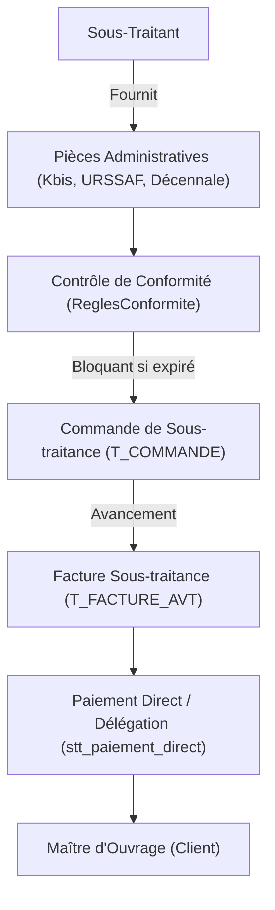
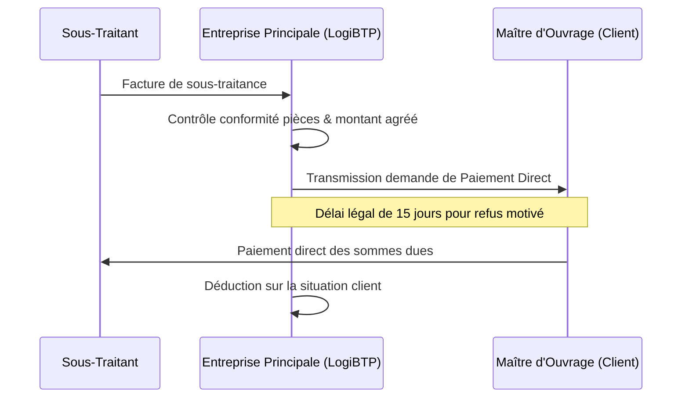

# Module Sous-traitance

Le **module Sous-traitance** encadre la relation contractuelle, administrative et financière avec les sous-traitants de l'entreprise, dans le strict respect de la réglementation française (Loi n° 75-1334 du 31 décembre 1975 relative à la sous-traitance).

---

## ⚖️ 1. Principes & Cadre Juridique

Dans le BTP, le recours à la sous-traitance impose des obligations impératives à l'entreprise principale :
1. **Obligation de déclaration et d'agrément :** Tout sous-traitant doit être déclaré et accepté par le maître d'ouvrage, avec agrément préalable de ses conditions de paiement (formulaire DC4 en marchés publics ou convention d'agrément en marchés privés).
2. **Obligation de garantie de paiement :** L'entreprise principale doit obligatoirement fournir au sous-traitant soit une **délégation de paiement direct** auprès du client, soit une **caution bancaire personnelle et solidaire**.
3. **Devoir de vigilance social et fiscal :** L'entreprise doit collecter et vérifier périodiquement les attestations sociales (URSSAF) et fiscales de chaque partenaire pour se prémunir du risque de travail dissimulé.

---

## 📜 2. Conformité Documentaire & Pièces Exigées

Le module surveille la validité des pièces administratives et bloque les opérations financières à risque :

### 1. Typologie et portée des pièces (`stt_piece_type`) :
- **Portée TIERS (propre à l'entreprise partenaire) :**  
  - Extrait Kbis de moins de 3 mois.
  - Attestation de vigilance URSSAF (validité 6 mois, vérification d'authenticité).
  - Attestation d'assurance Responsabilité Civile et Décennale en cours de validité.
  - Liste nominative des salariés étrangers soumis à autorisation de travail.
- **Portée MARCHÉ (propre au chantier) :**  
  - Acte spécial d'acceptation et d'agrément (DC4) validé par le client.
  - Plan Particulier de Sécurité et de Protection de la Santé (PPSPS).
  - Déclaration d'antériorité et attestations de congés payés (CIBTP).

### 2. États d'une pièce et contrôles bloquants :
Chaque pièce requise est évaluée en temps réel :
- **`FOURNIE` :** Document présent en GED et valide.
- **`A_ECHEANCE` :** Document approchant de sa date d'expiration (rappel automatique préventif envoyé par courriel).
- **`EXPIREE` :** Date de validité dépassée.
- **`MANQUANTE` :** Document obligatoire absent du dossier.
- **`DISPENSEE` :** Dispense exceptionnelle accordée par la direction avec motif obligatoire.

> [!CAUTION] Blocage automatique à la validation (`ST_PIECES`)
> Le système refuse formellement de valider une commande de sous-traitance ou de programmer le paiement d'une facture si une pièce marquée comme bloquante est manquante ou expirée.

---

## 📑 3. Marchés & Famille Documentaire T

Les documents de sous-traitance constituent la **famille T** du module Document :
- **`T_AO` :** Appel d'offres / Consultation sous-traitant avec comparatif d'offres.
- **`T_COMMANDE` :** Contrat de sous-traitance rattaché au marché de sous-traitance (`mar_sens = 'ST'`).
- **`T_FACTURE_AVT` :** Situation de travaux et facture du sous-traitant.
- **`T_AVOIR` :** Avoir de sous-traitance.

### Ventilation automatique des situations reçues :
Lorsqu'un sous-traitant transmet sa facture d'avancement, le moteur répartit automatiquement le montant déclaré au prorata du reste de chaque poste contractuel (`ventilerFactureRecue`), en absorbant les éventuels écarts d'arrondi sur la ligne principale.

---

## 💳 4. Procédure de Paiement Direct

Pour les marchés publics ou privés avec paiement direct, le sous-traitant est réglé directement par le maître d'ouvrage :

### Règles de gestion du paiement direct :
1. **Contrôle des plafonds :** Le total des sommes acceptées en paiement direct ne peut en aucun cas excéder le montant maximal agréé figurant à l'acte spécial.
2. **Délai d'acceptation de 15 jours :** LogiBTP trace la date de notification au client et déclenche une alerte à $J-3$ de l'expiration du délai légal d'acceptation tacite.
3. **Déduction automatique sur les factures client :** Le montant payé directement au sous-traitant est automatiquement déduit du pied de la situation de travaux adressée au maître d'ouvrage.

---

## 🔒 5. Retenues de Garantie & Libération

- **Retenue de garantie légale (5%) :**  
  Appliquée sur chaque situation d'avancement du sous-traitant, sauf substitution par une caution bancaire équivalente.
- **Échéance légale de libération :**  
  La retenue devient exigible **1 an jour pour jour après la réception des travaux** avec le client.
- **Condition de libération :**  
  Le déblocage de la retenue est automatiquement suspendu tant que subsistent des réserves non levées concernant le lot du sous-traitant.

---

## 🔌 6. Référence API & Modèle de Données

Les routes du module sont regroupées sous le préfixe `/api/sous-traitance` :

| Méthode | Route | Rôle |
| :--- | :--- | :--- |
| `GET` | `/api/sous-traitance/marches/{id}/conformite` | Évalue l'état de conformité de toutes les pièces d'un marché ST. |
| `GET` | `/api/sous-traitance/tiers/{id}/conformite` | Évalue la conformité générale d'une entreprise sous-traitante. |
| `POST`| `/api/sous-traitance/factures/{id}/paiement` | Déclare une demande de paiement direct pour une facture reçue. |
| `POST`| `/api/sous-traitance/paiements/{id}/accepter` | Enregistre l'acceptation de la demande de paiement direct. |
| `POST`| `/api/sous-traitance/paiements/{id}/transmettre`| Notifie la transmission officielle au maître d'ouvrage. |
