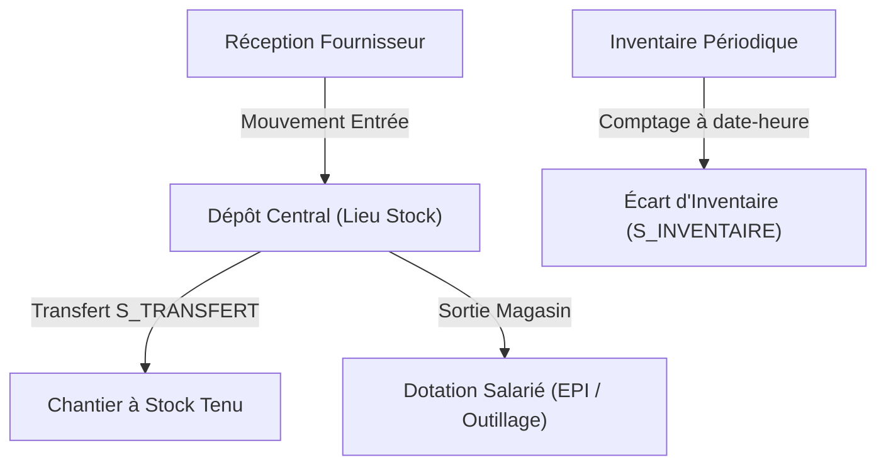
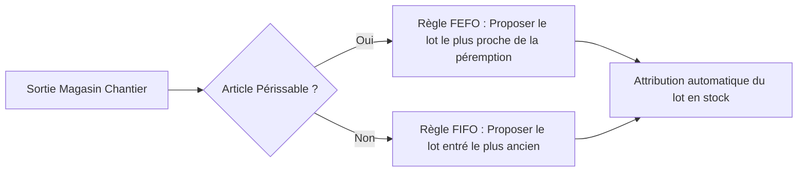

# Module Stock

Le **module Stock** assure la gestion des dépôts centraux, le suivi des approvisionnements de chantier, la traçabilité par lots et numéros de série, et la valorisation comptable des stocks en temps réel.

---

## 📦 1. Principes & Modèle de Calcul

Le moteur de stock de LogiBTP repose sur un principe mathématique rigoureux :
- **Le stock n'est jamais saisi manuellement :**  
  Il est calculé de manière déterministe à la date-minute $T$ selon la formule :
  $$\text{Stock à } T = \text{Dernier Comptage d'Inventaire} \le T + \sum \text{Mouvements postérieurs jusqu'à } T$$
- **Écriture exclusive par les pièces validées :**  
  Les mouvements de stock sont générés automatiquement par le cœur applicatif (`MouvementsStockBtp`) lors de la validation des documents commerciaux (Réceptions fournisseurs, Bons de livraison clients, Transferts inter-dépôts `S_TRANSFERT`). Une dévalidation annule automatiquement ses mouvements associés.
- **Lieux de stock :**  
  Dans LogiBTP, tout lieu de stockage est modélisé par un chantier spécial : soit un **dépôt central** (`cha_depot`), soit un **chantier à stock tenu** (`cha_stock_tenu`).

---

## 💰 2. Méthodes de Valorisation Financière

Le module calcule à la fois la quantité physique et la valeur monétaire des stocks :

1. **Prix Moyen Pondéré (PMP) :**  
   À chaque entrée valorisée (réception ou facture), le PMP est recalculé sur l'ensemble des dépôts :
   $$\text{Nouveau PMP} = \frac{(\text{Stock Existant} \times \text{Ancien PMP}) + (\text{Quantité Entrante} \times \text{Prix d'Achat Net})}{\text{Stock Total Nouveau}}$$
2. **Dernier Prix d'Achat :** Méthode alternative configurée au niveau de la société.
3. **Réceptions non encore facturées :**  
   Les réceptions sont valorisées au prix d'achat convenu sur la commande d'achat. Dès l'enregistrement de la facture définitive du fournisseur, les mouvements sont automatiquement revalorisés pour intégrer les écarts éventuels de facturation.

---

## 🏷️ 3. Traçabilité par Lots & Numéros de Série

Pour répondre aux exigences normatives (produits chimiques, résines, armatures, menuiseries et matériels sensibles), les articles peuvent être configurés sous 3 modes de suivi (`stk_article_suivi`) :
- **`AUCUN` :** Gestion en vrac standard.
- **`LOT` :** Numéro de lot attribué à la réception, date limite d'utilisation et traçabilité fournisseur.
- **`SERIE` :** Numéro de série unique par pièce unitaire, associé à une durée de garantie constructeur (de 1 à 600 mois).

---

## 📋 4. Inventaire Comptable & Écarts

Les inventaires s'effectuent par lots d'inventaire datés à la minute (`stk_lot_inventaire`) :
1. **Génération des bordereaux :**  
   Création automatique des feuilles de comptage par emplacement physique, par famille d'articles ou par marque d'outillage.
2. **Saisie des comptages réels :**  
   Saisie sur tablette ou bordereau papier. Le système conserve la quantité théorique calculée au moment exact du comptage.
3. **Calcul des écarts & Pièce d'ajustement :**  
   À la validation du lot d'inventaire, le système génère automatiquement une pièce comptable d'écart d'inventaire (`S_INVENTAIRE`), exportée en Opérations Diverses (OD) vers la comptabilité générale pour réaligner le compte de stock (classe 3).

---

## 🦺 5. Magasin, Dotations EPI & Borne Stock

- **Gestion des Dotations Salariés :**  
  Les Équipements de Protection Individuelle (EPI) et l'outillage électroportatif remis aux compagnons sont suivis par un chantier de dotation propre à chaque salarié (`sal_cha_dotation_id`).
- **Fiche de dotation numérique :**  
  À chaque remise de matériel, une fiche de dotation récapitulative est émargée sur la borne tactile par le salarié, compilée en PDF vectoriel et archivée immédiatement dans son dossier GED confidentiel.
- **Suivi des renouvellements :**  
  Des notifications automatiques préviennent le magasinier lorsque la date de validité d'un harnais ou d'un casque de chantier arrive à échéance.

---

## 📈 6. Approvisionnement & Projections de Rupture

Le module calcule en continu la frise chronologique des disponibilités futures :
- **Stock Projeté =** Stock Présent + Commandes Fournisseurs attendues − Réservations de chantiers prévues.
- **Détection préventive :** Identifie la date exacte de la première rupture de stock prévisionnelle avant qu'elle n'impacte le chantier.
- **Assistant de commande :** Propose les quantités optimales à commander auprès du fournisseur principal selon les seuils mini/maxi et le conditionnement d'achat (ex: palettes ou cartons complets).

---

## 🔌 7. Référence API & Modèle de Données

Les routes sont exposées sous le préfixe `/api/stock` :

| Méthode | Route | Description |
| :--- | :--- | :--- |
| `GET` | `/api/stock/lieux/{id}/etat` | Retourne les quantités physiques et la valorisation à une date donnée. |
| `POST`| `/api/stock/inventaires` | Initialise un lot d'inventaire sur un dépôt ou chantier. |
| `POST`| `/api/stock/inventaires/{id}/valider` | Valide les comptages et génère la pièce comptable d'écarts. |
| `GET` | `/api/stock/lieux/{id}/approvisionnement` | Analyse les besoins et affiche les propositions de réapprovisionnement. |
| `GET` | `/api/stock/articles/{id}/lots` | Consulte le stock ventilé par numéro de lot et date de péremption. |
