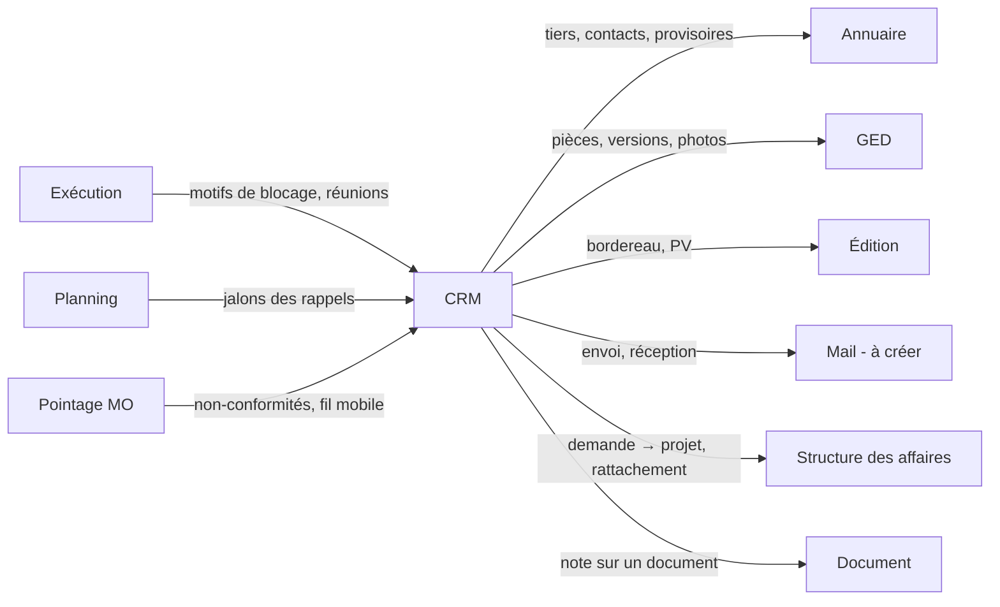

# LogiBTP – analyse du module CRM

> Analyse préalable (20/10/2026) à partir de la note « LogiBTP - Module CRM ». Socle commun aux quatre nouveaux modules
> (activation, services, ressources, notifications, mobile) : [ANALYSE-MODULES-TRANSVERSE.md](ANALYSE-MODULES-TRANSVERSE.md).
> Modules liés : [Exécution](ANALYSE-MODULE-EXECUTION.md) · [Planning](ANALYSE-MODULE-PLANNING.md) ·
> [Pointage MO](ANALYSE-MODULE-POINTAGE.md).

> **Réalisation** : premier temps (lots 0 à 5) réalisé le 21/10/2026 ; contexte technique dans
> [modules/crm/CLAUDE.md](../../modules/crm/CLAUDE.md). Écarts : bordereau imprimé par le navigateur (modèle Édition à venir),
> journal des consultations propre au module (`crm_consultation`, pas `journal_confidentiel` du module Fiche, pour ne pas
> dépendre de lui), droits SUPERVISER et RGPD dans `crm_droit`, scripts du module numérotés 095 à 099.

## 1. Objet

Suivre la **relation** avec les tiers et la **circulation de l'information** autour d'une affaire, du premier contact
(avant-projet, demande de consultation) jusqu'à l'exécution (validation des plans, diffusion, fil d'actualité du
chantier). Le module ne calcule rien de métier : il **trace** (qui, quand, quoi), **rappelle** (alertes, tâches) et
**relie** (tiers, structure des affaires, documents, ordres, pièces de la GED).

Cinq modes d'utilisation, qui partagent une même entité de base (la note) :

| Mode | Rôle | Entité principale |
|---|---|---|
| Demande | Regrouper les échanges d'un avant-projet ou d'une demande de consultation | `crm_demande` |
| Action / message / tâche | Unité de suivi : ce qui est à faire, a été dit ou est à retenir | `crm_note` |
| Suivi des validations | Plans et pièces techniques soumis au visa des tiers, par indice | `crm_plan`, `crm_plan_indice`, `crm_visa` |
| Bordereau de diffusion | Envoi tracé d'un lot de pièces à une liste de tiers, retours attendus | `crm_diffusion` |
| Fil d'actualité | Flux chronologique (messages, documents, photos) d'un chantier ou d'une affaire | vue sur les notes et la GED |

## 2. Synthèse fonctionnelle

### 2.1 Services Vente et Achat

La note demande « l'ajout des services Vente et Achat ». Lecture retenue (C1) : le **référentiel des services** (commun à
l'Exécution et au Planning, voir transverse § 4.1) reçoit deux services administratifs, Vente et Achat, pour que les notes
puissent être typées par service au même titre que BE, atelier, pose… Une note est soit **globale**, soit **d'un
service** (filtre des vues, destinataires par défaut).

### 2.2 Demande

- **Pré-dossier** (décision C8) : avant-projet ou demande de consultation suivie **avant la création du projet**, pour
  la veille commerciale (échanges, pièces, relances).
- Regroupe des actions, messages et tâches ; porte le tiers (éventuellement **provisoire**, module Annuaire), le
  contact, le service, l'objet, l'échéance de réponse, l'état : veille → à étudier → en cours → transformée en projet →
  sans suite, avec motif (C16).
- Assignable à un **service** : visible de tous ses membres tant que personne ne l'a prise ; la personne qui la prend
  en charge en devient responsable (C3, C18).
- Débouche sur un **projet** de la structure des affaires, et peut produire des **demandes de prix d'achat** (DDP,
  documents du module Document) : boutons « Créer le projet » / « Créer les demandes de prix » qui reprennent tiers,
  contact, objet, pièces.
- La sous-traitance n'est pas suivie ici : l'ordre de sous-traitance (Exécution) anticipe et suit une ou plusieurs
  demandes ou commandes de sous-traitance (module Sous-traitance à créer).

### 2.3 Action / message / tâche (la note)

| Champ | Détail |
|---|---|
| Nature | Action, message, tâche (une seule table, la nature change l'affichage et les champs obligatoires) |
| État | À faire, en cours, terminé, pour mémo, annulée |
| Type de note | Lié à un service ou global (paramétrable : appel, courriel, visite, réunion, relance…) |
| Responsable | Un individu, ou un service tant que personne ne l'a prise en charge (affichée alors à tous les salariés du service, principal ou secondaire) ; la prise en charge fait de son auteur le responsable ; tout changement de responsable est tracé (C3, C18) |
| Objet, message | Message en HTML mis en forme (le rédacteur déjà utilisé par les libellés) |
| Pièces jointes | Dans la GED (`type_element = 'crm_note'`) : versions, accès, coffre-fort si besoin |
| Rappel | Deux types : **à date** (date et heure) ou **avant la date** (délai avant l'échéance) ; pastille verte, orange ou rouge selon les **seuils globaux** des paramètres du CRM (par exemple orange à 7 jours ou moins, rouge à 1 jour ou moins et au-delà) ; liste « mes rappels » et widget de l'accueil (C6, C19, C26) |
| Dans le fil | Case à cocher, **décochée par défaut** : la note paraît dans le fil d'actualité de son élément (C17) |
| Confidentialité | Lisible par tous (C24) sauf : note **privée** (auteur et destinataires ; un droit superviseur peut lever le masquage, consultation journalisée et visible de l'auteur : C14, C21) ou note **données personnelles / RGPD** (droit RGPD, lecture journalisée : C28) |
| Conservation | Jusqu'à l'archivage ou la suppression du tiers ; reportée sur la fiche conservée en cas de fusion (C25, C29) |
| Traçabilité | Créé par / le, modifié par / le, historique des changements d'état et de responsable |
| Mail | Courriel glissé (.eml / .msg) → note, sans module Mail ; envoi quand le module Mail existera (C7) |

### 2.4 Suivi des validations

- Un **plan** (ou toute pièce technique : note de calcul, fiche produit, échantillon) porte : repère CCTP, repère du
  plan, nom, lot, finition, message.
- Chaque **indice** (A, B, C…) est une version de la pièce dans la GED, avec date de diffusion et motif de révision.
- Pour chaque indice, un **visa par tiers** (architecte, bureau de contrôle, client, MOE…) : attendu, reçu, statut
  (bon pour exécution, visa avec observations, refusé, sans objet), date, observations, pièce de retour (plan annoté).
- Historique complet des diffusions et validations ; l'indice en vigueur est le dernier visé « bon pour exécution ».

### 2.5 Bordereau de diffusion

- Sélection de pièces (plans à leur indice courant, documents de la GED) et d'une **liste de diffusion** (tiers et
  contacts, par défaut les intervenants du chantier selon leur fonction).
- Mode par destinataire (courriel, papier, plateforme, remise en main propre), nombre d'exemplaires.
- Impression par le module Édition ; envoi avec les pièces jointes par le module Mail, quand il existera (C7).
- Création automatique d'une **tâche de retour** par tiers valideur (échéance = date de diffusion + délai de visa),
  soldée quand le visa est saisi.

### 2.6 Fil d'actualité

- Flux chronologique par chantier (ou affaire, projet, global) : messages, documents déposés, photos, événements des
  autres modules (diffusion, visa reçu, ordre bloqué, livraison planifiée…).
- Saisie rapide depuis le mobile (photo + commentaire), réactions et réponses (fil de discussion).
- **Filtres** du fil (C13) : nature (notes, documents, photos, événements), service, module d'origine, période. Seules
  les notes cochées « Dans le fil » y paraissent (C17).
- **Chargement progressif** : le fil se charge par lots pendant le défilement ; les documents ne se téléchargent qu'à
  la demande ; un groupe de photos ne montre que les trois premières et le nombre restant ; miniatures au second temps
  (C23) ; hors ligne, seul le premier lot est disponible, sans photos ni documents.
- Visibilité, portée et agrégation à étoffer plus tard (C12).

## 3. Liens avec les autres modules

| Module | Avec lui | Sans lui (module désactivé ou absent) |
|---|---|---|
| Annuaire | Tiers, individus, intervenants, création d'un tiers provisoire depuis une demande | Indispensable (prérequis) |
| GED | Pièces jointes, indices des plans, photos du fil | Indispensable (prérequis) |
| Structure | Rattachement projet / affaire / chantier / marché ; demande → projet | Notes rattachées aux tiers et documents seulement |
| Mail (à créer) | Envoi des notes et bordereaux, réception des courriels | Bordereau imprimé ou exporté en PDF ; courriels glissés à la main |
| Édition | Bordereau, PV de réunion, fiche de visa | Pas d'impression (liste exportable) |
| Exécution | Motifs de blocage d'un ordre → tâche CRM au service ou au tiers fautif ; réunions de chantier | Rien |
| Planning | Rappels et visas attendus affichés en jalons | Rien |
| Pointage | Fil d'actualité et alertes sur le mobile ; non-conformité → note au service concerné | Rien |

Les liens passent par le cœur (règle d'architecture) : le module CRM connaît une cible par `(type_element, id_element)`,
comme la GED, et le cœur fournit les libellés, les liens de navigation et les droits (`SpecialisationCrmBtp`).

## 4. Questions, propositions et décisions

### 4.1 Questions de la première analyse (relues le 20/10/2026)

| N° | Question | Proposition | Décision |
|---|---|---|---|
| C1 | « Ajout des services Vente, Achat » : référentiel commun ou notion propre au CRM ? | Référentiel commun des services (transverse § 4.1), Vente et Achat y sont des services administratifs sans capacité de production. | ✔ Retenue. |
| C2 | Action, message, tâche : trois entités ou une ? | **Une** table `crm_note` avec une nature ; une tâche exige un responsable et une échéance, un message un ou des destinataires, une action rien de plus. Conversion d'une nature à l'autre sans perte. | ✔ Retenue. |
| C3 | Assignation : un responsable, plusieurs, un service entier ? | Un responsable (individu) **ou** un service ; destinataires en copie multiples. Pas de tâche à plusieurs responsables. | ✔ Retenue, complétée : une demande ou une tâche en attente peut être assignée à un **service** ; celui qui la prend en charge en devient responsable ; le responsable peut changer, chaque changement est tracé. Détails : C18. |
| C4 | Différence entre « pour mémo » et un message terminé ? | « Pour mémo » = information à conserver, jamais dans les listes de travail ni les rappels, toujours dans le fil et l'historique. | ✔ Retenue. |
| C5 | À quoi rattacher une note ? | À un ou plusieurs éléments (`crm_note_lien`) : tiers, individu, demande, projet, affaire, chantier, marché, document, ordre d'exécution, tâche de planning, plan. Le premier lien est l'élément principal (titre, droits). | ✔ Retenue. |
| C6 | Rappel : quand, à qui, par quel canal ? | Date-heure absolue ou relative à l'échéance, récurrence simple, destinataires = responsable par défaut ; canal : centre de notifications, courriel si le module Mail est actif, mobile plus tard. | ◐ À approfondir. Premier temps : **liste des rappels** et **widget de l'accueil** ; deux types, **à date** ou **avant la date** ; code couleur vert / orange / rouge. Récurrence, courriel et mobile plus tard. Détails : C19. |
| C7 | Le module Mail : envoi seul ou aussi réception ? | Lot 1 : envoi et dépôt manuel des courriels reçus ; lot 2 : boîte relevée avec rapprochement automatique. | ⏸ Reporté : module Mail à définir entièrement plus tard. Le CRM démarre sans lui (courriels glissés à la main, bordereau imprimé). |
| C8 | Demande de consultation achat : doublon avec la DDP et l'« appel d'offres » de l'Exécution ? | La demande CRM est le dossier de consultation ; les DDP en sont issues ; un seul appel d'offres, porté par la demande. | ✔ Retenue, précisée : la demande est un **pré-dossier** suivi avant la création du projet (veille commerciale) ; les DDP (demandes de prix d'achat) sont créées depuis elle ; l'ordre de sous-traitance de l'Exécution anticipe et suit une ou plusieurs demandes ou commandes de sous-traitance (module Sous-traitance à créer). Voir C20. |
| C9 | « Finition » dans le suivi des validations : que recouvre-t-elle ? | Finition du produit (teinte RAL, état de surface) soumise au visa avec le plan : champ libre + liste de valeurs paramétrable par lot. | ✔ Retenue. |
| C10 | Indice de plan = version de la GED ? | Une version GED par indice, toutes conservées ; l'**indice métier** (lettre, motif, date) est porté par `crm_plan_indice`. | ✔ Retenue. |
| C11 | Statuts de visa : liste fixe ou paramétrable ? | Liste paramétrable fournie avec les visas usuels, chacun « bloquant » ou non. | ✔ Retenue. |
| C12 | Fil d'actualité : par chantier, par affaire, global ? Qui le voit ? | Par élément de la structure, agrégé vers le haut ; interne au départ ; message « confidentiel » possible. | ✔ Retenue pour commencer ; à étoffer plus tard. |
| C13 | Le fil stocke-t-il ses propres données ? | Non : vue chronologique sur les notes, les dépôts de la GED et les événements des modules (`crm_evenement`). | ✔ Retenue, avec des **filtres** dans le fil et le choix des notes à y afficher (C17). |
| C14 | Notes privées ? | Visibles de l'auteur et des destinataires seulement ; jamais pour une note rattachée à un visa ou une diffusion. | ✔ Retenue, complétée : un **droit superviseur** peut lever le masquage (consultation journalisée, C21). |
| C15 | Suppression d'une note ? | Annulation plutôt que suppression ; suppression par l'auteur tant que personne ne l'a lue, sinon par l'administrateur, journalisée. | ✔ Retenue. |

### 4.2 Questions de la deuxième lecture (décidées le 20/10/2026)

| N° | Question | Proposition | Décision |
|---|---|---|---|
| C16 | États de la demande pour un pré-dossier de veille ? | Veille → à étudier → en cours → transformée en projet → sans suite (motif : perdue, non retenue, abandonnée). « Gagnée / perdue » relève ensuite du projet. | ✔ Retenue. |
| C17 | Quelles notes paraissent dans le fil ? | Par défaut selon le type de note, modifiable sur chaque note. | ✔ Autrement : une **case « Dans le fil »** sur chaque note, **décochée par défaut** ; pas de réglage par type. Jamais pour une note privée ou RGPD. |
| C18 | Prise en charge par un service : qui peut prendre, qui est prévenu ? | Les membres du service ; liste « à prendre » du service. | ✔ Une personne du service prend la tâche ; tant que personne ne l'a prise, la tâche en attente est affichée à **tous les membres du service**. Les membres sont les **salariés** (individus de notre société dans l'Annuaire), rattachés à un ou plusieurs services dont un **principal** (transverse § 4.1). |
| C19 | Rappels : bornes des couleurs ? | Bornes par type de rappel. | ✔ **Options globales** dans les paramètres du CRM, par exemple orange à 7 jours ou moins de l'échéance, rouge à 1 jour ou moins (et au-delà de l'échéance). Voir C26. |
| C20 | Sous-traitance : module à part ? | Oui, à cadrer. | ✔ Oui : **analyse à faire** pour la gestion des marchés de sous-traitance et des **documents obligatoires** (attestations, agréments). Inscrit dans TACHES.md. |
| C21 | L'auteur d'une note privée voit-il qui l'a consultée ? | Journal des consultations par un superviseur. | ✔ Oui, **comme pour les règles RGPD** (journal des consultations confidentielles du module Fiche) : l'auteur voit qui a levé le masquage et quand. |
| C22 | Relances des devis et factures : règles et moment ? | Liste proposée, validée avant l'envoi, chaque relance tracée. | ✔ On relance **tant que le document est en attente de réponse** (devis) **ou de paiement** (facture). Règle **globale**, **surchargeable par tiers** : 1re relance à 15 jours, 2e à 1 mois, 3e à 2 mois ; **modes d'envoi** : courriel, courrier postal, lettre recommandée avec accusé de réception. Toujours une liste proposée et validée par un utilisateur avant l'envoi. Voir C27. |
| C23 | Miniatures des photos du fil ? | Produites par la GED au dépôt. | ✔ Utiles pour éviter les surcharges, mais **reportées au second temps** : on commence sans miniatures (photos chargées à la demande, groupes limités aux trois premières). |
| C24 | Droits de lecture des notes ? | Lisibles par qui a accès à l'élément principal. | ✔ **Tout le monde voit les notes**, sauf les notes **privées** (C14) et les notes **RGPD** (accès restreint, voir C28). |
| C25 | Conservation des notes ? | Règle de rétention par type d'élément. | ✔ Les notes sont **conservées jusqu'à l'archivage ou la suppression du tiers** dans la base. Voir C29. |

### 4.3 Questions de la troisième lecture (décidées le 20/10/2026)

| N° | Question | Proposition | Décision |
|---|---|---|---|
| C26 | Les seuils globaux (C19) remplacent-ils le délai du rappel « avant la date » ? | Les seuils globaux donnent la **couleur** ; le rappel « avant la date » fixe seulement **à partir de quand** la note entre dans la liste des rappels et le widget (par défaut : le seuil orange). Rappel « à date » : vert avant la date, puis rouge. Pas de délai par type de note. | ✔ Retenue. |
| C27 | Relances : date de départ, place de la règle ? | Devis : date d'envoi (statut ENVOYE), arrêt à l'acceptation, au refus ou à la fin de validité ; facture : date d'échéance, arrêt quand le reste à payer est nul (module Règlements ; sans lui, statut de paiement du document). Règle globale dans les paramètres des documents, surcharge sur la fiche du tiers (`ALTER TABLE` du cœur sur `personne`) ; lettres par le module Édition (modèle par niveau), courriel par le module Mail quand il existera, numéro de recommandé saisi à la main ; chaque relance = note CRM sur le document (sinon historique du document). Second temps, avec l'onglet Règlements de la page document. | ✔ Retenue. |
| C28 | Qu'est-ce qu'une note « RGPD » et qui la lit ? | Case **« Données personnelles »** sur la note : lecture réservée au droit RGPD des champs confidentiels des fiches (`pcf_confidentiel`), chaque lecture journalisée (`journal_confidentiel`). Jamais dans le fil. | ✔ Retenue. |
| C29 | « Archivage du tiers » : l'Annuaire n'a qu'un indicateur `per_actif`. | À l'archivage, les notes dont le tiers est l'élément principal sont archivées avec lui (consultables par l'administrateur, hors listes) ; à la suppression, elles sont supprimées, et les notes rattachées aussi à d'autres éléments perdent seulement le lien vers le tiers. À la **fusion** de tiers (`fusionnerTiers`), les notes passent sur la fiche conservée (`SpecialisationAnnuaireBtp.ReporterFusionAsync`). | ✔ Retenue, avec un **module Archivage complet** (à analyser) plutôt qu'un archivage propre à l'Annuaire : le CRM s'y branche par un point d'accroche (« élément archivé » → notes archivées). |
| C30 | Salariés rattachés à plusieurs services : où le stocker ? | Table de rattachement salarié ↔ service (`srv_principal`) dans le référentiel des services du cœur, saisie sur la fiche salarié ; le service principal sert aussi au Planning (capacité) et au Pointage (filtre). | ✔ Retenue. |

Toutes les questions du CRM sont tranchées, sauf C6 (rappels : récurrence, courriel, mobile, à approfondir au second
temps) et C7 (module Mail, reporté). Analyses à mener à part : module Sous-traitance (C20), module Archivage (C29),
module Mail (C7).

## 5. Faisabilité

**Faisable sans difficulté majeure** : le module s'appuie presque entièrement sur des briques existantes.

| Besoin | Brique existante | Travail |
|---|---|---|
| Fiches demande, note, plan | Module Fiche (types, onglets, champs gérés, droits, verrou) | Définitions de fiches, champs gérés pour les liens et destinataires |
| Listes et vues (mes tâches, rappels, visas en attente) | Module Liste (vues, segments, filtres de rattachement) | Sources `v_liste_crm_*`, vues par défaut |
| Pièces jointes, indices, photos | GED (versions, accès, coffre-fort, classification) | Catégories `crm`, `plan`, `photo` ; règle « toutes les versions » |
| Message mis en forme | Rédacteur HTML des libellés | Réutilisation ; nettoyage HTML côté serveur |
| Bordereau, PV | Module Édition (sous-rapports, étiquettes, QR codes) | Modèles « bordereau de diffusion », « fiche de visa » |
| Tiers, contacts, intervenants | Annuaire, `v_intervenants` | Liste de diffusion par défaut depuis les intervenants |
| Graphe | Module Graphe | Optionnel : relations demande → projet → chantier → plans |

**À créer** :

- **Rappels, premier temps** (C6) : couleur calculée à l'affichage (liste et widget de l'accueil, à ajouter aux
  widgets de `navigation/widgets.js`), sans tâche de fond. Le **planificateur** (tâche de fond par base, sur le modèle
  d'`ArchivageGed`, à la minute) et le centre de notifications (transverse § 5) ne sont nécessaires qu'avec les
  notifications poussées et les récurrences.
- **Miniatures des photos** (C23) : produites par la GED au dépôt, au second temps.
- **Salariés rattachés aux services** (C18, C30) et branchement sur le **module Archivage** à créer (C29).
- **Module Mail** : reporté (C7) ; aucun lot du CRM n'en dépend, seuls l'envoi des bordereaux et la réception des
  courriels l'attendent.
- **Temps réel** pour le fil d'actualité : un rafraîchissement périodique suffit au départ ; le canal temps réel du
  Planning (SignalR) servira ensuite.

**Volume du fil** (décidé) : chargement par lots pendant le défilement (pagination par curseur du module Liste),
documents téléchargés à la demande seulement, groupes de photos limités aux trois premières avec le nombre restant,
miniatures au second temps ; hors ligne, premier lot seulement, sans photos ni documents.

**Risques** : RGPD (notes sur des personnes physiques : conservation liée au tiers C25 / C29, notes RGPD à accès
restreint C28, export et droit d'accès), dérive vers
un gestionnaire de projet complet (s'en tenir à la trace et au rappel ; la planification reste au Planning).

## 6. Simplification d'utilisation

- **Note en contexte** : raccourci global (personnalisable, `declarerRaccourcis`) « Nouvelle note » depuis n'importe
  quelle page ; la note est pré-rattachée à l'élément ouvert (document, fiche, chantier) et au service de l'utilisateur.
- **Panneau CRM ancrable** dans la page document et les fiches (`Disposition` : zone droite) : notes et tâches de
  l'élément, saisie rapide sur une ligne (Entrée = message, Ctrl+Entrée = tâche) ; ouvrable aussi dans une fenêtre à
  côté, qui suit l'élément ouvert dans la fenêtre principale (diffusion entre fenêtres, canal `logibtp-fenetres`).
- **Glisser un courriel** (Outlook, .eml, .msg) sur le panneau : note créée avec expéditeur, date, objet, corps et
  pièces jointes dans la GED.
- **Modèles de notes** par type (relance de devis, demande de visa, compte rendu de visite) avec texte à variables.
- **Mentions `@`** d'un individu (destinataire + notification) et `#` d'un chantier ou document (lien).
- **Conversion en un clic** : message → tâche, tâche → note de planning, demande → projet.
- **Bordereau depuis la GED** : sélection de pièces dans l'explorateur → « Diffuser… » ; liste de diffusion proposée
  depuis les intervenants ; tâches de retour créées sans saisie.
- **Widget de l'accueil** : mes rappels (vert / orange / rouge), mes tâches du jour, tâches à prendre de mon service,
  visas en retard.
- **Vue Kanban** des tâches par état (glisser = changer d'état), en plus de la liste.

## 7. Possibilités non encore explorées

Calendrier décidé le 20/10/2026 : premier temps = lots 0 à 5 (§ 9) ; second et troisième temps ci-dessous.

| N° | Possibilité | Quand |
|---|---|---|
| 1 | **Pipeline commercial** : étapes de la demande, montant estimé, probabilité, CA pondéré, taux de transformation par commercial ou par type de client ; alimenté aussi par les devis (statuts ENVOYE / ACCEPTE). | Second temps |
| 2 | **Relances** des devis en attente de réponse **et des factures** en attente de paiement : règle globale surchargeable par tiers (15 jours, 1 mois, 2 mois), courriel, courrier ou recommandé avec accusé de réception, liste proposée et validée avant l'envoi, chaque relance tracée (C22, C27). | Retenue ; second temps proposé (C27) |
| 3 | **Calendrier** : export iCalendar des tâches et rappels, abonnement Outlook / Google en lecture. | Second temps |
| 4 | **Portail tiers** (architecte, client, sous-traitant) : visa des plans en ligne, consultation du fil, dépôt de pièces ; droits de la GED, accès par lien signé à durée limitée. | Troisième temps |
| 5 | **Réserves et levée des réserves** (OPR, garantie de parfait achèvement) : réserve = note placée sur un plan (point cliquable sur le PDF), photo avant / après, responsable, procès-verbal par le module Édition. | Troisième temps |
| 6 | **Comptes rendus de réunion** : la réunion de chantier (Exécution) produit des notes (une par point), les tâches qui en sortent et un PV diffusé par bordereau. | Troisième temps |
| 7 | **Dossier des ouvrages exécutés (DOE)** : assemblage des derniers indices visés, fiches produits et notices. | Troisième temps |
| 8 | **Assistance IA locale** : résumé d'un courriel, extraction des tâches et des dates, rattachement proposé au bon chantier. | Troisième temps |
| 9 | **Journal d'appels** : saisie rapide d'un appel (durée, interlocuteur), téléphonie plus tard. | Troisième temps |
| 10 | **Enquête de satisfaction** en fin de chantier, rattachée au tiers. | Idée conservée, non planifiée |

## 8. Esquisse du modèle de données (`modules/crm/db`, numéros 200+)

| Table | Colonnes principales |
|---|---|
| `crm_parametre` | `cpa_seuil_orange_jours` (7 par défaut), `cpa_seuil_rouge_jours` (1 par défaut) : seuils globaux des rappels (C19) |
| `crm_type_note` | `tno_id`, `tno_code`, `tno_libelle`, `tno_srv_id` (service, nul = global), `tno_modele_html` |
| `crm_demande` | `dem_id`, `dem_tiers_id`, `dem_ind_id`, `dem_srv_id`, `dem_responsable_id` (nul = à prendre par le service), `dem_objet`, `dem_etat` (C16), `dem_motif_sans_suite`, `dem_echeance`, `dem_montant_estime`, `dem_projet_id` (cœur, `ALTER TABLE`) |
| `crm_note` | `not_id`, `not_nature` (ACTION / MESSAGE / TACHE), `not_etat`, `not_tno_id`, `not_srv_id`, `not_objet`, `not_message_html`, `not_responsable_id` (nul = à prendre par le service), `not_echeance`, `not_parent_id` (réponse), `not_dem_id`, `not_prive`, `not_rgpd` (C28), `not_dans_fil` (faux par défaut), `not_archivee_le` (C29), `not_cree_par`, `not_cree_le`, `not_maj_par`, `not_maj_le` |
| `crm_note_lien` | `nli_not_id`, `nli_type_element`, `nli_id_element`, `nli_principal` |
| `crm_note_destinataire` | `nde_not_id`, `nde_ind_id`, `nde_lu_le` |
| `crm_rappel` | `rap_id`, `rap_not_id`, `rap_type` (DATE / AVANT), `rap_quand` (DATE), `rap_delai_jours` (AVANT), `rap_ind_id`, `rap_traite_le` ; plus tard `rap_recurrence`, `rap_declenche_le` |
| `crm_note_historique` | trigger : état, responsable (prise en charge, réassignation, rendu au service), échéance, qui, quand ; même historique pour les demandes |
| `crm_consultation_privee` | `ccp_not_id`, `ccp_par`, `ccp_le` : levée du masquage d'une note privée par un superviseur, visible de l'auteur (C21) ; les lectures des notes RGPD vont dans `journal_confidentiel` (C28) |
| `crm_plan` | `pla_id`, `pla_repere`, `pla_repere_cctp`, `pla_nom`, `pla_lot`, `pla_finition`, élément de la structure |
| `crm_plan_indice` | `pin_id`, `pin_pla_id`, `pin_indice`, `pin_dge_id` / version GED, `pin_motif`, `pin_date` |
| `crm_statut_visa` | `stv_code`, `stv_libelle`, `stv_bloquant` |
| `crm_visa` | `vis_id`, `vis_pin_id`, `vis_tiers_id`, `vis_ind_id`, `vis_attendu_le`, `vis_stv_code`, `vis_recu_le`, `vis_observation`, `vis_dge_retour_id`, `vis_not_id` (tâche de retour) |
| `crm_diffusion` | `dif_id`, `dif_numero`, `dif_date`, `dif_objet`, élément de la structure, `dif_dge_edition_id` |
| `crm_diffusion_piece` | `dfp_dif_id`, `dfp_pin_id` ou `dfp_dge_id` |
| `crm_diffusion_destinataire` | `dfd_dif_id`, `dfd_tiers_id`, `dfd_ind_id`, `dfd_mode`, `dfd_exemplaires`, `dfd_envoye_le`, `dfd_attend_visa` |
| `crm_evenement` | `eve_id`, `eve_type`, `eve_type_element`, `eve_id_element`, `eve_libelle`, `eve_url`, `eve_quand`, `eve_par` (publié par les modules via le cœur) |

Règle répliquée JS ↔ C# (jeu de cas `modules/crm/tests/cas`) : **état calculé d'un plan** (indice en vigueur, visas
manquants, bloquant ou non) et **couleur des rappels** (vert / orange / rouge selon le type, la date, le délai et l'état
de la note : affichée hors ligne, utilisée par les listes du serveur et, plus tard, par le planificateur).

## 9. Découpage en lots

Premier temps :

| Lot | Contenu | Prérequis |
|---|---|---|
| 0 | Activation du module, services Vente / Achat, salariés rattachés à leurs services (principal et secondaires) | Transverse : activation, référentiel des services (C30) |
| 1 | Notes (nature, état, type, message, pièces, liens, historique), responsable ou service à prendre, case « Dans le fil », notes privées (droit superviseur, consultations visibles de l'auteur) et RGPD, listes « mes tâches » et « à prendre », panneau ancrable et fenêtre à côté, courriel glissé ; report à la fusion et suppression avec le tiers | Lot 0 |
| 2 | Rappels à date / avant la date, seuils globaux des couleurs dans les paramètres, couleur (jeu de cas), liste des rappels, widget de l'accueil | Lot 1 |
| 3 | Demandes (pré-dossier de veille, états C16), prise en charge par un service, conversion en projet, DDP | Lot 1 |
| 4 | Suivi des validations : plans, indices (GED), visas, état calculé (jeu de cas) ; bordereau de diffusion imprimé, tâches de retour | Lot 1, module Édition |
| 5 | Fil d'actualité : vue chronologique filtrable, notes cochées, événements des modules, chargement par lots (sans miniatures) | Lot 1 ; application mobile (transverse § 6) pour les photos prises sur place |

Second temps : pipeline commercial, export iCalendar, miniatures des photos (GED), relances des devis et factures (règle
globale et par tiers, C22, C27), notifications poussées et récurrence des rappels (planificateur, centre de
notifications) ; branchement sur le module Archivage quand il existera (C29). Troisième temps : portail tiers, réserves,
comptes rendus de réunion, DOE, assistance IA, journal d'appels. Avec le module Mail : envoi des notes et bordereaux,
réception des courriels.
