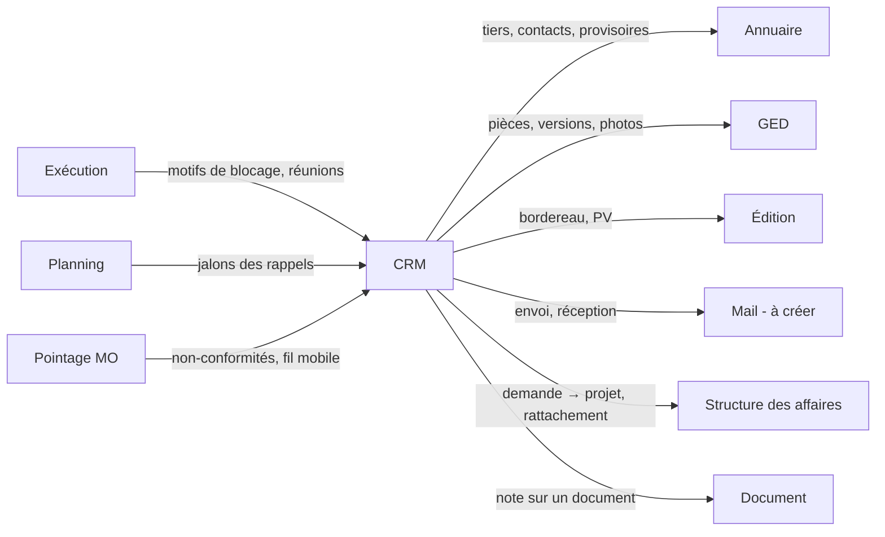

# LogiBTP – analyse du module CRM

> Analyse préalable (20/10/2026) à partir de la note « LogiBTP - Module CRM ». Socle commun aux quatre nouveaux modules
> (activation, services, ressources, notifications, mobile) : [ANALYSE-MODULES-TRANSVERSE.md](ANALYSE-MODULES-TRANSVERSE.md).
> Modules liés : [Exécution](ANALYSE-MODULE-EXECUTION.md) · [Planning](ANALYSE-MODULE-PLANNING.md) ·
> [Pointage MO](ANALYSE-MODULE-POINTAGE.md).

## 1. Objet

Suivre la **relation** avec les tiers et la **circulation de l'information** autour d'une affaire, du premier contact
(avant-projet, demande de consultation) jusqu'à l'exécution (validation des plans, diffusion, fil d'actualité du
chantier). Le module ne calcule rien de métier : il **trace** (qui, quand, quoi), **rappelle** (alertes, tâches) et
**relie** (tiers, structure des affaires, documents, ordres, pièces de la GED).

Cinq modes d'utilisation, qui partagent une même entité de base (la note) :

| Mode | Rôle | Entité principale |
|---|---|---|
| Demande | Regrouper les échanges d'un avant-projet ou d'une demande de consultation | `crm_demande` |
| Action / message / tâche | Unité de suivi : ce qui est à faire, a été dit ou est à retenir | `crm_note` |
| Suivi des validations | Plans et pièces techniques soumis au visa des tiers, par indice | `crm_plan`, `crm_plan_indice`, `crm_visa` |
| Bordereau de diffusion | Envoi tracé d'un lot de pièces à une liste de tiers, retours attendus | `crm_diffusion` |
| Fil d'actualité | Flux chronologique (messages, documents, photos) d'un chantier ou d'une affaire | vue sur les notes et la GED |

## 2. Synthèse fonctionnelle

### 2.1 Services Vente et Achat

La note demande « l'ajout des services Vente et Achat ». Lecture retenue : le **référentiel des services** (commun à
l'Exécution et au Planning, voir transverse § 3) reçoit deux services administratifs, Vente et Achat, pour que les notes
puissent être typées par service au même titre que BE, atelier, pose… Une note est soit **globale**, soit **d'un
service** (filtre des vues, destinataires par défaut).

### 2.2 Demande

- Avant-projet (côté vente : un client ou un prospect demande un chiffrage) ou demande de consultation (côté achat :
  nous consultons des fournisseurs / sous-traitants).
- Regroupe des actions, messages et tâches ; porte le tiers (éventuellement **provisoire**, module Annuaire), le
  contact, le service, l'objet, l'échéance de réponse, l'état (ouverte, transmise, gagnée, perdue, abandonnée).
- Débouche sur un **projet** de la structure des affaires (vente) ou sur des **demandes de prix** (achats) : bouton
  « Créer le projet » / « Créer les demandes de prix » qui reprend tiers, contact, objet, pièces.

### 2.3 Action / message / tâche (la note)

| Champ | Détail |
|---|---|
| Nature | Action, message, tâche (une seule table, la nature change l'affichage et les champs obligatoires) |
| État | À faire, en cours, terminé, pour mémo, annulée |
| Type de note | Lié à un service ou global (paramétrable : appel, courriel, visite, réunion, relance…) |
| Objet, message | Message en HTML mis en forme (le rédacteur déjà utilisé par les libellés) |
| Pièces jointes | Dans la GED (`type_element = 'crm_note'`) : versions, accès, coffre-fort si besoin |
| Rappel | Date et heure, destinataires ; alerte à l'écran et liste « mes rappels » |
| Traçabilité | Créé par / le, modifié par / le, historique des changements d'état |
| Mail | Envoi par le module Mail ; réception : un courriel glissé (.eml / .msg) devient une note |

### 2.4 Suivi des validations

- Un **plan** (ou toute pièce technique : note de calcul, fiche produit, échantillon) porte : repère CCTP, repère du
  plan, nom, lot, finition, message.
- Chaque **indice** (A, B, C…) est une version de la pièce dans la GED, avec date de diffusion et motif de révision.
- Pour chaque indice, un **visa par tiers** (architecte, bureau de contrôle, client, MOE…) : attendu, reçu, statut
  (bon pour exécution, visa avec observations, refusé, sans objet), date, observations, pièce de retour (plan annoté).
- Historique complet des diffusions et validations ; l'indice en vigueur est le dernier visé « bon pour exécution ».

### 2.5 Bordereau de diffusion

- Sélection de pièces (plans à leur indice courant, documents de la GED) et d'une **liste de diffusion** (tiers et
  contacts, par défaut les intervenants du chantier selon leur fonction).
- Mode par destinataire (courriel, papier, plateforme, remise en main propre), nombre d'exemplaires.
- Impression par le module Édition, envoi par le module Mail avec les pièces jointes.
- Création automatique d'une **tâche de retour** par tiers valideur (échéance = date de diffusion + délai de visa),
  soldée quand le visa est saisi.

### 2.6 Fil d'actualité

- Flux chronologique par chantier (ou affaire, projet, global) : messages, documents déposés, photos, événements des
  autres modules (diffusion, visa reçu, ordre bloqué, livraison planifiée…).
- Saisie rapide depuis le mobile (photo + commentaire), réactions et réponses (fil de discussion).

## 3. Liens avec les autres modules

| Module | Avec lui | Sans lui (module désactivé ou absent) |
|---|---|---|
| Annuaire | Tiers, individus, intervenants, création d'un tiers provisoire depuis une demande | Indispensable (prérequis) |
| GED | Pièces jointes, indices des plans, photos du fil | Indispensable (prérequis) |
| Structure | Rattachement projet / affaire / chantier / marché ; demande → projet | Notes rattachées aux tiers et documents seulement |
| Mail (à créer) | Envoi des notes et bordereaux, réception des courriels | Bordereau imprimé ou exporté en PDF ; courriels glissés à la main |
| Édition | Bordereau, PV de réunion, fiche de visa | Pas d'impression (liste exportable) |
| Exécution | Motifs de blocage d'un ordre → tâche CRM au service ou au tiers fautif ; réunions de chantier | Rien |
| Planning | Rappels et visas attendus affichés en jalons | Rien |
| Pointage | Fil d'actualité et alertes sur le mobile ; non-conformité → note au service concerné | Rien |

Les liens passent par le cœur (règle d'architecture) : le module CRM connaît une cible par `(type_element, id_element)`,
comme la GED, et le cœur fournit les libellés, les liens de navigation et les droits (`SpecialisationCrmBtp`).

## 4. Points en suspens (questions et propositions)

| N° | Question | Proposition |
|---|---|---|
| C1 | « Ajout des services Vente, Achat » : référentiel commun ou notion propre au CRM ? | Référentiel commun des services (transverse § 3), Vente et Achat y sont des services administratifs sans capacité de production. |
| C2 | Action, message, tâche : trois entités ou une ? | **Une** table `crm_note` avec une nature ; une tâche exige un responsable et une échéance, un message un ou des destinataires, une action rien de plus. Conversion d'une nature à l'autre sans perte. |
| C3 | Assignation : un responsable, plusieurs, un service entier ? | Un responsable (individu) **ou** un service ; destinataires en copie multiples. Pas de tâche à plusieurs responsables (on la duplique). |
| C4 | Différence entre « pour mémo » et un message terminé ? | « Pour mémo » = information à conserver, jamais dans les listes de travail ni les rappels, toujours dans le fil et l'historique. |
| C5 | À quoi rattacher une note ? | À un ou plusieurs éléments (`crm_note_lien`) : tiers, individu, demande, projet, affaire, chantier, marché, document, ordre d'exécution, tâche de planning, plan. Le premier lien est l'élément principal (titre, droits). |
| C6 | Rappel : quand, à qui, par quel canal ? | Date-heure absolue ou relative à l'échéance (« 2 jours avant »), récurrence simple (jour, semaine, mois), destinataires = responsable par défaut ; canal : centre de notifications (transverse § 5), courriel si le module Mail est actif, notification du mobile plus tard. |
| C7 | Le module Mail : envoi seul ou aussi réception ? | Lot 1 : envoi (SMTP ou API Microsoft 365 / Gmail) et dépôt manuel des courriels reçus (les lecteurs `.msg` / `.eml` de la GED existent : msgreader, postal-mime). Lot 2 : boîte relevée (IMAP / Graph) avec rapprochement automatique par adresse de l'expéditeur et référence dans l'objet. |
| C8 | Demande de consultation achat : doublon avec la demande de prix (DDP) du module Document et l'« appel d'offre » de l'Exécution ? | La demande CRM est le **dossier** de consultation (échanges, pièces, relances) ; les DDP sont des documents du module Document créés depuis elle ; l'ordre de sous-traitance se rattache à la demande ou à la commande. Un seul appel d'offres, porté par la demande. |
| C9 | « Finition » dans le suivi des validations : que recouvre-t-elle ? | À confirmer : finition du produit (teinte RAL, état de surface) soumise au visa avec le plan. Proposé : champ libre + liste de valeurs paramétrable par lot. |
| C10 | Indice de plan = version de la GED ? | Oui pour le fichier (une version GED par indice, conservées toutes : règle de conservation « toutes les versions » pour la catégorie plan) ; l'**indice métier** (lettre, motif, date) est porté par `crm_plan_indice`, distinct du numéro de version technique. |
| C11 | Statuts de visa : liste fixe ou paramétrable ? | Liste paramétrable, fournie avec les visas usuels (bon pour exécution, avec observations, refusé, sans objet / pour information), chacun marqué « bloquant » ou non pour l'exécution. |
| C12 | Fil d'actualité : par chantier, par affaire, global ? Qui le voit ? | Par élément de la structure, avec agrégation vers le haut (le fil d'une affaire montre ceux de ses chantiers) ; visibilité interne seulement au départ ; un message peut être marqué « confidentiel » (accès comme la GED). |
| C13 | Le fil stocke-t-il ses propres données ? | Non : vue chronologique sur les notes, les dépôts de la GED et les événements publiés par les modules (`crm_evenement` : type, élément, libellé, lien), pour ne pas dupliquer. |
| C14 | Notes privées ? | Oui (`not_prive`) : visibles de l'auteur et des destinataires seulement ; jamais pour une note rattachée à un visa ou une diffusion. |
| C15 | Suppression d'une note ? | Annulation (état « annulée ») plutôt que suppression ; suppression réservée à l'auteur tant que personne d'autre ne l'a lue, sinon à l'administrateur, journalisée. |

## 5. Faisabilité

**Faisable sans difficulté majeure** : le module s'appuie presque entièrement sur des briques existantes.

| Besoin | Brique existante | Travail |
|---|---|---|
| Fiches demande, note, plan | Module Fiche (types, onglets, champs gérés, droits, verrou) | Définitions de fiches, champs gérés pour les liens et destinataires |
| Listes et vues (mes tâches, rappels, visas en attente) | Module Liste (vues, segments, filtres de rattachement) | Sources `v_liste_crm_*`, vues par défaut |
| Pièces jointes, indices, photos | GED (versions, accès, coffre-fort, classification) | Catégories `crm`, `plan`, `photo` ; règle « toutes les versions » |
| Message mis en forme | Rédacteur HTML des libellés | Réutilisation ; nettoyage HTML côté serveur |
| Bordereau, PV | Module Édition (sous-rapports, étiquettes, QR codes) | Modèles « bordereau de diffusion », « fiche de visa » |
| Tiers, contacts, intervenants | Annuaire, `v_intervenants` | Liste de diffusion par défaut depuis les intervenants |
| Graphe | Module Graphe | Optionnel : relations demande → projet → chantier → plans |

**À créer** :

- **Centre de notifications et planificateur de rappels** (transverse § 5) : tâche de fond par base (sur le modèle
  d'`ArchivageGed`, mais à la minute) qui déclenche les rappels échus.
- **Module Mail** (déjà attendu par la GED et l'Édition : `dge_a_envoyer`) : prérequis du lot 2 du CRM, pas du lot 1.
- **Temps réel** pour le fil d'actualité : un rafraîchissement périodique suffit au départ ; le canal temps réel du
  Planning (SignalR) servira ensuite.

**Risques** : volume du fil (pagination par curseur du module Liste), RGPD (notes sur des personnes physiques :
durée de conservation, export, droit d'accès ; la GED a déjà des règles de rétention réutilisables), dérive vers un
gestionnaire de projet complet (s'en tenir à la trace et au rappel ; la planification reste au Planning).

## 6. Simplification d'utilisation

- **Note en contexte** : raccourci global (personnalisable, `declarerRaccourcis`) « Nouvelle note » depuis n'importe
  quelle page ; la note est pré-rattachée à l'élément ouvert (document, fiche, chantier) et au service de l'utilisateur.
- **Panneau CRM ancrable** dans la page document et les fiches (`Disposition` : zone droite) : notes et tâches de
  l'élément, saisie rapide sur une ligne (Entrée = message, Ctrl+Entrée = tâche).
- **Glisser un courriel** (Outlook, .eml, .msg) sur le panneau : note créée avec expéditeur, date, objet, corps et
  pièces jointes dans la GED.
- **Modèles de notes** par type (relance de devis, demande de visa, compte rendu de visite) avec texte à variables.
- **Mentions `@`** d'un individu (destinataire + notification) et `#` d'un chantier ou document (lien).
- **Conversion en un clic** : message → tâche, tâche → note de planning, demande → projet.
- **Bordereau depuis la GED** : sélection de pièces dans l'explorateur → « Diffuser… » ; liste de diffusion proposée
  depuis les intervenants ; tâches de retour créées sans saisie.
- **Tableau de bord personnel** (widget du bandeau) : mes tâches du jour, rappels échus, visas en retard.
- **Vue Kanban** des tâches par état (glisser = changer d'état), en plus de la liste.

## 7. Possibilités non encore explorées

1. **Pipeline commercial** : étapes de la demande, montant estimé, probabilité, CA pondéré, taux de transformation
   par commercial ou par type de client ; alimenté aussi par les devis (statuts ENVOYE / ACCEPTE).
2. **Relances automatiques** des devis envoyés sans réponse (règle par type : relance à J+15, tâche au rédacteur).
3. **Portail tiers** (architecte, client, sous-traitant) : visa des plans en ligne, consultation du fil, dépôt de
   pièces ; même mécanique de droits que la GED, accès par lien signé à durée limitée.
4. **Réserves et levée des réserves** (OPR, garantie de parfait achèvement) : réserve = note géolocalisée sur un plan
   (point cliquable sur le PDF), photo avant / après, responsable (lot, sous-traitant), procès-verbal par le module
   Édition. Très demandé en BTP et proche du suivi des validations.
5. **Comptes rendus de réunion** : la réunion de chantier (module Exécution) produit des notes (une par point traité),
   les tâches qui en sortent et un PV diffusé par bordereau.
6. **Dossier des ouvrages exécutés (DOE)** : assemblage automatique des derniers indices visés, fiches produits et
   notices, à partir des plans et de la GED.
7. **Calendrier** : export iCalendar des tâches et rappels, abonnement Outlook / Google en lecture.
8. **Assistance IA locale** (déjà envisagée pour la GED) : résumé d'un courriel, extraction des tâches et des dates,
   proposition de rattachement au bon chantier.
9. **Journal d'appels** : saisie rapide d'un appel (durée, interlocuteur), intégration téléphonie plus tard.
10. **Enquête de satisfaction** en fin de chantier, rattachée au tiers.

## 8. Esquisse du modèle de données (`modules/crm/db`, numéros 200+)

| Table | Colonnes principales |
|---|---|
| `crm_type_note` | `tno_id`, `tno_code`, `tno_libelle`, `tno_srv_id` (service, nul = global), `tno_modele_html` |
| `crm_demande` | `dem_id`, `dem_sens` (V / A), `dem_tiers_id`, `dem_ind_id`, `dem_srv_id`, `dem_objet`, `dem_etat`, `dem_echeance`, `dem_montant_estime`, `dem_projet_id` (cœur, `ALTER TABLE`) |
| `crm_note` | `not_id`, `not_nature` (ACTION / MESSAGE / TACHE), `not_etat`, `not_tno_id`, `not_srv_id`, `not_objet`, `not_message_html`, `not_responsable_id`, `not_echeance`, `not_parent_id` (réponse), `not_dem_id`, `not_prive`, `not_cree_par`, `not_cree_le`, `not_maj_par`, `not_maj_le` |
| `crm_note_lien` | `nli_not_id`, `nli_type_element`, `nli_id_element`, `nli_principal` |
| `crm_note_destinataire` | `nde_not_id`, `nde_ind_id`, `nde_lu_le` |
| `crm_rappel` | `rap_id`, `rap_not_id`, `rap_quand`, `rap_relatif`, `rap_recurrence`, `rap_ind_id`, `rap_declenche_le` |
| `crm_note_historique` | trigger : état, responsable, échéance, qui, quand |
| `crm_plan` | `pla_id`, `pla_repere`, `pla_repere_cctp`, `pla_nom`, `pla_lot`, `pla_finition`, élément de la structure |
| `crm_plan_indice` | `pin_id`, `pin_pla_id`, `pin_indice`, `pin_dge_id` / version GED, `pin_motif`, `pin_date` |
| `crm_statut_visa` | `stv_code`, `stv_libelle`, `stv_bloquant` |
| `crm_visa` | `vis_id`, `vis_pin_id`, `vis_tiers_id`, `vis_ind_id`, `vis_attendu_le`, `vis_stv_code`, `vis_recu_le`, `vis_observation`, `vis_dge_retour_id`, `vis_not_id` (tâche de retour) |
| `crm_diffusion` | `dif_id`, `dif_numero`, `dif_date`, `dif_objet`, élément de la structure, `dif_dge_edition_id` |
| `crm_diffusion_piece` | `dfp_dif_id`, `dfp_pin_id` ou `dfp_dge_id` |
| `crm_diffusion_destinataire` | `dfd_dif_id`, `dfd_tiers_id`, `dfd_ind_id`, `dfd_mode`, `dfd_exemplaires`, `dfd_envoye_le`, `dfd_attend_visa` |
| `crm_evenement` | `eve_id`, `eve_type`, `eve_type_element`, `eve_id_element`, `eve_libelle`, `eve_url`, `eve_quand`, `eve_par` (publié par les modules via le cœur) |

Règle répliquée JS ↔ C# (jeu de cas `modules/crm/tests/cas`) : **état calculé d'un plan** (indice en vigueur, visas
manquants, bloquant ou non) et **échéance des rappels relatifs et récurrents** (calcul affiché hors ligne et exécuté
par le planificateur).

## 9. Découpage en lots

| Lot | Contenu | Prérequis |
|---|---|---|
| 0 | Activation du module, services Vente / Achat, centre de notifications (transverse) | Transverse lots 0–1 |
| 1 | Notes (nature, état, type, message, pièces, liens, historique), listes « mes tâches », panneau ancrable, rappels à l'écran | — |
| 2 | Demandes (vente, achat), conversion en projet / DDP, pipeline simple | Lot 1 |
| 3 | Suivi des validations : plans, indices (GED), visas, état calculé (jeu de cas) | Lot 1 |
| 4 | Bordereau de diffusion : édition, tâches de retour ; envoi par courriel | Lot 3, module Édition ; module Mail pour l'envoi |
| 5 | Fil d'actualité : vue chronologique, événements des modules, photos depuis le mobile | Lot 1 ; application mobile (transverse § 6) pour les photos |
| 6 | Réception des courriels, relances automatiques, réserves, portail tiers (au choix) | Module Mail lot 2 |
