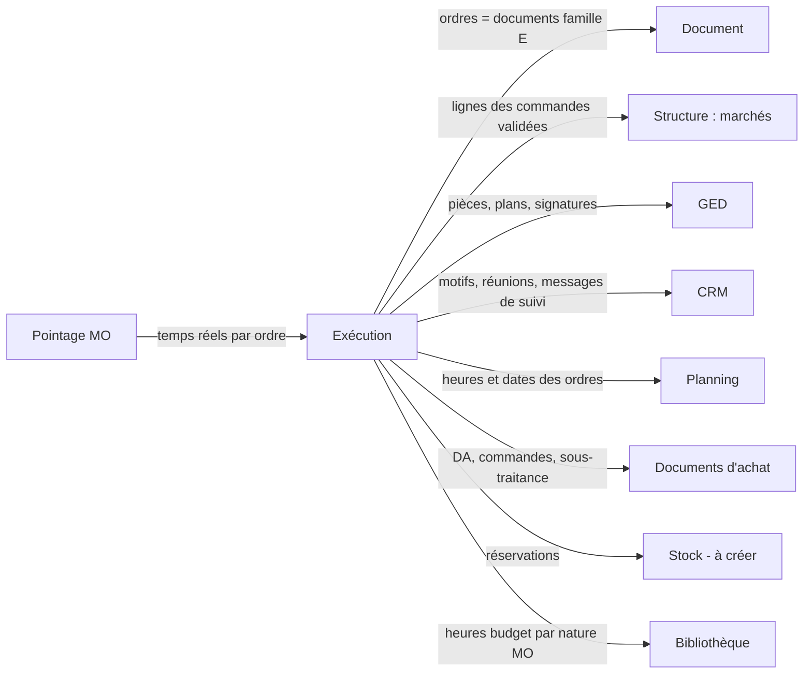

# LogiBTP – analyse du module Exécution

> Analyse préalable (20/10/2026) à partir de la note « LogiBTP - Module Exe ». Socle commun aux quatre nouveaux modules :
> [ANALYSE-MODULES-TRANSVERSE.md](ANALYSE-MODULES-TRANSVERSE.md). Modules liés : [CRM](ANALYSE-MODULE-CRM.md) ·
> [Planning](ANALYSE-MODULE-PLANNING.md) · [Pointage MO](ANALYSE-MODULE-POINTAGE.md).

## 1. Objet

Suivre la **réalisation** d'un chantier, une fois la commande client validée dans un marché : qui fait quoi, dans quel
service, dans quel ordre, avec quel état et quel blocage. Deux faces :

- **La synthèse par chantier** (suivi global ou par service) : une ligne par chantier, un état par service et
  sous-service (automatique ou imposé), les responsables, le dernier message de suivi, les réunions de chantier.
- **Les ordres** : des documents de travail transmis de service en service (exécution → BE → BM → fabrication →
  colisage → livraison → pose ; ou achat, sous-traitance, SAV), qui reprennent les quantités vendues, peuvent être
  modifiés, répartis en sous-ordres, et portent les temps et les pièces.

## 2. Décision structurante proposée : un ordre est un document

Les besoins de la note sur les ordres correspondent presque point par point à ce que le module Document sait déjà
faire :

| Besoin de la note | Déjà dans le module Document / le cœur |
|---|---|
| Lignes reprises des commandes de vente d'un marché, quantité vendue toujours rattachée | Transformation (`TransformationService.TransformerPlusieurs`, « Nouveau BL » depuis le marché), liens de lignes (`document_ligne_lien`), colonnes Qté parent / Reste / Soldé |
| Modifier quantité, prix, ajouter, supprimer, changer la nature | Saisie de la grille, natures (`lig_nat_id`), bibliothèque (F3, glisser), ouvrages et composantes |
| Transfert d'un ordre vers un autre ordre | `transformation_autorisee` (cibles par type), fenêtre de transformation commune |
| Répartir les quantités dans plusieurs sous-ordres | Transformation partielle avec reste à solder, tout le reliquat, seuils de solde |
| Ordre de sous-traitance rattaché à une commande sous-traitant | Transformation vers `A_COMMANDE`, intervenants, paiement direct |
| Demande d'approvisionnement, réservation de stock | Types `S_DEMANDE` (DA) et `S_RESERVATION` (RS) **existent déjà** avec leurs transformations (DA → commande, DA → RS) |
| Documents dans la GED | Onglet Pièces (`type_element` = code du type) |
| Poids, dimensions par ligne (colisage, livraison) | Colonnes techniques `lig_poids`, `lig_longueur`, `lig_largeur`, `lig_hauteur`, `lig_volume` (`db/165`) |
| Impression, bordereau signé | Module Édition (source document, étiquettes, codes-barres, QR codes) |
| Intervention SAV → facture | Transformation vers la facture, reprise des lignes |
| Statuts, droits, numérotation, verrou, historique | Cycle de vie et règles des documents (`db/178`–`180`), `droit_document`, `compteur_numero` |

**Proposition** : une nouvelle **famille de documents E (exécution)**, à côté de V (ventes), A (achats) et S (stock),
avec un type par ordre (OE, BE, BM, OF, CO, LI, PO, SAV, OST, DA, DAC), non comptables, sans TVA ni pied par défaut,
présentés par des vues de colonnes propres (quantités, heures, poids, dimensions ; prix masqués sauf droit).

Le **module Exécution** lui-même reste générique et sans dépendance au module Document (règle d'architecture) : il
porte les services, les parcours, le calcul des états, les motifs, la synthèse et les réunions. Le **cœur** fait le lien
(`SpecialisationExecutionBtp`) : il déclare les types E comme « ordres » du module, fournit leurs états et leurs heures,
et ajoute les colonnes d'exécution aux documents (`ALTER TABLE`).

Ce choix évite de réécrire une seconde chaîne documentaire et donne d'emblée la grille, les ouvrages, la bibliothèque,
le métré, la GED, l'impression et les transformations. Il demande en contrepartie quelques ajouts au module Document
(§ 6).

## 3. Synthèse fonctionnelle

### 3.1 Synthèse par chantier

- **Liste** (module Liste) : code, libellé, chargé d'affaires, conducteur de travaux, dessinateur, dernier message de
  suivi (CRM), date de fin théorique, puis **une colonne d'état par service** (et sous-service dépliable).
- **État automatique** d'un service = agrégat des ordres de ce service sur le chantier (§ 4, règle répliquée) : sans
  objet, à venir, en attente, en cours, bloqué, terminé.
- **État manuel** : l'utilisateur impose un état (pas d'ordre, intervention sans suivi…), avec motif et date ; il
  prime sur l'automatique et l'écart est signalé (pastille).
- **Vue détaillée** : tous les ordres non terminés du chantier, regroupés par service, avec leur état et leur motif.
- **Vue rapport** : ordres et tâches en alerte (bloqués, en retard sur la date prévue, sans retour d'un tiers),
  tous chantiers confondus, filtrables par service et responsable.
- **Réunions de chantier**, avec ou sans le Planning : date, participants (intervenants), points traités (notes CRM),
  tâches issues, PV par le module Édition.

### 3.2 Parcours des ordres

- On part d'un **premier ordre** (ordre d'exécution, saisi par le conducteur ou le chargé d'affaires) qui déroule le
  fonctionnement ordre par ordre.
- Pour **anticiper**, on décrit le **parcours** : les ordres utilisés et leur hiérarchie (OE → BE → BM → OF bois et OF
  métal en parallèle → colisage → livraison → pose). Un parcours modèle est choisi par chantier (ou par lot) et peut
  être ajusté ; il sert au calcul de l'état « à venir / en attente » des services qui n'ont pas encore d'ordre et au
  planning théorique.
- Un ordre se **transforme** en totalité ou se **répartit** en sous-ordres (étalement de quantités, découpage par
  atelier), avec une codification qui rappelle le parent (`OF2026-00012.1`, `.2`).

### 3.3 Les ordres

| Ordre | Porteur | Reprend | Transfert vers | Particularités |
|---|---|---|---|---|
| Exécution (OE) | Conducteur, chargé d'affaires | Lignes des commandes validées d'un marché | Tous les ordres | Premier ordre, choix du parcours |
| Bureau d'études (BE) | Service BE | OE | BM, OF, achat, sous-traitance, colisage, pose, DA, réservation | Conception, calcul, dessin ; lien suivi des validations (CRM) |
| Bureau des méthodes (BM) | Service BM (atelier) | BE, OE | OF, achat, sous-traitance, colisage, pose, DA, réservation | Gamme de fabrication |
| Fabrication (OF) | Un ou plusieurs services d'atelier | BE, BM, OE | Colisage, livraison | Opérations en parallèle ou à la suite |
| Colisage (CO) | Logistique | Plusieurs ordres, commandes et BL d'achat | Livraison | Emplacement, palette, contenu, poids, dimensions |
| Livraison (LI) | Livraison interne | Plusieurs ordres, colisages, commandes et BL d'achat | — (fin) | Poids et dimensions repris ou saisis |
| Pose (PO) | Poseurs | Tout ordre amont | — (fin) | Intervention sur chantier |
| Intervention (SAV) | Techniciens | Contrat, demande client | Facture | Tablette, signature client, bordereau signé envoyé |
| Sous-traitance (OST) | Un tiers | Tout ordre | Demande de prix, commande sous-traitant | Anticipe et suit une ou plusieurs demandes ou commandes de sous-traitance (module Sous-traitance à créer, décision C8 du CRM) |
| Demande d'approvisionnement (DA) | Tout service | Tout ordre | DDP, commande, réservation, sous-traitance, livraison | Matériel, location, intérim, achat |
| Demande d'achat (DAC) | Service achat | DA, tout ordre | DDP, commande, réservation, sous-traitance | « Liste de courses » du service achat |
| Réservation de stock (RS) | Magasin | DA, DAC | Sortie de stock | Type `S_RESERVATION` existant ; module Stock à venir |

## 4. Règle des états (répliquée JS ↔ C#)

Calcul de l'état d'un service sur un chantier, à partir du parcours et des ordres (jeu `modules/execution/tests/cas`) :

1. État manuel posé → il s'applique (indicateur d'écart si l'automatique diffère).
2. Service absent du parcours et sans ordre → **sans objet**.
3. Au moins un ordre bloqué (motif) → **bloqué** (priorité sur « en cours »).
4. Au moins un ordre en cours ou partiellement soldé → **en cours**.
5. Tous les ordres du service terminés et quantités soldées → **terminé**.
6. Aucun ordre, mais un service amont du parcours non terminé → **à venir** ; service amont terminé → **en attente**
   (le service doit agir).

L'état d'un ordre suit son statut documentaire (brouillon = à faire, validé = en cours, soldé = terminé, annulé) plus
un **état d'exécution** propre (`ent_exe_etat` : en attente, en cours, bloqué, terminé) et un **motif** de blocage
paramétrable (problème d'achat, pas de retour d'un tiers, conditions d'intervention non réunies, plan non visé…).

## 5. Liens avec les autres modules

| Module | Avec lui | Sans lui |
|---|---|---|
| Document, Structure, GED | Indispensables (prérequis) | — |
| CRM | Message de suivi dans la synthèse, motif de blocage → tâche au service ou au tiers, réunions et PV | Motif seul, sans tâche ; dernier commentaire de l'ordre en guise de message |
| Planning | Heures et dates des ordres → tâches à planifier ; planning théorique depuis le parcours ; dates prévues des ordres relues | Dates prévues saisies dans l'ordre |
| Pointage MO | Temps passé par ordre et par ligne (réel vs budget) | Temps saisis sur l'ordre (colonne heures réalisées) |
| Stock (à créer) | Réservation, sortie, emplacements | Réservation documentaire sans mouvement |
| Règlements | — | — |

## 6. Ajouts nécessaires au module Document et au cœur

| Ajout | Où | Remarque |
|---|---|---|
| Famille E et types d'ordres | `modules/document/db` (famille) ; cœur (types, transformations, vues, droits) | `tyd_famille` accepte E ; non comptable, sans TVA |
| Numérotation par parent (`.1`, `.2`) | Module Document (`compteur_numero`, mode `PARENT`) | Distinct des indices de révision (`ent_groupe_id`) |
| Lignes depuis plusieurs documents de familles différentes (ordres + BL d'achat dans un colisage) | `TransformerPlusieurs` : aujourd'hui une famille cible ; contrôler les transformations croisées E ← A | À vérifier : `ControlerTransformation` |
| État d'exécution, motif, responsable, service, dates prévues | Cœur : `ent_exe_etat`, `ent_exe_motif`, `ent_srv_id`, `ent_responsable_id`, `ent_debut_prevu`, `ent_fin_prevue` | Ajoutés par `ALTER TABLE` |
| Heures par ligne | Cœur : `lig_heures_budget` (issues des composantes de nature MO), `lig_heures_realisees` (pointage) | Liaison nature MO → service (transverse § 3) |
| Emplacement, palette | Cœur ou module Stock : `lig_emplacement`, `ent_palette` | Étiquette de palette par le module Édition |
| Signature | Cœur : image + horodatage dans la GED (coffre-fort) | Commun avec le Pointage (feuille signée) |

## 7. Points en suspens (questions et propositions)

| N° | Question | Proposition |
|---|---|---|
| E1 | Les ordres sont-ils des documents (famille E) ou des objets propres au module ? | Documents (§ 2). Le module Exécution garde le parcours, les états, la synthèse. |
| E2 | Un ordre porte-t-il des prix ? | Oui, masqués par défaut (droit « voir les prix »). Les prix servent à valoriser un changement de nature (MO → sous-traitance) et l'écart au budget, jamais la vente. |
| E3 | Que se passe-t-il si la somme des sous-ordres dépasse la quantité vendue ? | Avertissement non bloquant (`EXE_DEPASSEMENT`), comme `LIGNE_DEPASSEE` de l'avancement ; un ajout hors commande est marqué « hors marché » (candidat à un avenant : lien CRM / avenant). |
| E4 | Un ordre peut-il couvrir plusieurs chantiers (fabrication groupée, livraison en tournée) ? | Colisage et livraison oui (lignes rattachées à leur chantier : `lig_cha_id`, déjà évoqué en 13.14 de la conception achats) ; OE, BE, BM, pose, SAV non. Un OF groupé reste à confirmer : il complique le rattachement obligatoire des pointages au chantier (on pointerait la ligne). |
| E5 | « Plusieurs services dans un ou des ateliers, en parallèle ou à la suite » : sous-ordres ou opérations ? | **Opérations** dans l'OF (gamme : débit, usinage, assemblage, peinture), chacune avec service, heures prévues, état, prédécesseur ; le sous-ordre reste pour séparer des quantités ou des ateliers distincts. Évite la prolifération de documents. |
| E6 | Retour en arrière (l'atelier renvoie au BE) ? | Un ordre peut être **renvoyé** à son parent avec motif : l'ordre passe « bloqué », une tâche CRM est créée au service parent ; pas de transformation inverse. |
| E7 | Qui crée le parcours et quand ? | Parcours modèles paramétrés (par type de chantier, par famille d'ouvrage) ; choisi dans l'OE, modifiable tant que les ordres concernés n'existent pas. Sans parcours : états calculés sur les seuls ordres existants. |
| E8 | Sous-services : un niveau ou une arborescence ? | Deux niveaux (service, sous-service), suffisants pour atelier → bois / métal ; au-delà, opérations. |
| E9 | Saisie de temps « sur l'élément global ou au détail » : dans l'ordre ou par le pointage ? | Les temps réels viennent du Pointage (rattaché à l'ordre et éventuellement à la ligne) ; sans Pointage, saisie directe de `lig_heures_realisees`. Jamais les deux à la fois pour un même ordre. |
| E10 | Changement de nature (prestation → sous-traitance) : effet sur le marché ? | Aucun sur la vente ; l'analyse de rentabilité du chantier compare budget (commande) et exécution (ordres valorisés). Le changement est tracé (historique de ligne). |
| E11 | Réunions de chantier : dans l'Exécution ou le CRM ? | Objet réunion dans l'Exécution (date, chantier, participants, lien planning) ; les points et tâches sont des notes CRM ; sans CRM, points en texte libre. |
| E12 | Signature du client (SAV) : valeur probante ? | Signature manuscrite capturée (image) + horodatage + empreinte du PDF dans le coffre-fort de la GED ; suffisant pour un bon d'intervention. Signature électronique qualifiée : hors périmètre (prestataire si besoin). |
| E13 | Ordre de SAV sans chantier (client particulier, contrat d'entretien) ? | La règle « pointage toujours rattaché à un chantier » impose un chantier : chantier « SAV / entretien » par client ou par contrat (création automatique). À valider. |
| E14 | Demande d'approvisionnement : DA du stock existante ou nouveau type ? | Réutiliser `S_DEMANDE` (DA) en l'ouvrant aux transformations depuis les ordres E ; ajouter la nature de demande (achat, location, matériel, intérim). |
| E15 | Désactivation du module : que deviennent les ordres ? | Les types E sont masqués (création refusée `MODULE_INACTIF`), les ordres existants restent consultables en lecture seule dans les listes de documents. |

## 8. Faisabilité

**Faisable**, à condition de s'appuyer sur le module Document (§ 2). Effort principal :

- **Paramétrage** des types E, transformations, vues de colonnes, droits, modèles d'édition : volumineux mais sans
  risque technique (même mécanique que les types V / A / S).
- **Parcours et calcul des états** : règle nouvelle, à répliquer JS ↔ C# avec un jeu de cas (affichage hors ligne sur
  tablette, calcul serveur pour les listes).
- **Synthèse à colonnes dynamiques** (une colonne par service) : le module Liste a des colonnes fixes par source ;
  options : vue SQL générée à partir du référentiel des services (comme `generer-vues-liste`) ou colonne JSONB d'états
  avec rendu par clé. Recommandé : colonne JSONB `etats` + colonnes déclarées par service dans la source (point
  d'accroche du module Liste à ajouter).
- **Opérations d'OF** : sous-table des lignes (ou lignes de type « opération » sans prix), à arbitrer avec le module
  Document (type de ligne nouveau vs table propre au cœur). Recommandé : table `ordre_operation` du cœur, liée à
  l'entête, pour ne pas toucher aux moteurs de calcul.
- **SAV sur tablette** : relève de l'application mobile commune (transverse § 6) ; la page document actuelle n'est pas
  faite pour un écran tactile : un écran simplifié est nécessaire.

**Risques** : complexité perçue (trop de types d'ordres pour une petite entreprise : prévoir l'activation par type),
performances de la synthèse (agrégats par chantier et service : vue matérialisée ou table d'états tenue par trigger
à la validation des ordres), cohérence des quantités entre commande, ordres et sous-ordres (s'appuyer sur les restes
déjà calculés par `RecalculerLiens`).

## 9. Simplification d'utilisation

- **Types d'ordres activables un par un** : une PME de pose n'active que OE, PO et DA ; un menuisier industriel tout.
- **Assistant « Lancer le chantier »** depuis la fiche du marché : choix du parcours, sélection des lignes (toutes par
  défaut), création de l'OE et des premiers ordres en un écran.
- **Transfert en masse** : sélection de lignes dans l'ordre → « Envoyer à… » (service ou tiers) ; les lignes non
  envoyées restent visibles comme reste.
- **Synthèse cliquable** : un clic sur un état ouvre les ordres du service ; un clic droit pose un état manuel.
- **Motif obligatoire pour bloquer** avec destinataire proposé (service fournisseur du motif) : la tâche CRM se crée
  seule.
- **Code-barres / QR code** sur les ordres, colis et palettes (module Édition) : la tablette ouvre l'ordre ou valide le
  chargement par lecture.
- **Vue « Ma file »** par service : ordres en attente du service, triés par date prévue, avec le planning à côté.
- **Modèles de parcours** fournis (menuiserie, métallerie, gros œuvre, SAV) à adapter plutôt qu'à créer.

## 10. Possibilités non encore explorées

1. **Rentabilité de chantier en continu** : budget (commandes : heures et déboursés par nature) / engagé (commandes
   d'achat, ordres de sous-traitance) / réalisé (pointages valorisés, BL et factures d'achat) / reste à dépenser, par
   service et par nature.
2. **Nomenclature et débit** : un OF calcule les besoins matière depuis les composantes d'ouvrage (bibliothèque) et
   propose la DA du manquant ; optimisation de débit (barres, panneaux) en module tiers.
3. **Traçabilité des colis** : chaque colis scanné au chargement et au déchargement (preuve de livraison, photo).
4. **Contrats d'entretien** : SAV récurrent généré automatiquement (périodicité, équipements du client), alimentant le
   planning.
5. **Contrôle qualité / autocontrôles** : liste de points à cocher par type d'ordre (fiche d'autocontrôle signée), non-
   conformités vers le CRM.
6. **Tableau d'atelier** (écran TV) : ordres du jour par poste, état en temps réel.
7. **Portail sous-traitant** : l'OST consultable et accusé de réception en ligne, dépôt des attestations.
8. **Indicateurs** : délai moyen par service, taux de blocage par motif, respect des dates prévues.

## 11. Esquisse du modèle de données

Module Exécution (`modules/execution/db`, générique) :

| Table | Colonnes principales |
|---|---|
| `exe_parcours_modele` | `pam_id`, `pam_code`, `pam_libelle`, `pam_actif` |
| `exe_parcours_etape` | `pae_id`, `pae_pam_id`, `pae_srv_id`, `pae_type_ordre`, `pae_parent_id` (hiérarchie), `pae_ordre`, `pae_parallele` |
| `exe_parcours` | parcours instancié par élément (`type_element`, `id_element`) : copie modifiable des étapes |
| `exe_motif` | `mot_code`, `mot_libelle`, `mot_srv_id` (service à prévenir), `mot_actif` |
| `exe_etat_manuel` | `etm_type_element`, `etm_id_element`, `etm_srv_id`, `etm_etat`, `etm_motif`, `etm_par`, `etm_le` |
| `exe_etat` | état calculé par élément et service (table tenue par le serveur, lue par la synthèse) |
| `exe_reunion` | `reu_id`, élément, `reu_date`, `reu_lieu`, `reu_participants` (JSONB), `reu_dge_pv_id` |

Cœur (`db/2xx`) : types de la famille E, `ent_exe_*`, `lig_heures_*`, `ordre_operation` (`opr_id`, `opr_ent_id`,
`opr_srv_id`, `opr_libelle`, `opr_heures`, `opr_etat`, `opr_prec_id`), vues `v_liste_ordres`, `v_synthese_chantiers`.

## 12. Découpage en lots

| Lot | Contenu | Prérequis |
|---|---|---|
| 0 | Activation, référentiel des services (sous-services), liaison nature MO → service | Transverse lots 0–1 |
| 1 | Famille E, types OE / PO / DA, transformations depuis le marché, état d'exécution et motif, liste des ordres | Lot 0 |
| 2 | Parcours (modèles, instanciation), règle des états (jeu de cas), synthèse par chantier, vues détail et rapport | Lot 1 |
| 3 | BE, BM, OF avec opérations, numérotation par parent, renvoi au parent | Lot 2 |
| 4 | Colisage, livraison (multi-sources, multi-chantiers), étiquettes de palette | Lot 3 |
| 5 | SAV sur tablette, signature, bordereau, facture ; sous-traitance, demande d'achat | Lot 1 ; application mobile |
| 6 | Réunions de chantier (CRM, Planning), rentabilité continue | CRM lot 1 ; Pointage lot 3 |
