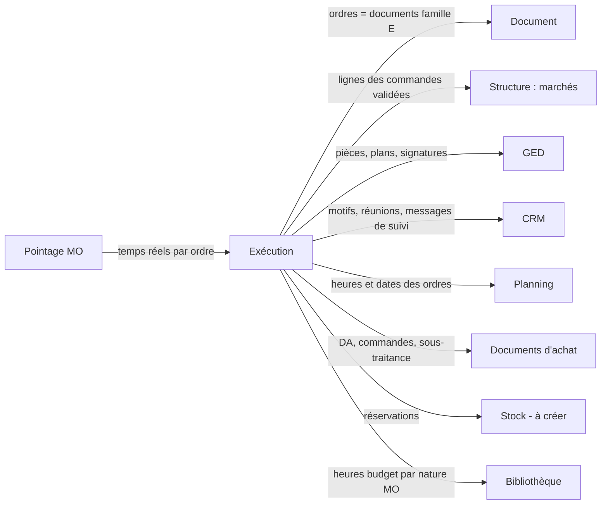

# LogiBTP – analyse du module Exécution

> Analyse préalable (20/10/2026) à partir de la note « LogiBTP - Module Exe ». Socle commun aux quatre nouveaux modules :
> [ANALYSE-MODULES-TRANSVERSE.md](ANALYSE-MODULES-TRANSVERSE.md). Modules liés : [CRM](ANALYSE-MODULE-CRM.md) ·
> [Planning](ANALYSE-MODULE-PLANNING.md) · [Pointage MO](ANALYSE-MODULE-POINTAGE.md).

> **Réalisation** : lot 1 réalisé le 22/10/2026 (`db/197`, `Btp/ExecutionBtp.cs`, `client/src/app/execution/`). Écarts : codes
> de types `E_OE`, `E_PO`, `E_DAP` ; statuts « Transmis » (envoyé) et « Pris en charge » (validé par le tiers) ; heures budget
> calculées par une vue (`v_heures_lignes`) au lieu d'une colonne `lig_heures_budget` ; état « à faire » ajouté.
> Lot 2 réalisé le 22/10/2026 (`modules/execution`, `db/198`, `pages/execution.js`) : parcours copié du modèle sur le
> chantier (modifiable), états par service calculés (`etats.js` ↔ `ReglesEtats.cs`), états imposés avec écart signalé ;
> le rapport imprimable de la synthèse reste à faire.

## 1. Objet

Suivre la **réalisation** d'un chantier, une fois la commande client validée dans un marché : qui fait quoi, dans quel
service, dans quel ordre, avec quel état et quel blocage. Deux faces :

- **La synthèse par chantier** (suivi global ou par service) : une ligne par chantier, un état par service et
  sous-service (automatique ou imposé), les responsables, le dernier message de suivi, les réunions de chantier.
- **Les ordres** : des documents de travail transmis de service en service (exécution → BE → BM → fabrication →
  colisage → livraison → pose ; ou achat, sous-traitance, SAV), qui reprennent les quantités vendues, peuvent être
  modifiés, répartis en sous-ordres, et portent les temps et les pièces.

## 2. Décision structurante proposée : un ordre est un document

Les besoins de la note sur les ordres correspondent presque point par point à ce que le module Document sait déjà
faire :

| Besoin de la note | Déjà dans le module Document / le cœur |
|---|---|
| Lignes reprises des commandes de vente d'un marché, quantité vendue toujours rattachée | Transformation (`TransformationService.TransformerPlusieurs`, « Nouveau BL » depuis le marché), liens de lignes (`document_ligne_lien`), colonnes Qté parent / Reste / Soldé |
| Modifier quantité, prix, ajouter, supprimer, changer la nature | Saisie de la grille, natures (`lig_nat_id`), bibliothèque (F3, glisser), ouvrages et composantes |
| Transfert d'un ordre vers un autre ordre | `transformation_autorisee` (cibles par type), fenêtre de transformation commune |
| Répartir les quantités dans plusieurs sous-ordres | Transformation partielle avec reste à solder, tout le reliquat, seuils de solde |
| Ordre de sous-traitance rattaché à une commande sous-traitant | Transformation vers `A_COMMANDE`, intervenants, paiement direct |
| Réservation de stock | Type `S_RESERVATION` (RS) **existe déjà** ; la demande d'approvisionnement est un nouveau type E en amont (E14) |
| Documents dans la GED | Onglet Pièces (`type_element` = code du type) |
| Poids, dimensions par ligne (colisage, livraison) | Colonnes techniques `lig_poids`, `lig_longueur`, `lig_largeur`, `lig_hauteur`, `lig_volume` (`db/165`) |
| Impression, bordereau signé | Module Édition (source document, étiquettes, codes-barres, QR codes) |
| Intervention SAV → facture | Transformation vers la facture, reprise des lignes |
| Budget planifié (E2, E16) | Prix modifiables de l'ordre d'exécution, instantanés de l'historique à la validation |
| Statuts, droits, numérotation, verrou, historique | Cycle de vie et règles des documents (`db/178`–`180`), `droit_document`, `compteur_numero` |

**Proposition** : une nouvelle **famille de documents E (exécution)**, à côté de V (ventes), A (achats) et S (stock),
avec un type par ordre (OE, BE, BM, OF, CO, LI, PO, SAV, OST, DAP, DAC), non comptables, chacun rattaché à **un seul chantier** (E4), sans TVA ni pied par défaut,
présentés par des vues de colonnes propres (quantités, heures, poids, dimensions ; prix masqués sauf droit).

Le **module Exécution** lui-même reste générique et sans dépendance au module Document (règle d'architecture) : il
porte les services, les parcours, le calcul des états, les motifs, la synthèse et les réunions. Le **cœur** fait le lien
(`SpecialisationExecutionBtp`) : il déclare les types E comme « ordres » du module, fournit leurs états et leurs heures,
et ajoute les colonnes d'exécution aux documents (`ALTER TABLE`).

Ce choix évite de réécrire une seconde chaîne documentaire et donne d'emblée la grille, les ouvrages, la bibliothèque,
le métré, la GED, l'impression et les transformations. Il demande en contrepartie quelques ajouts au module Document
(§ 6).

## 3. Synthèse fonctionnelle

### 3.1 Synthèse par chantier

- **Liste** (module Liste) : code, libellé, chargé d'affaires, conducteur de travaux, dessinateur, dernier message de
  suivi (CRM), date de fin théorique, puis **une colonne d'état par service** (et sous-service dépliable).
- **État automatique** d'un service = agrégat des ordres de ce service sur le chantier (§ 4, règle répliquée) : sans
  objet, à venir, en attente, en cours, bloqué, terminé.
- **État manuel** : l'utilisateur impose un état (pas d'ordre, intervention sans suivi…), avec motif et date ; il
  prime sur l'automatique et l'écart est signalé (pastille).
- **Vue détaillée** : tous les ordres non terminés du chantier, regroupés par service, avec leur état et leur motif.
- **Vue rapport** : ordres et tâches en alerte (bloqués, en retard sur la date prévue, sans retour d'un tiers),
  tous chantiers confondus, filtrables par service et responsable.
- **Réunions de chantier**, avec ou sans le Planning : date, participants (intervenants), points traités (notes CRM),
  tâches issues, PV par le module Édition.

### 3.2 Parcours des ordres

- On part d'un **premier ordre** (ordre d'exécution, saisi par le conducteur ou le chargé d'affaires) qui déroule le
  fonctionnement ordre par ordre.
- Pour **anticiper**, on décrit le **parcours** : les ordres utilisés et leur hiérarchie (OE → BE → BM → OF bois et OF
  métal en parallèle → colisage → livraison → pose). Un parcours modèle est choisi par chantier (ou par lot) et peut
  être ajusté ; il sert au calcul de l'état « à venir / en attente » des services qui n'ont pas encore d'ordre et au
  planning théorique.
- Un ordre bloqué peut être **renvoyé** à son parent avec un motif : tâche au service parent, qui peut alors modifier l'ordre, et tâche de relance au service qui attend (E6, E18, E19).
- Un ordre se **transforme** en totalité ou se **répartit** en sous-ordres (étalement de quantités, découpage par
  atelier), avec une codification qui rappelle le parent (`OF2026-00012.1`, `.2`).

### 3.3 Les ordres

| Ordre | Porteur | Reprend | Transfert vers | Particularités |
|---|---|---|---|---|
| Exécution (OE) | Conducteur, chargé d'affaires | Lignes des commandes validées d'un marché | Tous les ordres | Premier ordre, choix du parcours ; prix modifiables = budget planifié ; seul ordre à montrer les coefficients par nature |
| Bureau d'études (BE) | Service BE | OE | BM, OF, achat, sous-traitance, colisage, pose, DA, réservation | Conception, calcul, dessin ; lien suivi des validations (CRM) |
| Bureau des méthodes (BM) | Service BM (atelier) | BE, OE | OF, achat, sous-traitance, colisage, pose, DA, réservation | Gamme de fabrication |
| Fabrication (OF) | Un ou plusieurs services d'atelier | BE, BM, OE | Colisage, livraison | Opérations en parallèle ou à la suite |
| Colisage (CO) | Logistique | Plusieurs ordres, commandes et BL d'achat du même chantier | Livraison | Emplacement, palette, contenu, poids, dimensions |
| Livraison (LI) | Livraison interne | Plusieurs ordres, colisages, commandes et BL d'achat du même chantier | — (fin) | Poids et dimensions repris ou saisis ; tournées (plusieurs chantiers) organisées par le Planning |
| Pose (PO) | Poseurs | Tout ordre amont | — (fin) | Intervention sur chantier |
| Intervention (SAV) | Techniciens | Contrat, demande client ; toujours sur un chantier | Facture | Tablette, signature client (image, horodatage, empreinte du PDF en GED), courriel de confirmation |
| Sous-traitance (OST) | Un tiers | Tout ordre | Demande de prix, commande sous-traitant | Anticipe et suit une ou plusieurs demandes ou commandes de sous-traitance (module Sous-traitance à créer, décision C8 du CRM) |
| Demande d'approvisionnement (DAP) | Tout service | Tout ordre, ou saisie libre | Demande d'achat, réservation, sous-traitance, livraison, location, intérim | « Liste de courses » : natures diverses ou texte, orientée ensuite vers le bon service |
| Demande d'achat (DAC) | Service achat | DAP, tout ordre | DDP, commande, réservation, sous-traitance | Besoins à traiter par le service achat |
| Réservation de stock (RS) | Magasin | DAP, DAC | Sortie de stock | Type `S_RESERVATION` existant ; module Stock à venir |

## 4. Règle des états (répliquée JS ↔ C#)

Calcul de l'état d'un service sur un chantier, à partir du parcours et des ordres (jeu `modules/execution/tests/cas`) :

1. État manuel posé → il s'applique (indicateur d'écart si l'automatique diffère).
2. Service absent du parcours et sans ordre → **sans objet**.
3. Au moins un ordre bloqué (motif) → **bloqué** (priorité sur « en cours »).
4. Au moins un ordre en cours ou partiellement soldé → **en cours**.
5. Tous les ordres du service terminés et quantités soldées → **terminé**.
6. Aucun ordre, mais un service amont du parcours non terminé → **à venir** ; service amont terminé → **en attente**
   (le service doit agir).

L'état d'un ordre suit son statut documentaire (brouillon = à faire, validé = en cours, soldé = terminé, annulé) plus
un **état d'exécution** propre (`ent_exe_etat` : en attente, en cours, bloqué, terminé) et un **motif** de blocage
paramétrable (problème d'achat, pas de retour d'un tiers, conditions d'intervention non réunies, plan non visé…).

## 5. Liens avec les autres modules

| Module | Avec lui | Sans lui |
|---|---|---|
| Document, Structure, GED | Indispensables (prérequis) | — |
| CRM | Message de suivi dans la synthèse, motif de blocage → tâche au service ou au tiers, réunions et PV | Motif seul, sans tâche ; dernier commentaire de l'ordre en guise de message |
| Planning | Heures et dates des ordres → tâches à planifier ; planning théorique depuis le parcours ; dates prévues des ordres relues | Dates prévues saisies dans l'ordre |
| Pointage MO | Temps passé par ordre et par ligne (réel vs budget) | Temps saisis sur l'ordre (colonne heures réalisées) |
| Stock (à créer) | Réservation, sortie, emplacements | Réservation documentaire sans mouvement |
| Règlements | — | — |

## 6. Ajouts nécessaires au module Document et au cœur

| Ajout | Où | Remarque |
|---|---|---|
| Famille E et types d'ordres | `modules/document/db` (famille) ; cœur (types, transformations, vues, droits) | `tyd_famille` accepte E ; non comptable, sans TVA |
| Numérotation par parent (`.1`, `.2`) | Module Document (`compteur_numero`, mode `PARENT`) | Distinct des indices de révision (`ent_groupe_id`) |
| Lignes depuis plusieurs documents de familles différentes (ordres + BL d'achat d'un même chantier dans un colisage) | `TransformerPlusieurs` : aujourd'hui une famille cible ; contrôler les transformations croisées E ← A et l'unicité du chantier | À vérifier : `ControlerTransformation` |
| État d'exécution, motif, responsable, service, dates prévues | Cœur : `ent_exe_etat`, `ent_exe_motif`, `ent_srv_id`, `ent_responsable_id`, `ent_debut_prevu`, `ent_fin_prevue` | Ajoutés par `ALTER TABLE` |
| Heures par ligne | Cœur : `lig_heures_budget` (issues des composantes de nature MO), `lig_heures_realisees` (pointage) | Liaison nature MO → service (transverse § 3) |
| Emplacement, palette | Cœur ou module Stock : `lig_emplacement`, `ent_palette` | Étiquette de palette par le module Édition |
| Signature | Cœur : image + horodatage + empreinte du PDF dans la GED (sans coffre-fort), courriel de confirmation (module Mail) | Commun avec le Pointage (feuille signée) |
| Bloc « Exécution » du détail | Cœur (`PanneauxBtp` pour les types E) : budget de la ligne d'exécution, déjà réparti dans les ordres du même type, reste | E3, E17 ; coefficients par nature masqués hors OE |
| Budget planifié | Cœur : vendu / planifié / réalisé ; budget de référence figé à la première validation de l'OE, instantanés aux validations suivantes | E2, E16 |

## 7. Questions, propositions et décisions

### 7.1 Questions de la première analyse (relues le 21/10/2026)

| N° | Question | Proposition | Décision |
|---|---|---|---|
| E1 | Les ordres sont-ils des documents (famille E) ou des objets propres au module ? | Documents (§ 2). Le module Exécution garde le parcours, les états, la synthèse. | ✔ Retenue. |
| E2 | Un ordre porte-t-il des prix ? | Oui, masqués par défaut (droit « voir les prix »). Les prix valorisent un changement de nature et l'écart au budget, jamais la vente. | ✔ Retenue, complétée : les prix de l'**ordre d'exécution** se modifient pour établir un **budget planifié** (à côté du budget vendu des commandes). Voir E16. |
| E3 | Somme des sous-ordres au-delà de la quantité vendue ? | Avertissement non bloquant (`EXE_DEPASSEMENT`) ; ajout hors commande marqué « hors marché ». | ✔ Retenue, complétée : dans les ordres qui suivent l'exécution, la partie « élément » du détail est remplacée par le **budget** de la ligne de l'exécution et la **somme des quantités des ordres du même type** issus de la même ligne ; les **coefficients par nature** ne s'affichent que dans l'ordre d'exécution. Voir E17. |
| E4 | Un ordre peut-il couvrir plusieurs chantiers ? | Colisage et livraison oui, les autres non. | ✘ Autrement : **un seul chantier par ordre**, sans exception ; les livraisons groupées (tournées) sont organisées par le **Planning**. |
| E5 | Plusieurs services d'atelier : sous-ordres ou opérations ? | **Opérations** dans l'OF (service, heures prévues, état, prédécesseur). | ✔ Retenue. |
| E6 | Retour en arrière (l'atelier renvoie au BE) ? | Renvoi au parent avec motif : ordre bloqué, tâche CRM au service parent. | ✔ Retenue, complétée : une **seconde tâche** rappelle de **relancer** l'ordre bloqué, et le **service parent peut modifier** l'ordre bloqué. Voir E18, E19. |
| E7 | Qui crée le parcours et quand ? | Modèles paramétrés, choisis dans l'OE, modifiables tant que les ordres concernés n'existent pas. | ✔ Retenue. |
| E8 | Sous-services ? | Deux niveaux (service, sous-service) ; au-delà, opérations. | ✔ Retenue. |
| E9 | Saisie des temps ? | Par le Pointage (ordre et ligne) ; sans Pointage, `lig_heures_realisees` ; jamais les deux. | ✔ Retenue. |
| E10 | Changement de nature : effet sur le marché ? | Aucun sur la vente ; tracé ; comparé au budget dans la rentabilité. | ✔ Retenue. |
| E11 | Réunions de chantier ? | Objet réunion dans l'Exécution, points et tâches en notes CRM. | ✔ Retenue. |
| E12 | Signature du client (SAV) ? | Signature capturée + horodatage + empreinte du PDF au coffre-fort de la GED. | ✘ Autrement : signature capturée (image), horodatage et empreinte du PDF rangés **dans la GED, sans le coffre-fort**, et **courriel de confirmation** envoyé au client. Voir E22. |
| E13 | SAV sans chantier ? | Chantier « SAV / entretien » créé automatiquement, à valider. | ✔ Un ordre de SAV est **toujours rattaché à un chantier** (adresses, client, historique du chantier). Voir E20. |
| E14 | Demande d'approvisionnement : DA du stock ou nouveau type ? | Réutiliser `S_DEMANDE` (DA). | ✘ Autrement : la **demande d'approvisionnement** est un ordre **en amont** de la demande d'achat : une « liste de courses » libre (lignes de natures diverses ou simple texte), **transformée** ensuite pour orienter chaque besoin vers le bon service ou le bon ordre. Voir E21. |
| E15 | Désactivation du module ? | Types E masqués, ordres existants consultables en lecture seule. | ✘ Autrement : un module se désactive plutôt **à l'initialisation du dossier** ; les documents restants sont des essais : **tout est masqué**, listes comprises. Voir E24. |

### 7.2 Questions de la deuxième lecture (décidées le 21/10/2026)

| N° | Question | Proposition | Décision |
|---|---|---|---|
| E16 | Budget planifié (E2) : que contient-il, qui le modifie, garde-t-il un historique ? | Le budget planifié = les lignes de l'ordre d'exécution valorisées (quantités, prix de revient, heures par nature), modifiables par le conducteur ou le chargé d'affaires (droit « budget ») ; trois colonnes partout où l'on compare : **vendu** (commandes), **planifié** (ordre d'exécution), **réalisé** (ordres, achats, pointages). Un instantané du budget planifié est gardé à chaque validation de l'ordre d'exécution (historique des versions, comme les documents). Budget de référence figé à la première validation. | ✔ Retenue, avec un **budget de référence** figé à la première validation de l'ordre d'exécution pour mesurer les dérives. |
| E17 | Bloc « Exécution » du détail des ordres suivants (E3) : contenu exact ? | Pour la ligne sélectionnée : ligne d'origine de l'exécution (libellé, quantité, unité), budget planifié (montant, heures), quantités déjà réparties dans les ordres du **même type** issus de cette ligne (somme, reste, nombre d'ordres, lien vers eux), écart signalé en rouge (dépassement `EXE_DEPASSEMENT`). Mêmes informations en colonnes facultatives de la grille (Qté exécution, Déjà réparti, Reste). Les coefficients par nature (et la marge) restent dans l'ordre d'exécution seulement. | ✔ Retenue. |
| E18 | Tâche de relance d'un ordre renvoyé (E6) : pour qui, quand ? | Au service qui a renvoyé l'ordre (celui qui attend), échéance = date du renvoi + délai paramétrable (par défaut 3 jours ouvrés), terminée d'office au déblocage de l'ordre ; la tâche du service parent est terminée en même temps. | ✔ Retenue. |
| E19 | Modification d'un ordre bloqué par le service parent (E6) : quelles limites ? | Tant que l'ordre est bloqué par un renvoi, les membres du service parent le modifient (lignes, pièces, commentaire) comme son service propriétaire ; « Débloquer » rend la main au service propriétaire (tracé dans l'historique). | ✔ Retenue. |
| E20 | SAV rattaché à un chantier (E13) : créer un chantier pour une première intervention chez un particulier ? | À la création du SAV, choix du chantier du client ; s'il n'en a pas, création rapide d'un chantier « Entretien et dépannage » pré-rempli (client, adresse) — comme la proposition de chantier à la validation d'une commande ; un contrat d'entretien aura plus tard son propre chantier. | ✔ Retenue. |
| E21 | Demande d'approvisionnement (E14) : quel type, quelles transformations, lignes texte ? | Nouveau type E « Demande d'approvisionnement » (DAP), saisi par tout service ; lignes d'éléments, d'ouvrages ou de **texte** (besoin décrit) ; transformée en demande d'achat (DAC), réservation de stock, ordre de sous-traitance, livraison, location ou intérim. Une ligne texte se transforme telle quelle (le service destinataire la remplace par un élément). Le type existant `S_DEMANDE` (libellé aujourd'hui « Demande d'approvisionnement ») est renommé « Demande de stock » pour éviter la confusion. | ✔ Retenue (`S_DEMANDE` renommé « Demande de stock »). |
| E22 | Courriel de confirmation du SAV (E12) : sans module Mail ? | Le module Mail est un prérequis de l'envoi ; avant lui, le bon signé (PDF en GED) s'imprime ou se télécharge, et la pièce est marquée « à envoyer » (`dge_a_envoyer`). | ✘ Pas de solution d'attente : la confirmation par courriel du SAV **attend le module Mail**. |
| E23 | Calendrier des possibilités sans temps donné (rentabilité continue, contrats d'entretien, autocontrôles) ? | Rentabilité continue : premier temps (lot 6, avec le Pointage) ; autocontrôles : second temps (liste paramétrable par type d'ordre, surchargée sur l'ordre) ; contrats d'entretien : second temps (avec le Planning). | ✔ Retenue. |
| E24 | Désactivation « tout masqué » (E15) : même règle pour tous les modules facultatifs ? | Oui : un module désactivé masque ses menus, ses onglets et ses données dans les listes (documents de la famille E filtrés de `v_liste_documents`, notes du CRM absentes des onglets) ; la page des modules le rappelle avant de désactiver. Règle à reporter dans l'analyse transverse (§ 3). | ✔ Retenue : règle commune à tous les modules facultatifs (à appliquer aussi au CRM et aux Règlements). |

Toutes les questions de l'Exécution sont tranchées (E1 à E24).

## 8. Faisabilité

**Faisable**, à condition de s'appuyer sur le module Document (§ 2). Effort principal :

- **Paramétrage** des types E, transformations, vues de colonnes, droits, modèles d'édition : volumineux mais sans
  risque technique (même mécanique que les types V / A / S).
- **Parcours et calcul des états** : règle nouvelle, à répliquer JS ↔ C# avec un jeu de cas (affichage hors ligne sur
  tablette, calcul serveur pour les listes).
- **Synthèse à colonnes dynamiques** (une colonne par service) : le module Liste a des colonnes fixes par source ;
  options : vue SQL générée à partir du référentiel des services (comme `generer-vues-liste`) ou colonne JSONB d'états
  avec rendu par clé. Recommandé : colonne JSONB `etats` + colonnes déclarées par service dans la source (point
  d'accroche du module Liste à ajouter).
- **Opérations d'OF** : sous-table des lignes (ou lignes de type « opération » sans prix), à arbitrer avec le module
  Document (type de ligne nouveau vs table propre au cœur). Recommandé : table `ordre_operation` du cœur, liée à
  l'entête, pour ne pas toucher aux moteurs de calcul.
- **SAV sur tablette** : relève de l'application mobile commune (transverse § 6) ; la page document actuelle n'est pas
  faite pour un écran tactile : un écran simplifié est nécessaire.

**Risques** : complexité perçue (trop de types d'ordres pour une petite entreprise : prévoir l'activation par type),
performances de la synthèse (agrégats par chantier et service : vue matérialisée ou table d'états tenue par trigger
à la validation des ordres), cohérence des quantités entre commande, ordres et sous-ordres (s'appuyer sur les restes
déjà calculés par `RecalculerLiens`).

## 9. Simplification d'utilisation

Toutes retenues le 21/10/2026.

- **Types d'ordres activables un par un** : une PME de pose n'active que OE, PO et DA ; un menuisier industriel tout.
- **Assistant « Lancer le chantier »** depuis la fiche du marché : choix du parcours, sélection des lignes (toutes par
  défaut), création de l'OE et des premiers ordres en un écran.
- **Transfert en masse** : sélection de lignes dans l'ordre → « Envoyer à… » (service ou tiers) ; les lignes non
  envoyées restent visibles comme reste.
- **Synthèse cliquable** : un clic sur un état ouvre les ordres du service ; un clic droit pose un état manuel.
- **Motif obligatoire pour bloquer** avec destinataire proposé (service fournisseur du motif) : la tâche CRM se crée
  seule.
- **Code-barres / QR code** sur les ordres, colis et palettes (module Édition) : la tablette ouvre l'ordre ou valide le
  chargement par lecture.
- **Vue « Ma file »** par service : ordres en attente du service, triés par date prévue, avec le planning à côté.
- **Modèles de parcours** fournis (menuiserie, métallerie, gros œuvre, SAV) à adapter, et modèles créés dans le paramétrage.

## 10. Possibilités non encore explorées

Calendrier décidé le 21/10/2026 (E23).

| N° | Possibilité | Quand |
|---|---|---|
| 1 | **Rentabilité de chantier en continu** : vendu / planifié (E16) / engagé (commandes d'achat, ordres de sous-traitance) / réalisé (pointages valorisés, BL et factures d'achat) / reste à dépenser, par service et par nature. | Premier temps (lot 6) |
| 2 | **Nomenclature et débit** : besoins matière d'un OF depuis les composantes d'ouvrage, demande d'approvisionnement du manquant ; optimisation de débit en module tiers. | Troisième temps |
| 3 | **Traçabilité des colis** : chaque colis scanné au chargement et au déchargement (preuve de livraison, photo). | Second temps |
| 4 | **Contrats d'entretien** : SAV récurrent généré automatiquement (périodicité, équipements du client), alimentant le planning. | Second temps |
| 5 | **Contrôle qualité / autocontrôles** : liste de points paramétrable par type d'ordre, **surchargeable sur l'ordre**, fiche signée, non-conformités vers le CRM. | Second temps |
| 6 | **Tableau d'atelier** (écran TV) : ordres du jour par poste, état en temps réel. | Second temps |
| 7 | **Portail sous-traitant** : OST consultable, accusé de réception en ligne, dépôt des attestations. | Troisième temps |
| 8 | **Indicateurs** : délai moyen par service, taux de blocage par motif, respect des dates prévues. | Second temps |

## 11. Esquisse du modèle de données

Module Exécution (`modules/execution/db`, générique) :

| Table | Colonnes principales |
|---|---|
| `exe_parcours_modele` | `pam_id`, `pam_code`, `pam_libelle`, `pam_actif` |
| `exe_parcours_etape` | `pae_id`, `pae_pam_id`, `pae_srv_id`, `pae_type_ordre`, `pae_parent_id` (hiérarchie), `pae_ordre`, `pae_parallele` |
| `exe_parcours` | parcours instancié par élément (`type_element`, `id_element`) : copie modifiable des étapes |
| `exe_motif` | `mot_code`, `mot_libelle`, `mot_srv_id` (service à prévenir), `mot_actif` |
| `exe_etat_manuel` | `etm_type_element`, `etm_id_element`, `etm_srv_id`, `etm_etat`, `etm_motif`, `etm_par`, `etm_le` |
| `exe_etat` | état calculé par élément et service (table tenue par le serveur, lue par la synthèse) |
| `exe_reunion` | `reu_id`, élément, `reu_date`, `reu_lieu`, `reu_participants` (JSONB), `reu_dge_pv_id` |
| `exe_renvoi` | `ren_id`, ordre (`type_element`, `id_element`), service parent, motif, tâches (parent, relance), `ren_le`, `ren_debloque_le` (E6, E18, E19) |
| `exe_autocontrole` | listes de points par type d'ordre, surcharges par ordre (second temps) |

Cœur (`db/2xx`) : types de la famille E (dont DAP ; `S_DEMANDE` renommé « Demande de stock »), `ent_exe_*`, `lig_heures_*`, budget planifié (instantanés de l'OE), `ordre_operation` (`opr_id`, `opr_ent_id`,
`opr_srv_id`, `opr_libelle`, `opr_heures`, `opr_etat`, `opr_prec_id`), vues `v_liste_ordres`, `v_synthese_chantiers`.

## 12. Découpage en lots

| Lot | Contenu | Prérequis |
|---|---|---|
| 0 | Activation, référentiel des services (sous-services), liaison nature MO → service | Transverse lots 0–1 |
| 1 | Famille E (un chantier par ordre), types OE / PO / DAP (`S_DEMANDE` renommé « Demande de stock »), transformations depuis le marché, état d'exécution et motif, liste des ordres, budget planifié et budget de référence de l'OE, bloc « Exécution » du détail | Lot 0 |
| 2 | Parcours (modèles, instanciation), règle des états (jeu de cas), synthèse par chantier, vues détail et rapport | Lot 1 |
| 3 | BE, BM, OF avec opérations, numérotation par parent, renvoi au parent (tâches au parent et de relance, modification par le parent) | Lot 2 ; CRM |
| 4 | Colisage, livraison (plusieurs sources d'un même chantier), étiquettes de palette | Lot 3 ; tournées : Planning |
| 5 | SAV sur tablette (chantier obligatoire, création rapide), signature en GED, bordereau, facture ; sous-traitance, demande d'achat | Lot 1 ; application mobile |
| 5b | Courriel de confirmation du SAV (bon signé) | Module Mail (aucune solution d'attente, E22) |
| 6 | Réunions de chantier (CRM, Planning), rentabilité continue (vendu / planifié / réalisé) | CRM lot 1 ; Pointage lot 3 |
