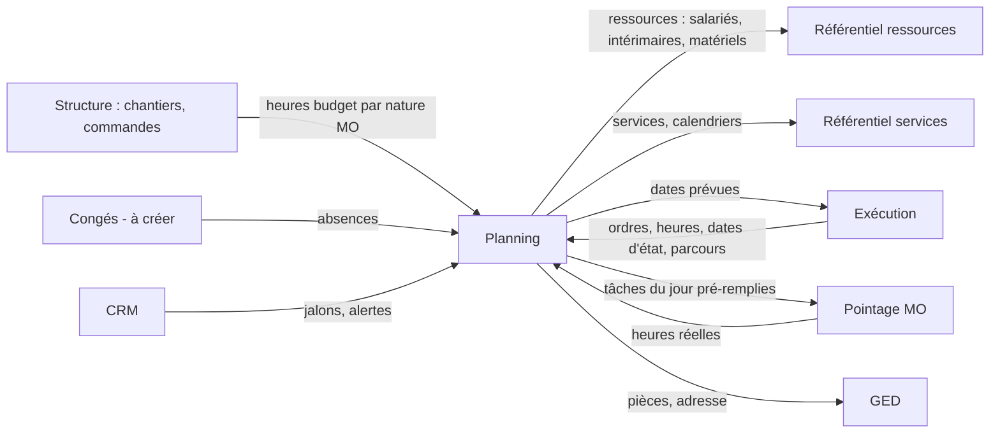

# LogiBTP – analyse du module Planning

> Analyse préalable (20/10/2026) à partir de la note « LogiBTP - Module Planning ». Socle commun aux quatre nouveaux
> modules : [ANALYSE-MODULES-TRANSVERSE.md](ANALYSE-MODULES-TRANSVERSE.md). Modules liés : [CRM](ANALYSE-MODULE-CRM.md) ·
> [Exécution](ANALYSE-MODULE-EXECUTION.md) · [Pointage MO](ANALYSE-MODULE-POINTAGE.md).

> **Réalisation** : lot 1 réalisé le 22/10/2026 (`modules/planning/js`, prototype `/planning/prototype`) : rendu DOM
> positionné et virtualisé ; sur 500 ressources, 3 mois et 20 000 tâches, chargement des données en 12 ms et dessin
> d'une vue en 2 ms.

## 1. Objet

Planifier **à plusieurs, vite et visuellement** les tâches des chantiers et des services sur des ressources (équipes,
salariés, intérimaires, matériels, locations, sous-traitants), en voyant à tout moment la **capacité**, le **planifié**
et le **disponible** par service, et en remontant les **incohérences** dans une vue de notifications.

Deux modes :

- **Théorique** : tâche rattachée à un service, sans ressource ; sert au planning de charge et aux dates de début /
  fin par service d'un chantier.
- **Fonctionnel** : tâche affectée à des ressources ; sert à l'organisation quotidienne (atelier, pose, livraison).

Le planning fonctionne en **capacité infinie** : il autorise la sur-affectation et la signale, il ne la refuse jamais.

## 2. Synthèse fonctionnelle

### 2.1 Affichage

- Période en colonnes, lignes = regroupement choisi par la vue (affaire / chantier, équipe, ressource, service,
  ordre d'exécution…), tâches en barres ; mixte **Gantt** (vue chantier, période longue) et **agenda** (vue ressources,
  heure ou demi-journée).
- Pas d'affichage : heure, demi-journée, jour, semaine ; période : jour, semaine, mois, début / fin, **flottante** (par
  exemple deux semaines avant et quatre après aujourd'hui).
- Zoom par la largeur des colonnes et la hauteur des lignes ; hauteur fixe ou adaptée au nombre de tâches superposées.
- Même donnée, plusieurs niveaux de détail : l'atelier et la pose par jour et ressource ; le chantier en global avec
  les dates de début et fin de chaque service.
- Rendu de la tâche selon la vue (vue équipe : chantier + titre ; vue chantier : titre + ressources sur plusieurs
  lignes).
- **Panneau ancrable à droite** (détachable dans une autre fenêtre) : tâches à planifier et ressources utilisables,
  avec le rapport d'heures (budget, planifié, reste à planifier, réel, écarts).
- **Vues personnelles** : chantiers choisis à la main, ressources choisies (livreur, engins, sous-traitants), filtres
  (service, type de ressource, affaire / chantier, conducteur, ressource).
- **Couleurs par règles** : par type de chantier, chargé d'affaires, type de ressource, service, ou couleur propre de
  la tâche. **Pastilles d'état** (option, urgent, validé…).
- **Jalons** : livraisons, fins de chantier ou d'ordre, alertes CRM, prochaines interventions.

### 2.2 Manipulations

Glisser-déposer, déplacer, agrandir, copier, **scinder**, réaffecter (changer de ressource, en ajouter), pas de
15 minutes par défaut, saisie précise des dates-heures de début et de fin.

### 2.3 Tâches

- Toujours rattachée à un **chantier** (ou projet en théorique) et à un **service**.
- Origine : chantier (commandes validées : global, commande / avenant, tranche, ouvrage), ordre d'exécution (heures par
  ordre, planning théorique depuis les dates d'état), congés, tâches administratives (réunion, formation, rendez-vous
  médical).
- Partie planning : libellé, mémo, avancement théorique, couleur, état. Partie mobile : adresse, contact, commentaire,
  pièces de la GED, liens.
- **Composition propre** : une ou plusieurs équipes, intérimaires, engins… sans modifier la composition de l'équipe.
- **Tâches liées** à une tâche principale (l'intérimaire du mercredi matin dans la tâche de l'équipe du lundi au
  vendredi) : déplaçables indépendamment, alerte si elles sortent de la période de la principale.
- **Dépendances** fin → début ou début → début, en jours calendaires (séchage) ou ouvrés (intervention d'un sous-traitant), fixes (propagées) ou d'alerte (21 jours de séchage, compressible) (P9).
- **Tâches répétitives** (absences, réunions).

### 2.4 Modes de calcul

| Mode | Saisi | Calculé |
|---|---|---|
| 1 (défaut) | Début, nombre d'heures, ressources | Fin |
| 2 | Début, ressources, fin | Nombre d'heures |
| 3 (charge) | Début, nombre d'heures, nombre de ressources, fin | Ventilation théorique des heures par jour ouvré |

### 2.5 Capacité et calendriers

- **Capacité** = heures produites par les ressources − absences ; **planifié** = heures des tâches théoriques ou des
  ressources utilisées ; **disponible** = différence ; regroupés par service ; à l'heure en affichage jour, au jour en
  affichage semaine.
- **Horaires** : plages (début, fin, coupure de midi) donnant les heures par jour ; semaine classique ou **cycle de N semaines**
  à partir d'une date de référence (P13), ou par période ; définis au service, surchargés par ressource ; jours fériés
  et périodes de fermeture (P12, P22).

### 2.6 Équipes

- Gérées dans le planning, compositions **datées** (périodes souples), jamais supprimées (mises en sommeil) ; une tâche garde la copie de la composition et le lien vers l'équipe (P7).
- Un changement de composition propose de l'appliquer aux tâches déjà planifiées, avec recalcul des heures ou de la
  date de fin selon le mode de chaque tâche.

### 2.7 Notifications

Vue filtrable : sur-occupation, sous-occupation, délai non respecté, dépendance violée, tâche liée hors période,
messages des services (livraison décalée, fabrication interrompue…).

## 3. Liens avec les autres modules

| Module | Avec lui | Sans lui |
|---|---|---|
| Structure, Annuaire | Chantiers, adresses, contacts, conducteur (prérequis) | — |
| Référentiels services / ressources (transverse) | Prérequis | — |
| Exécution | Tâches depuis les ordres, planning théorique depuis le parcours, dates relues par l'ordre | Tâches depuis les commandes du chantier ou libres |
| Pointage MO | Pointages pré-remplis depuis le planning ; heures réelles dans le rapport | Colonne réel vide |
| Congés (à créer) | Absences importées, capacité exacte | Absences saisies en tâches répétitives |
| CRM | Jalons (rappels, visas attendus), message de suivi | Pas de jalons CRM |
| Bibliothèque | Heures budget par composantes de nature MO (unité heure), service par nature | Heures saisies à la main |

## 4. Questions, propositions et décisions

| N° | Question | Proposition | Décision (21/10/2026) |
|---|---|---|---|
| P1 | « Nombre d'heures » : heures de travail cumulées (homme × heure) ou durée calendaire ? | Heures **de travail cumulées** (comme le budget MO). Mode 1 : fin = début + heures / somme des capacités horaires des ressources, en suivant leurs calendriers. Une ressource matérielle n'ajoute pas de capacité de travail (elle est occupée). | ✔ Heures **de travail** (cumulées). |
| P2 | Ressources aux calendriers différents dans une même tâche ? | La tâche avance au rythme cumulé des calendriers ; une ressource absente un jour ne contribue pas ce jour-là. Recalcul quand une absence est posée (proposition, pas d'office). | ✔ Précisé : le calcul part de la **date de début**, sans tenir compte des autres tâches **sauf les tâches d'absence** des ressources, puis applique les règles de calcul (calendriers, mode de la tâche). |
| P3 | Une tâche théorique peut-elle devenir fonctionnelle ? | Oui : affecter une ressource à une tâche théorique la rend fonctionnelle ; la charge théorique du service est remplacée par celle des ressources. Une tâche théorique non affectée reste visible dans la charge. | ✔ Retenue. |
| P4 | Capacité des sous-traitants, locations, ressources théoriques ? | Pas de capacité (infinie) sauf saisie d'un plafond ; ils apparaissent dans la vue mais pas dans le disponible du service. | ✔ Retenue. |
| P5 | Matériel « par nombre » (échafaudage, banches) ? | Capacité en **unités** et non en heures : le planifié est la somme des quantités affectées par jour, alerte au-delà du stock ; affichage propre (histogramme de quantité). | ✔ Les deux : l'affectation garde les **heures d'utilisation** et le **nombre d'unités** ; le planning calcule les unités utilisées par jour et **avertit** au-delà de la quantité disponible. |
| P6 | Ressource rattachée à plusieurs services ? | Un service principal (capacité) et des services secondaires (affectables) ; la capacité n'est comptée que dans le principal. | ✔ Retenue. |
| P7 | Composition d'équipe : la tâche référence l'équipe ou une copie ? | La tâche référence l'équipe **et** garde la liste effective de ses ressources (instantané) ; le changement de composition compare l'instantané à la nouvelle composition et propose la mise à jour tâche par tâche (ou toutes). | ✔ La tâche **garde une copie** de la composition **et le lien** vers l'équipe (son identifiant). |
| P8 | Tâches liées et scission : même objet ? | Non. Scinder = découper une tâche en deux tâches indépendantes (reste rattachées à la même origine). Tâche liée = tâche fille (`tac_parent_id`) avec sa propre période et ses ressources, contrainte d'inclusion en alerte. Les deux sont faisables. | ✔ Retenue. |
| P9 | Dépendances : types et unité du décalage ? | Fin → début, début → début, fin → fin ; décalage en jours **calendaires** (séchage) ou **ouvrés** (au choix) ; mode fixe (propagation à la tâche suivante, en cascade, avec aperçu) ou alerte (décalage minimal, compressible avec confirmation). Les dépendances circulaires sont refusées. | ✔ Dépendances **fin → début** ou **début → début** (pas de fin → fin) ; jours **calendaires** (séchage…) ou **ouvrés** (intervention d'un sous-traitant…) choisis sur chaque dépendance. |
| P10 | Synchronisation « rapide » à plusieurs : quel niveau ? | Temps réel : chaque modification est envoyée au serveur puis diffusée aux autres utilisateurs de la même base (SignalR, groupe par base et période). Verrou optimiste par tâche (numéro de version) ; conflit = la seconde modification est refusée et la tâche rechargée avec un message. Pas de verrou du planning entier. | ✔ Temps réel par défaut, mais l'utilisateur peut, pour éviter les traitements longs, **mettre la synchronisation en pause**, **allonger l'intervalle** entre deux synchronisations ou passer en **synchronisation manuelle** (préférence du navigateur) ; le verrou optimiste protège toujours les écritures. |
| P11 | Les règles de calcul sont-elles répliquées JS ↔ C# ? | Oui (convention du projet) : calcul de fin / d'heures / ventilation selon calendriers, propagation des dépendances, capacité. Le client calcule pendant le glisser (réactivité), le serveur recalcule et fait foi (changement de composition, dates d'un ordre, absence importée). Jeu `modules/planning/tests/cas`. | ✔ Retenue. |
| P12 | Jours fériés ? | Calendrier des jours fériés par société (France métropolitaine, Alsace-Moselle, outre-mer), calculé (Pâques) et complétable ; ponts saisis en absences collectives. | ✔ Liste **complète pour la France** proposée, à choisir et compléter ; un jour se définit par une date unique (AAAAMMJJ), une date annuelle (MMJJ) ou une **règle** (« 1er jeudi de septembre »…) ; **périodes de fermeture** aussi. Voir P22. |
| P13 | Horaires : semaine sur deux, par période — référence de parité ? | Semaine ISO paire / impaire, ou cycle de N semaines à partir d'une date de référence (plus général : 4×10 h, équipes alternantes). | ✔ **Cycle de N semaines** à partir d'une date de référence. |
| P14 | Qu'est-ce qui déclenche une notification de sous-occupation ? | Disponible > seuil (paramétrable par service, en % de la capacité) sur la période affichée ; calculée à la demande, pas stockée. Les autres notifications sont stockées avec un état (vue, traitée) pour ne pas réapparaître. | ✔ Retenue. |
| P15 | Dates d'un ordre d'exécution et tâches : qui fait foi ? | Le planning fait foi pour les dates prévues des ordres planifiés (`ent_debut_prevu`, `ent_fin_prevue` mis à jour) ; un ordre non planifié garde ses dates saisies. | ✘ Autrement : les ordres **proposent** des dates et des tâches au planning ; une date modifiée dans le planning remonte à l'ordre comme **proposition de modification** (la date la plus ancienne des tâches), que l'utilisateur accepte ou non (une tâche terminée peut laisser du rangement, du démontage…). |
| P16 | Granularité de l'origine « chantier » (global, commande, tranche, ouvrage) : comment éviter de planifier deux fois les mêmes heures ? | Chaque tâche consomme des heures d'une **origine** (`tac_origine` : chantier, commande, tranche, ligne, ordre) ; le reste à planifier d'une origine = budget − heures des tâches qui la consomment, elle et ses descendants. Avertissement si une même heure est consommée à deux niveaux. | ✔ **Avertir sans bloquer** et proposer les heures restantes (budget − planifié) ; une tâche peut être replanifiée après une non-conformité, une erreur, une mauvaise estimation… |
| P17 | Le panneau détaché dans une autre fenêtre : faisable ? | Oui : le glisser-déposer entre fenêtres (HTML5) existe déjà pour la bibliothèque vers le document ; la diffusion entre fenêtres (`app.publier`, canal `logibtp-fenetres`) synchronise la sélection. | ✔ Retenue, avec le choix de garder le panneau **dans la même fenêtre** (ancré) ou de le détacher dans une autre. |
| P18 | Congés : module à part ? | Oui (module Congés / absences, à cadrer) ; en attendant, tâches répétitives d'absence saisies dans le planning, avec type d'absence (congé, maladie, formation, intempérie). | ✔ Module Congés à part, **lié** au planning. Voir P23. |

## 5. Faisabilité

**Faisable, mais c'est le module le plus lourd côté interface.** Trois chantiers techniques :

### 5.1 Composant d'affichage

- Besoins : grille à deux axes virtualisée (milliers de ressources × centaines de colonnes), barres déplaçables au pas
  de 15 minutes, superposition, rendu variable par vue, zoom, panneau, mixte Gantt / agenda.
- Options : bibliothèque du commerce (riche mais licence par développeur et dépendance lourde), bibliothèque libre
  (trop limitée pour la capacité, les tâches liées et les vues multiples), **composant propre** sur le socle (comme
  `GrilleArbre` et `VueGraphe`). **Recommandé : composant propre** dans un module `planning` sans métier (axe temps,
  lignes, barres, glisser, virtualisation, rendu par méthode patron), spécialisé par le cœur. Rendu DOM positionné
  absolu avec virtualisation (lignes et colonnes visibles seulement) ; canvas seulement pour les histogrammes de charge.
- Estimation : le plus gros poste (plusieurs semaines) ; à prototyper en premier (lot 1) sur un volume réaliste
  (500 ressources, 3 mois, 20 000 tâches).

### 5.2 Calcul

- Calendriers (plages, cycles, fériés, surcharges), mode de calcul, dépendances, capacité : règles nouvelles,
  **répliquées JS ↔ C#** avec jeu de cas (decimal.js pour les heures, pas de `Number` pour les cumuls d'heures
  valorisés).
- Capacité calculée à la demande par service et période (requête SQL agrégée côté serveur, mise en cache par base et
  période, invalidée par la diffusion temps réel).

### 5.3 Temps réel

- SignalR (ASP.NET Core) : hub par base de société (`SocieteCourante.Base`), groupes par période / vue ; messages
  « tâche modifiée / supprimée », « capacité à recalculer ».
- Nouveau dans le projet (aujourd'hui la diffusion n'existe qu'entre fenêtres d'un même navigateur) ; servira aussi au
  fil d'actualité du CRM et à la synthèse de l'Exécution.
- Réglage de l'utilisateur (navigateur, P10) : temps réel, intervalle allongé (30 s, 1 min, 5 min), pause ou synchronisation
  manuelle (bouton ⟳) ; une écriture reste contrôlée par le verrou optimiste quel que soit le réglage.

**Risques** : performance du rendu, propagation en cascade des dépendances (limiter la profondeur, aperçu avant
application), conflits multi-utilisateurs, ergonomie (trop d'options visibles : réglages par vue, vues fournies),
dépendance au référentiel des ressources (aujourd'hui tables de démonstration `demo_salarie`, `demo_equipe`,
`demo_materiel` : à remplacer, transverse § 4).

## 6. Simplification d'utilisation

Retenues le 21/10/2026 (impression au second temps, vue en consultation ajoutée).

- **Planifier par glisser** depuis le panneau « à planifier » sur une ligne de ressource : début = point de dépôt,
  heures = reste à planifier, fin calculée ; **Ctrl** = copier (décision du 21/10/2026), Alt = scinder à l'endroit du clic.
- **Vues fournies** prêtes à l'emploi : « Atelier par jour », « Pose par semaine », « Chantiers (Gantt) », « Charge par
  service », « Livraisons » ; l'utilisateur part d'une vue et l'enregistre (comme les vues de liste).
- **Planning théorique automatique** depuis le parcours de l'Exécution : une tâche par service, enchaînées par des
  dépendances, durées tirées des heures budget ; il ne reste qu'à ajuster.
- **Proposition de créneau** : malgré la capacité infinie, bouton « Premier créneau libre » pour une ressource ou un
  service.
- **Raccourcis clavier** déclarés dans un groupe `planning` (`declarerRaccourcis`) : flèches = déplacer d'un pas,
  Maj+flèches = agrandir, Suppr, Ctrl+D = dupliquer, Ctrl+X/V = déplacer vers une autre ressource.
- **Annuler / rétablir** sur les dernières opérations (essentiel pour un outil de glisser-déposer).
- **Barre de capacité** sous chaque service, colorée (vert / orange / rouge), cliquable pour filtrer les tâches.
- **Notifications groupées** par type et par chantier, avec action directe (aller à la tâche, appliquer la proposition).
- **Vue en consultation** (décision du 21/10/2026) : la vue courante en lecture seule, à partager par son adresse, pour
  éviter les impressions (voir P20).
- **Impression** de la vue courante par le module Édition (PDF paysage, une ressource par page en option) et envoi aux
  équipes : second temps.

## 7. Possibilités non encore explorées

Calendrier décidé le 21/10/2026 (dont P21).

| N° | Possibilité | Quand |
|---|---|---|
| 1 | **Scénarios** : planning de travail (brouillon) comparé au planning en vigueur, puis publié ; **planning de référence** (figé à la signature) pour mesurer les dérives. | Second temps |
| 2 | **Compétences et habilitations** (CACES, travail en hauteur, électricité, SST, visites médicales) avec dates de validité. **Gérées dans les fiches salarié et matériel (engin)**, lues par le planning pour la recherche de créneaux et les alertes, et par la saisie de la main-d'œuvre (Pointage). | Premier temps (P19) |
| 3 | **Temps de trajet** entre chantiers (géocodage, API adresse nationale) : trajet affiché, enchaînement impossible signalé, zones de déplacement du Pointage. | Second temps |
| 4 | **Intempéries** : journée « intempérie » sur un chantier (tâches décalées, heures d'intempérie du Pointage, déclaration à la caisse des congés intempéries). | Second temps (avec le Pointage) |
| 5 | **Partage en lecture** (client, sous-traitant, lien signé) et export iCalendar par ressource. | Troisième temps |
| 6 | **Planning des matériels** : réservation des engins et locations, retour au dépôt, coût de location prévisionnel. | Premier temps (lot 2) |
| 7 | **Lissage de charge** assisté : décaler les tâches non contraintes pour résorber une sur-occupation. | Second temps |
| 8 | **Mode affichage atelier** (écran TV, temps réel, sans interaction). | Second temps |
| 9 | **Tournées de livraison** : enchaînement des livraisons d'une journée par proximité, poids et volume des ordres de livraison comparés à la charge utile du véhicule. **Nécessaire** : un ordre de livraison ne couvre qu'un chantier (décision E4 de l'Exécution), les livraisons groupées sont des tournées du planning. | Premier temps (lot 6) |
| 10 | **Avancement réel** saisi par le chef d'équipe sur mobile (pourcentage), comparé à l'avancement théorique et aux situations de travaux. | Second temps (application mobile) |

### 7.1 Points de la relecture du 21/10/2026

| N° | Question | Proposition | Décision |
|---|---|---|---|
| P19 | Habilitations dans les fiches salarié et matériel : où les stocker, comment le planning s'en sert ? | Table d'habilitations du référentiel des ressources (transverse § 4.2) : type paramétrable (CACES R482 cat. A, travail en hauteur, B1V, SST, visite médicale…), date d'obtention, fin de validité, pièce en GED ; saisie dans un onglet des fiches salarié et matériel ; une tâche peut exiger des habilitations (`tac_habilitations`) : « Premier créneau libre » ne propose que les ressources habilitées, une affectation sans habilitation valable à la date de la tâche lève une notification ; la saisie de la main-d'œuvre signale une habilitation expirée. Premier temps (lot 4, avec les notifications). | ✔ Retenue. |
| P20 | Vue en consultation : pour qui, et quoi de plus qu'une vue enregistrée ? | Toute vue s'ouvre en consultation (`/planning?vue=&consultation=1`) : pas de glisser ni de saisie, panneau masqué, rafraîchie en temps réel, partageable par son adresse aux utilisateurs connectés (droit « consulter le planning », par exemple les chefs d'équipe) ; plein écran possible (préfigure le mode atelier). Premier temps (lot 3, avec le temps réel). | ✔ Retenue. |
| P21 | Temps des possibilités acceptées sans période (trajets, intempéries, matériels, lissage, tournées, avancement réel) ? | Premier temps : matériels (lot 2) et tournées (lot 6) ; second temps : trajets, intempéries (avec le Pointage), lissage, avancement réel (mobile). | ✔ Retenue. |

### 7.2 Points de la troisième lecture (décidés le 21/10/2026)

| N° | Question | Proposition | Décision |
|---|---|---|---|
| P22 | Jours fériés et fermetures (P12) : quelles règles, et à quel niveau ? | Règles : date unique (AAAAMMJJ), date annuelle (MMJJ), n-ième ou dernier jour de semaine d'un mois (« 1er jeudi de septembre », « dernier lundi de mai »), date relative à Pâques (lundi de Pâques +1, Ascension +39, lundi de Pentecôte +50) ; calcul répliqué JS ↔ C# (jeu de cas). Liste proposée : jours fériés nationaux, Alsace-Moselle (Vendredi saint, 26 décembre) et outre-mer (abolition de l'esclavage par département), à cocher. Fériés et périodes de fermeture définis pour la société, avec surcharge par service (fermeture de l'atelier en août) et par calendrier. | ✔ Retenue. |
| P23 | Lien Congés ↔ Planning (P18) : dans quel sens ? | Le module Congés porte les demandes et leur validation ; une absence validée devient une tâche d'absence du planning (lecture seule, ressource indisponible) ; une absence posée dans le planning (réunion, formation, rendez-vous) reste une tâche du planning ; une demande de congé faite depuis le planning ouvre le module Congés. Sans le module Congés, les absences se saisissent en tâches répétitives du planning. | ✔ Retenue. |

Toutes les questions du Planning sont tranchées (P1 à P23).

## 8. Esquisse du modèle de données (`modules/planning/db`)

| Table | Colonnes principales |
|---|---|
| `pla_calendrier` | `cal_id`, `cal_libelle`, `cal_cycle_semaines`, `cal_reference` (date) |
| `pla_jour_ferme` | `jfe_id`, `jfe_libelle`, `jfe_regle` (DATE AAAAMMJJ, ANNUEL MMJJ, NIEME : rang + jour + mois, PAQUES : décalage), `jfe_actif`, portée (société, service, calendrier) ; périodes de fermeture (`jfe_du`, `jfe_au`) |
| `pla_plage` | `plg_cal_id`, `plg_semaine_cycle`, `plg_jour`, `plg_debut`, `plg_fin`, `plg_du`, `plg_au` |
| `pla_ressource` | vue ou table d'adaptation sur le référentiel commun : `res_id`, `res_type` (EQUIPE, SALARIE, INTERIM, MATERIEL, LOCATION, SOUS_TRAITANT, THEORIQUE), `res_ref_id`, `res_srv_id`, `res_cal_id` (surcharge), `res_quantite` (matériel par nombre), `res_sommeil` |
| `pla_equipe_composition` | `eqc_equipe_id`, `eqc_res_id`, `eqc_du`, `eqc_au`, `eqc_chef` |
| `pla_tache` | `tac_id`, `tac_mode` (THEORIQUE / FONCTIONNEL), `tac_calcul` (1 / 2 / 3), `tac_debut`, `tac_fin`, `tac_heures`, `tac_srv_id`, `tac_type_element` / `tac_id_element` (chantier, projet), `tac_origine_type` / `tac_origine_id` (commande, tranche, ligne, ordre), `tac_parent_id` (tâche liée), `tac_libelle`, `tac_memo`, `tac_avancement`, `tac_couleur`, `tac_etat`, `tac_mobile` (JSONB : adresse, contact, commentaire, liens), `tac_repetition` (règle), `tac_habilitations` (P19), `tac_version` |
| `pla_affectation` | `aff_tac_id`, `aff_res_id`, `aff_equipe_id` (lien vers l'équipe, composition copiée), `aff_heures` (heures d'utilisation), `aff_quantite` (unités d'un matériel par nombre, P5), `aff_debut`, `aff_fin` (affectation partielle) |
| `pla_dependance` | `dep_de`, `dep_vers`, `dep_type` (FD, DD), `dep_decalage`, `dep_unite` (CAL / OUV), `dep_mode` (FIXE / ALERTE) |
| `pla_proposition` | dates proposées à un ordre d'exécution depuis le planning (P15) : ordre, date de début / fin proposée, état (proposée, acceptée, refusée), qui, quand |
| `pla_jalon` | `jal_id`, `jal_quand`, `jal_type`, `jal_libelle`, élément, `jal_source` (CRM, Exécution…) |
| `pla_notification` | `pno_id`, `pno_type`, `pno_tac_id`, `pno_res_id`, `pno_message`, `pno_etat`, `pno_le` |
| `pla_vue` | `pvu_id`, `pvu_libelle`, `pvu_utilisateur` (nul = globale), `pvu_definition` (JSONB : regroupement, période, pas, filtres, sélection manuelle, rendu, règles de couleur) |
| `pla_regle_couleur` | `prc_vue_id`, `prc_critere`, `prc_valeur`, `prc_couleur`, `prc_ordre` |

Les préférences d'affichage purement locales (largeur de colonnes, hauteur de lignes, panneau ouvert) restent dans le
navigateur (règle du projet) ; les vues partagées sont en base comme les vues de liste.

## 9. Découpage en lots

| Lot | Contenu | Prérequis |
|---|---|---|
| 0 | Activation ; référentiels services, ressources, calendriers (transverse) | Transverse lots 0–2 |
| 1 | **Prototype du composant** (module `planning` sans métier) : axe temps, lignes, barres, glisser, virtualisation, sur volume réaliste | — |
| 2 | Tâches fonctionnelles et théoriques, affectations (dont matériels et locations), calendriers et modes de calcul (jeu de cas), vues fournies, panneau à planifier depuis les chantiers | Lots 0, 1 |
| 3 | Temps réel multi-utilisateurs (SignalR, verrou optimiste), annuler / rétablir, vue en consultation | Lot 2 |
| 4 | Capacité / planifié / disponible par service, notifications, équipes datées et recalcul, habilitations requises (alertes, créneaux) | Lot 2 ; habilitations des fiches salarié et matériel |
| 5 | Tâches liées, dépendances (fixe / alerte), tâches répétitives, jalons | Lot 2 |
| 6 | Liaisons : Exécution (ordres, planning théorique, tournées de livraison), Pointage (pré-remplissage, réel), CRM (jalons), vues personnelles et règles de couleur | Modules concernés |

Second temps : impression (module Édition), scénarios et planning de référence, mode atelier, trajets, intempéries, lissage, avancement réel ; troisième temps : partage en lecture et iCalendar.
