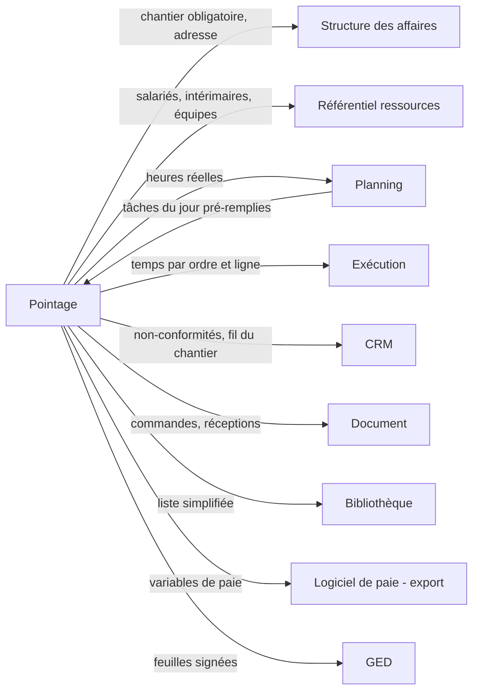

# LogiBTP – analyse du module Pointage MO

> Analyse préalable (20/10/2026) à partir de la note « LogiBTP - Module Pointage MO ». Socle commun aux quatre nouveaux
> modules : [ANALYSE-MODULES-TRANSVERSE.md](ANALYSE-MODULES-TRANSVERSE.md). Modules liés : [CRM](ANALYSE-MODULE-CRM.md) ·
> [Exécution](ANALYSE-MODULE-EXECUTION.md) · [Planning](ANALYSE-MODULE-PLANNING.md).

> **Réalisation** : lot 1 réalisé le 22/10/2026 (`modules/pointage`, `db/199`, `client/src/app/pages/pointage.js`). Écarts :
> durées en minutes (`poi_minutes`) au lieu d'heures ; type de MO = identifiant de nature (`poi_type_mo`), sous-type
> `poi_sous_type` ; amplitudes paramétrables (`ppa_amplitude_jour`, `ppa_amplitude_semaine`) ; droits de saisie provisoires
> (salarié, responsable du service, administrateur) en attendant le module des droits.
> Lot 2 réalisé le 22/10/2026 (`modules/pointage/db/087`, `ServiceSynthese.cs`, `validation.js` ↔ `ReglesValidation.cs`) :
> la couche validée couvre la semaine entière d'un salarié (`poi_semaine`) ; RH = membre d'un service administratif, chef
> = responsable du service ; demande de correction = semaine complète envoyée (`poi_correction`) au lieu d'un pointage
> marqué « à corriger ».
> Lot 3 réalisé le 22/10/2026 (`modules/pointage/db/088`, `db/200`, `paie.js` ↔ `ReglesPaie.cs`, `ServicePaie.cs`) : règles
> CUMUL_HEURES, SEUIL_JOUR, TRANCHES_SEMAINE, ZONE, PLAFOND (FORMULE reportée) ; zones saisies ou validées par le RH sans
> géocodage (reporté) ; export CSV unique ; valorisation par taux du salarié, de la mission d'intérim ou import.

## 1. Objet

Saisir les **heures de main-d'œuvre** des salariés et intérimaires, toujours rattachées à un **chantier** (et
éventuellement à un ordre d'exécution), avec les éléments variables de paie (paniers, déplacements, heures
supplémentaires), puis les **valider** en une synthèse qui alimente la paie et le coût réel des chantiers.

Trois écrans :

| Écran | Pour qui | Où |
|---|---|---|
| Borne | Salariés d'atelier | Tablette tactile partagée, fixée à l'atelier |
| Personnel | Salarié, intérimaire, chef d'équipe, conducteur, chargé d'affaires | Téléphone ou tablette, **hors ligne possible** |
| Synthèse | Chef de service, RH | Poste de bureau |

## 2. Synthèse fonctionnelle

### 2.1 Paramètres de la société

- Ordre des libellés : « Nom Prénom » ou « Prénom Nom ».
- Pas de saisie en minutes (15 par défaut).
- **Profils de paie** : rubriques (heures normales, heures supplémentaires par tranche, panier, zone de déplacement,
  trajet, grand déplacement, intempéries, absences…), règles de calcul et limites (plafonds, seuils).

### 2.2 Borne

- Liste des salariés (nom, photo), filtre de l'interface par salarié, verrouillage facultatif par **code PIN** (au
  global ou par salarié).
- Plusieurs écrans : saisie libre ou **préparation depuis le planning** (tâches du jour proposées).
- Choix du jour, du chantier, de l'ordre, du type de MO.
- Écran de saisie : toucher pour changer une valeur, heures au pas défini, panier, commentaire ; affichage de tous les
  pointages de la journée du salarié.
- **Dupliquer une ligne pour signaler une non-conformité** (problème de commande, de matériaux, de plan…) ou en
  ajouter une nouvelle.

### 2.3 Personnel (mobile)

- Connexion personnelle du salarié ou de l'intérimaire ; **mode hors ligne** (consultation et saisie sans réseau).
- Groupes de droits : chargé d'affaires / conducteur de travaux, chef d'équipe, salarié, consultation.
- Saisie comme sur la borne, filtrée par service ; **saisie par équipe** (création et modification tant que les
  pointages des membres sont identiques).
- Données issues du planning (vides ou pré-remplies), vue jour ou semaine, pointages libres, compositions d'équipe.
- Rubriques sur une seule page : certaines saisies, d'autres pré-calculées dans la synthèse.
- Informations de la tâche (adresse, contact, commentaires) et **raccourci de navigation GPS**.
- Passerelles : documents (commandes et réceptions fournisseurs), Exécution (ordres d'achat, d'intervention, de
  sous-traitance, stock, livraison, pose, demande d'approvisionnement), CRM (messages, alertes, tâches, fil du
  chantier), bibliothèque simplifiée (liste courte, informations réduites, sans nature).

### 2.4 Synthèse MO

- Les pointages **saisis** sont conservés tels quels ; la synthèse travaille sur une **copie** modifiée / validée par
  le RH.
- **Double validation** possible : chef de service puis RH.
- **Pré-calculs** : panier au-delà de 6 h de travail dans la journée, ventilation des heures supplémentaires, zone de
  déplacement (la plus éloignée des chantiers de la journée)…
- La validation **bloque** les pointages à la journée ou à la semaine ; dévalidation selon le niveau (chef, RH).

## 3. Liens avec les autres modules

| Module | Avec lui | Sans lui |
|---|---|---|
| Structure, Annuaire, référentiel ressources | Prérequis (chantier obligatoire, salariés liés aux individus) | — |
| Planning | Écrans pré-remplis par les tâches du jour ; heures réelles dans le rapport du planning | Saisie libre (chantiers récents du salarié proposés) |
| Exécution | Pointage sur un ordre (et une ligne / opération), temps réel vs budget de l'ordre ; création d'ordres depuis le mobile | Pointage au chantier seulement |
| CRM | Non-conformité → note au service concerné ; fil d'actualité et alertes sur le mobile | Non-conformité conservée comme type de MO, sans notification |
| Document, Bibliothèque | Commande et réception fournisseur depuis le mobile | Passerelle masquée |
| Congés (à créer) | Absences pré-remplies, contrôle de cohérence | Absences saisies en rubriques |

## 4. Questions, propositions et décisions

### 4.1 Questions de la première analyse (relues le 21/10/2026)

| N° | Question | Proposition | Décision |
|---|---|---|---|
| M1 | « Profils de paie avec rubriques et règles de calcul » : LogiBTP calcule-t-il la paie ? | **Non** : il calcule les **variables de paie** (quantités par rubrique et par salarié pour la période) et les **exporte** vers le logiciel de paie (formats Silae, Sage, Cegid, ADP… par modèle d'export paramétrable, CSV au départ). Le calcul des salaires, cotisations et bulletins reste hors périmètre (réglementation trop mouvante). | ✔ Retenue. |
| M2 | Règles de calcul : langage ou liste fermée ? | Liste de **règles typées paramétrables** (seuil journalier → rubrique ; ventilation hebdomadaire par tranches ; zone selon distance ; plafond ; arrondi au pas), évaluées par un moteur unique répliqué JS ↔ C# (jeu `modules/pointage/tests/cas`). Pour les cas particuliers, une formule dans le langage d'expressions du socle (`Expression`, déjà répliqué). | ✔ Retenue. |
| M3 | Heures supplémentaires : semaine civile, modulation, annualisation ? | Semaine civile par défaut (au-delà de 35 h : tranches paramétrables, ex. 8 premières heures, puis au-delà) ; la ventilation n'est calculée qu'une fois la semaine complète. Modulation / annualisation : compteur reporté, en lot ultérieur. | ✔ Retenue. |
| M4 | Zone de déplacement : distance depuis où, calculée comment ? | Depuis le point de rattachement du salarié (siège ou agence, `sal_ind_id` → rattachement à l'agence de notre société) jusqu'au chantier, à vol d'oiseau (pratique usuelle des barèmes BTP en zones concentriques) ; coordonnées du chantier géocodées depuis son adresse (API adresse nationale, relayée par le serveur comme le module Entreprises françaises). Zone de la journée = la plus élevée des chantiers pointés. Barème par profil de paie. | ✔ Précisé : la **zone est définie par agence sur le chantier** ; si aucune zone n'est définie pour l'agence du salarié, la zone calculée est **proposée à l'utilisateur pour validation**. Voir M16. |
| M5 | Panier « plus de 6 h » : heures de travail seules ou trajet compris ? | Heures de travail effectif seules par défaut, paramétrable ; panier non dû si le salarié est en grand déplacement (rubrique exclusive). | ✔ Retenue. |
| M6 | Saisie par équipe « tant que les pointages sont identiques » : comment le savoir ? | La saisie d'équipe crée un pointage par membre avec un identifiant de groupe ; tant que tous les pointages du groupe ont les mêmes valeurs, ils s'éditent ensemble ; dès qu'un membre diverge, il sort du groupe (affiché à part) et l'équipe reste éditable pour les autres. | ✔ Retenue, complétée : l'écran **signale que l'équipe n'est plus celle d'origine**, et l'on voit **tous les pointages de la même tâche**, même ceux des salariés sortis du groupe. |
| M7 | Hors ligne : quelles données sur l'appareil, quels conflits ? | Application installable (PWA), données de l'utilisateur seulement (ses pointages des N dernières semaines, chantiers et tâches de la période, rubriques de son profil) dans IndexedDB ; file d'envoi rejouée au retour du réseau. Conflit : un pointage validé côté serveur ne peut plus être modifié (refus, la saisie locale est conservée en brouillon avec un message) ; sinon la dernière modification l'emporte, chaque version étant journalisée. | ✔ Précisé : l'appareil ne garde que les pointages de **la semaine en cours** ; un brouillon refusé (pointage validé entre-temps) peut être **envoyé au service RH** pour modification. Voir M17. |
| M8 | PIN de la borne : sécurité ? | PIN haché (jamais en clair), tentatives limitées ; la borne est un **appareil enregistré** (jeton d'appareil délivré par un administrateur), pas une session utilisateur ; déconnexion automatique après chaque saisie. | ✔ Précisé : borne = **compte de service** (sans lien à un salarié) avec **appareil enregistré**, détaillés dans le futur module des droits ; la page de la borne reste accessible depuis la liste des utilisateurs ; le PIN évite qu'un salarié consulte les pointages d'un autre (la borne est dans un lieu sûr, à l'accès très limité). |
| M9 | Photos des salariés (RGPD) ? | Facultatives, avec consentement ; stockées dans la GED (catégorie confidentielle `photo_salarie`), servies en miniature à la borne seulement. | ✔ Retenue : les photos rendent l'interface plus humaine ; une **image ou un logo** peut aussi servir. |
| M10 | Intérimaires : compte et données ? | L'intérimaire est un individu rattaché à l'agence d'intérim (tiers fournisseur) ; ses heures servent au **contrôle des factures de l'agence** et au coût du chantier, pas à la paie. Profil de paie « intérim » sans export. | ✔ Précisé : par défaut, contrôle des **factures d'intérim seulement** ; une **option globale** rend les pointages des intérimaires imputables aux chantiers avec un coût. Voir M18. |
| M11 | Copie RH : copie entière ou écarts seulement ? | Deux couches dans la même table (`poi_couche` : SAISIE / VALIDE) ; la couche VALIDE est créée à la première modification ou validation ; les écarts sont affichés ligne à ligne. La saisie reste figée dès la validation. | ✔ Précisé : la couche validée est créée **dès la première modification** du RH, pour garder ses corrections avant la validation. |
| M12 | Double validation : obligatoire ? | Paramètre par service : validation simple (RH) ou double (chef puis RH). Dévalidation : le chef dévalide tant que le RH n'a pas validé ; le RH dévalide tout ; la dévalidation après export de paie est signalée (export correctif). | ✔ Précisé : en double validation, le **RH peut valider sans la validation du chef** ; une dévalidation après export est **tracée (qui, quand, quoi, pourquoi : motif obligatoire)**. |
| M13 | Pointage sur une tâche administrative (formation, réunion) sans chantier ? | La règle « toujours un chantier » impose des **chantiers internes** (frais généraux, atelier, formation, dépôt) créés par société ; à valider. | ✔ **Chantiers internes** (frais généraux, atelier, formation, dépôt). |
| M14 | Type de MO : liste ? | Paramétrable : production, préparation, trajet, non-conformité (avec motif), attente, nettoyage… ; chaque type a une rubrique de paie et un sens analytique (productif / improductif). | ✘ Autrement : les types de MO sont **liés aux natures** (analytique), avec des **sous-types** pour détailler. Voir M19. |
| M15 | Géolocalisation du pointage ? | Pas par défaut (la CNIL encadre strictement la géolocalisation des salariés) ; éventuellement une position **au moment de la saisie** seulement, facultative et déclarée. Le raccourci GPS (ouvrir la navigation vers le chantier) ne pose pas ce problème. | ✘ **Aucune géolocalisation** des pointages ; le raccourci GPS n'enregistre pas la position et reste au choix du salarié. |

### 4.2 Points de la relecture du 21/10/2026

| N° | Question | Proposition | Décision |
|---|---|---|---|
| M16 | Zones par agence sur le chantier (M4) : qui valide la zone proposée, et quand ? | Table des zones du chantier par agence (`chantier_zone` : chantier, agence, zone, validée par, le) ; à la première saisie d'un pointage d'un salarié d'une agence sans zone, la zone calculée (géocodage, vol d'oiseau, barème du profil) est proposée au conducteur ou au RH dans la synthèse ; une fois validée, elle sert à tous les pointages du chantier pour cette agence. Fiche chantier : onglet ou groupe « Zones de déplacement » pour la saisir d'avance. | ✔ Retenue. |
| M17 | Brouillon envoyé au RH (M7) : par quel moyen ? | Le pointage refusé est enregistré comme **demande de correction** (pointage en couche SAISIE marqué « à corriger », motif « validé avant l'envoi ») ; il paraît en tête de la synthèse du RH, qui l'applique ou le rejette ; si le CRM est actif, une tâche part au service RH. | ✔ Retenue. |
| M18 | Coût des intérimaires imputés (M10) : quel taux ? | Taux horaire facturé par l'agence, saisi sur la mission de l'intérimaire (ou repris du dernier tarif de l'agence), modifiable ; le coût réel est corrigé par le contrôle des factures (écart signalé). | ✔ Retenue : taux horaire facturé par l'agence, saisi sur la mission, corrigé par le contrôle des factures. |
| M19 | Types de MO liés aux natures (M14) : comment ? | Le type de MO = une **nature** du regroupement Main-d'œuvre de la bibliothèque (MO atelier, MO pose…), qui porte l'analytique et le lien au service ; les **sous-types** paramétrables (production, préparation, trajet, non-conformité avec motif, attente, nettoyage…) portent la rubrique de paie et le sens productif / improductif ; la borne propose le type puis le sous-type (quatre touches). | ✔ Retenue. |
| M20 | Valorisation des heures (possibilité 2) : quels modes ? | Taux moyen par salarié ou par type de MO, par période (mois, trimestre) ; revalorisation des pointages d'une période après la paie, au coût horaire moyen réel du salarié importé du logiciel de paie (fichier CSV salarié × période × coût) ; la valeur appliquée et sa source sont gardées sur chaque pointage valorisé. | ✔ Retenue. |
| M21 | Relevé hebdomadaire (possibilité 7) : signature et envoi ? | Le relevé est celui **validé par le RH** (vraies valeurs, rubriques calculées) ; la signature du salarié est facultative (paramètre) ; l'envoi par courriel (option) attend le module Mail ; le relevé produit est rangé dans la GED du salarié. | ✔ Retenue. |
| M22 | Calendrier des possibilités retenues sans période ? | Premier temps : coût réel du chantier (M20) et types de MO par nature ; second temps : pointage des matériels, contrôle des factures d'intérim, intempéries (avec le Planning), badge en plus de la photo + PIN, compteurs (option), relevé hebdomadaire, avancement sur mobile, rapport journalier, tableau de bord productivité. | ✔ Retenue. |

Toutes les questions du Pointage sont tranchées (M1 à M22).

## 5. Faisabilité

**Faisable**, avec deux sujets nouveaux pour le projet : l'**authentification réelle** (dans un module des droits, à créer) et l'**application mobile hors
ligne**.

| Besoin | Existant | À faire |
|---|---|---|
| Salariés liés aux individus | `demo_salarie.sal_ind_id`, `SalariesAnnuaire` | Référentiel réel des salariés (transverse § 4) : service, profil de paie, calendrier, taux horaire |
| Chantiers, adresses | Structure des affaires, `ent_adresse_livraison`, contact sur place | Géocodage des chantiers (coordonnées) |
| Connexion personnelle, groupes de droits | **Aucune** : utilisateur lu dans les en-têtes `X-Utilisateur` / `X-Profil` | Module d'authentification (transverse § 2) : prérequis bloquant |
| Hors ligne | IndexedDB déjà utilisé (`depot-import.js`) | Service worker, file d'envoi, synchronisation, version de données |
| Règles de pré-calcul | Langage d'expressions du socle répliqué | Moteur de règles de paie répliqué JS ↔ C# + jeu de cas |
| Listes de synthèse | Module Liste (saisie en ligne, segments) | Grille hebdomadaire salarié × jour × rubrique (composant à faire sur `GrilleArbre` ou dédié) |
| Feuille d'heures signée | Module Édition, GED, coffre-fort | Modèle d'édition, capture de signature (commune avec le SAV de l'Exécution) |
| Export paie | — | Modèles d'export par logiciel (CSV paramétrable d'abord) |

**Risques** : fiabilité du hors-ligne (tests sur appareils réels, réseau intermittent), justesse des règles de paie
(responsabilité : bien cadrer « variables de paie » et laisser le dernier mot au RH), ergonomie de la borne (gros
boutons, peu de texte, aucune saisie clavier si possible), volume (5 000 salariés × 5 lignes × 220 jours ≈ 5,5 M de
lignes par an : index par salarié et date, partitionnement annuel à prévoir).

## 6. Simplification d'utilisation

Toutes retenues le 21/10/2026.

- **Journée pré-remplie** : depuis le planning (tâches du jour) ou, sans planning, en reprenant la journée précédente ;
  le salarié n'a qu'à confirmer (« Comme prévu ») ou corriger.
- **Borne en quatre touches** (décision du 21/10/2026) : photo du salarié → chantier / ordre du jour (proposés, ou
  recherchés par le **QR code de l'ordre**) → type de MO → heures (boutons ± au pas, valeurs fréquentes 4 h / 7 h / 8 h) ;
  panier coché d'office si la règle le prévoit.
- **Saisie d'équipe par le chef** : une ligne pour toute l'équipe, exceptions à la main (absent, parti plus tôt).
- **Contrôles visibles avant l'envoi** : total de la journée, journée incomplète, chevauchement, dépassement de
  l'amplitude légale (10 h / jour, 48 h / semaine), chantier clos ; aucun blocage sauf incohérence franche.
- **Synthèse par exceptions** : le RH ne voit d'abord que les salariés avec écarts (heures ≠ planning, pas de pointage,
  non-conformité, heures supplémentaires) ; « Tout valider » pour le reste de la semaine ; option « Tout voir », notamment pour contrôler les règles de calcul.
- **Non-conformité en un geste** : « Signaler un problème » sur la ligne → motif → photo facultative ; la note CRM part
  au bon service.
- **Libellés et pas** paramétrés une fois pour la société (ordre nom / prénom, 15 minutes).

## 7. Possibilités non encore explorées

Toutes retenues le 21/10/2026 ; temps décidés en M22.

| N° | Possibilité | Précision | Quand |
|---|---|---|---|
| 1 | **Pointage des matériels** : heures d'engin, kilomètres, carburant, saisis avec le conducteur → coût matériel et maintenance. | | Second temps |
| 2 | **Coût réel du chantier** : heures valorisées comparées au déboursé MO du budget, par nature, tranche ou ordre ; rentabilité continue de l'Exécution. | Plusieurs modes de valorisation : taux moyen par salarié ou par type de MO sur des périodes, revalorisation après la paie (M20). | Premier temps |
| 3 | **Contrôle des factures d'intérim** : relevé d'heures par agence et par semaine rapproché de la facture d'achat. | | Second temps |
| 4 | **Intempéries** : heures d'arrêt pour intempérie, liées à une journée marquée dans le planning. | | Second temps |
| 5 | **Carte BTP et badge** (QR code, NFC) à la borne. | En plus de la photo + PIN (les deux méthodes restent). | Second temps |
| 6 | **Compteurs** : heures supplémentaires cumulées, contingent, repos compensateur, récupération ; consultables par le salarié. | En option. | Second temps |
| 7 | **Relevé hebdomadaire signé**. | Relevé validé par le RH ; signature facultative ; envoi par courriel en option (module Mail) (M21). | Second temps |
| 8 | **Avancement sur mobile** saisi avec les heures. | | Second temps |
| 9 | **Rapport journalier de chantier** (météo, effectif, livraisons, incidents, photos), imprimable. | | Second temps |
| 10 | **Tableau de bord productivité** : heures productives / improductives, coût de la non-qualité par motif. | | Second temps |

## 8. Esquisse du modèle de données (`modules/pointage/db`)

| Table | Colonnes principales |
|---|---|
| `poi_parametre` | `ppa_ordre_nom` (NP / PN), `ppa_pas_minutes`, `ppa_validation` (SIMPLE / DOUBLE), `ppa_blocage` (JOUR / SEMAINE) |
| `poi_profil_paie` | `ppf_id`, `ppf_code`, `ppf_libelle`, `ppf_export_modele` |
| `poi_rubrique` | `rub_id`, `rub_ppf_id`, `rub_code`, `rub_libelle`, `rub_unite` (H, NB, ZONE), `rub_saisie` (S / C / SC), `rub_code_paie`, `rub_ordre` |
| `poi_regle` | `prg_id`, `prg_ppf_id`, `prg_type` (SEUIL_JOUR, TRANCHES_SEMAINE, ZONE, PLAFOND, FORMULE), `prg_parametres` (JSONB), `prg_rub_id`, `prg_ordre` |
| `poi_type_mo` | `tmo_code`, `tmo_libelle`, `tmo_productif`, `tmo_rub_id`, `tmo_non_conformite` |
| `poi_pointage` | `poi_id`, `poi_couche` (SAISIE / VALIDE), `poi_origine_id` (ligne saisie d'origine), `poi_sal_id`, `poi_date`, `poi_cha_id`, `poi_ent_id` (ordre), `poi_lig_id` / `poi_opr_id`, `poi_tmo_code`, `poi_debut`, `poi_fin`, `poi_heures`, `poi_motif`, `poi_commentaire`, `poi_groupe` (saisie d'équipe), `poi_tac_id` (planning), `poi_saisi_par`, `poi_saisi_le`, `poi_appareil`, `poi_version` |
| `poi_valeur` | `pva_poi_id` ou (`pva_sal_id`, `pva_date`), `pva_rub_id`, `pva_valeur`, `pva_calculee` (rubriques du jour : panier, zone…) |
| `poi_validation` | `pvl_sal_id`, `pvl_du`, `pvl_au`, `pvl_niveau` (CHEF / RH), `pvl_par`, `pvl_le`, `pvl_annule_par`, `pvl_annule_le` |
| `poi_export` | `pex_id`, `pex_periode`, `pex_modele`, `pex_dge_id` (fichier en GED), `pex_par`, `pex_le` |
| `poi_appareil` | `pap_id`, `pap_libelle`, `pap_jeton_hache`, `pap_service`, `pap_actif` (bornes enregistrées) |

## 9. Découpage en lots

| Lot | Contenu | Prérequis |
|---|---|---|
| 0 | Activation ; authentification et droits ; référentiel salariés réel (service, profil, rattachement) | Transverse lots 0–2 |
| 1 | Paramètres, types de MO (natures et sous-types), saisie bureau (grille hebdomadaire) au chantier ou sur un chantier interne, contrôles | Lot 0 |
| 2 | Synthèse : couche validée dès la première modification, simple / double validation (le RH peut valider sans le chef), blocage, dévalidation tracée avec motif, demandes de correction, « Tout voir » | Lot 1 |
| 3 | Profils de paie, rubriques, règles (jeu de cas), zones par agence sur le chantier (proposition validée), export CSV, valorisation des heures | Lot 2 |
| 4 | Borne (compte de service, appareil enregistré, PIN, photos ou images, QR code des ordres), saisie par équipe (équipe modifiée signalée) | Lot 1 ; module des droits |
| 5 | Application personnelle hors ligne (PWA, semaine en cours), navigation GPS (sans enregistrement de position), pré-remplissage depuis le planning | Lot 1 ; transverse § 6 ; Planning lot 2 pour le pré-remplissage |
| 6 | Passerelles : ordres (Exécution), non-conformités (CRM), commandes / réceptions simplifiées ; pointage des matériels | Modules concernés |
