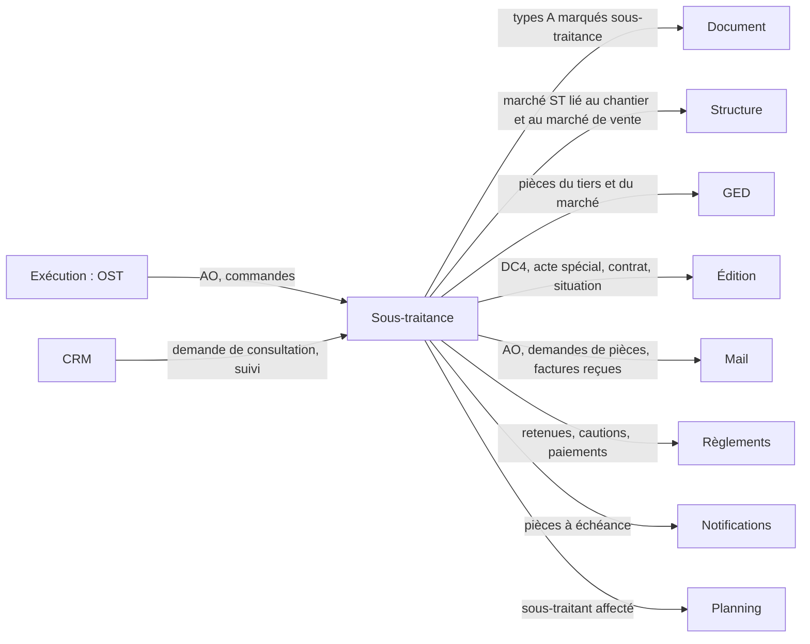

# LogiBTP – analyse du module Sous-traitance

> Analyse préalable (23/10/2026) à partir de la note « Module sous-traitance ». Socle commun :
> [ANALYSE-MODULES-TRANSVERSE.md](ANALYSE-MODULES-TRANSVERSE.md). Analyses liées : [Exécution](ANALYSE-MODULE-EXECUTION.md)
> (ordre de sous-traitance OST) · [CRM](ANALYSE-MODULE-CRM.md) (C8, C20 : analyse demandée) ·
> [Marchés et règlements](CONCEPTION-MARCHES-REGLEMENTS.md) (Q9 : paiement direct, sans décision) ·
> [Achats et marchés](CONCEPTION-ACHATS-MARCHES.md) · [Mail](ANALYSE-MODULE-MAIL.md) · [Édition](CONCEPTION-EDITION.md).
>
> **État** : questions ST1 à ST20 à trancher (§ 8).

## 1. Note d'origine (résumé)

- Comme les achats, avec trois types de documents : **appel d'offres**, **commande**, **facture d'avancement**.
- Les commandes s'inscrivent dans un **marché de sous-traitance**, lié à un **chantier** et, au choix, à un **marché
  de vente**.
- Le marché porte des **pièces annexes du sous-traitant** (extrait Kbis…) et des **documents propres au marché**
  (DC4…) ; des **éditions** complètent ces documents avec les informations saisies dans le marché.
- La **liste des pièces** est paramétrable (pièces obligatoires et facultatives) avec des **dates de validité**.
- Deux saisies de la facture : **à l'avancement** (le sous-traitant n'a pas de logiciel, on établit sa situation pour
  lui) ou **facture reçue** (on saisit ses montants).
- Une facture de sous-traitance peut être **rattachée à une vraie facture** (notre facture au client) pour le
  **paiement direct**.

## 2. Ce qui existe déjà

| Besoin | Déjà dans l'application |
|---|---|
| Chaîne de documents d'achat | Famille A : `A_DEVIS` (demande de prix), `A_COMMANDE`, `A_FACTURE_AVT` (« Situation fournisseur », avancement F : cumul − précédent), `A_AVOIR` (avoir d'avancement d'une période négative), transformations, restes, soldes |
| Avancement en % / quantité / montant cumulés, précédent, dépassement | Lots 6a et 6b (`lig_avt_*`, `DocumentService.Precedents`, `LIGNE_DEPASSEE`, `ent_rang_avancement`), répliqués entre les deux `MoteurDocument` |
| Marché : commande de base et avenants, montant calculé | `marche`, `marche_document` (BASE, AVENANT), `f_marche_recalculer`, `f_marche_commande` (`db/170`) |
| Postes de pied du marché (retenue de garantie), acomptes, échéancier | `marche_poste`, `marche_acompte`, `condition_paiement`, `document_echeance` (`db/173`, `174`, module Document `019b`) |
| Règlements, cautions | Module Règlements (décaissements `sens=D`, cautions, reste à payer) |
| Intervenant sous-traitant, paiement direct (information) | `fonction_intervenant` SOUS_TRAITANT (`fin_paiement_direct`), `intervenant.itv_paiement_direct`, `ent_intervenants` (`db/162`) |
| Pièces des tiers | Catégories GED `kbis`, `attestation_urssaf` (coffre), `attestation_assurance` (coffre), `rib` (`db/140`) |
| Éditions alimentées par les données | Module Édition (sources, dictionnaire, sources annexes, PDF rangé en GED) |
| Ordre de sous-traitance | Prévu par l'Exécution (OST : « anticipe et suit une ou plusieurs demandes ou commandes de sous-traitance ») |
| Réception des factures par courriel | Module Mail lots 3 et 4 (relève IMAP, reconnaissance, rattachement) |
| Données de démonstration | `demo_sous_traitant` (`db/120`, ancienne table de démo des ressources : code, raison, métier, taux horaire, agréé) |

**Ce qui manque** : un marché côté **dépense** (le `marche` actuel est un marché de vente : montant = commandes
clients), les **pièces exigées** avec validité et contrôle de conformité, la **saisie d'une facture reçue** sans
avancement ligne à ligne, le **lien de paiement direct** entre une facture de sous-traitance et notre facture au client,
les éditions DC4 / acte spécial / contrat.

## 3. Cadre réglementaire à couvrir (rappel, à valider)

| Sujet | Règle (France) | Effet dans le logiciel |
|---|---|---|
| Acceptation et agrément | Loi 75-1334 : le sous-traitant est accepté et ses conditions de paiement agréées par le maître d'ouvrage. Marchés publics : déclaration **DC4** (ou acte spécial) | Pièce du marché obligatoire, état « agréé » du marché, montant agréé |
| Paiement direct | Marchés publics : obligatoire pour le sous-traitant de 1er rang au-delà de 600 € TTC ; le titulaire a **15 jours** pour accepter ou refuser la demande de paiement. Marchés privés : **délégation de paiement** ou **caution** (art. 14) | Mode de garantie du marché (paiement direct, délégation, caution), délai d'acceptation suivi, plafond = montant agréé |
| Obligation de vigilance | Code du travail L8222-1 et D8222-5 : au contrat puis **tous les 6 mois** : attestation de vigilance URSSAF, Kbis (ou D1), liste des salariés étrangers (LNTE) ; assurances (RC, décennale) | Pièces à validité, échéances, blocage paramétrable |
| Autoliquidation de la TVA | CGI art. 283-2 nonies : travaux de construction sous-traités : le sous-traitant facture HT, le preneur autoliquide | Indicateur du marché, TVA nulle sur la pièce, mention ; écriture comptable plus tard (module Comptabilité) |
| Retenue de garantie | Loi 71-584 : 5 % au plus, remplaçable par une caution | Poste de pied du marché (déjà prévu pour les ventes), caution du module Règlements |
| Autofacturation | CGI art. 289 I-2 : une facture établie par le client au nom du fournisseur exige un **mandat** préalable et l'acceptation de chaque facture | Saisie à l'avancement : soit « proposition de situation » à faire facturer par le sous-traitant, soit autofacturation sous mandat (ST7) |

## 4. Décision structurante proposée

### 4.1 Les documents de sous-traitance sont des documents d'achat marqués « sous-traitance »

Une nouvelle famille (T) obligerait à revoir une vingtaine d'endroits qui distinguent ventes et achats (comptes des
lignes, contacts, règlements, transformations, graphe, courriels) pour un comportement identique aux achats.
**Proposition** : trois **types de la famille A** marqués `tyd_sous_traitance` (cœur, `ALTER TABLE type_document`) :

| Code | Libellé | Préfixe | Avancement | Remarque |
|---|---|---|---|---|
| `A_ST_AO` | Appel d'offres de sous-traitance | AOS | — | Un par sous-traitant consulté (comme `A_DEVIS`), regroupés par lot (ST3) |
| `A_ST_COMMANDE` | Commande de sous-traitance (contrat) | CST | — | Toujours dans un marché de sous-traitance (`MARCHE_ST_OBLIGATOIRE`) ; avenants |
| `A_ST_FACTURE_AVT` | Facture d'avancement de sous-traitance | FST | F (cumul − précédent) | Saisie à l'avancement ou facture reçue (§ 5.4) ; période négative → `A_AVOIR` (ou avoir de sous-traitance, ST11) |

Les listes, menus et droits les présentent à part (thème « Sous-traitance ») ; les règles des documents
(`regle_document`) s'appliquent par type comme pour les autres.

### 4.2 Le marché de sous-traitance est un marché « dépense »

**Proposition** : la table `marche` gagne un sens (`mar_sens` : V vente, ST sous-traitance), le sous-traitant
(`mar_tiers_id`) et le marché de vente lié (`mar_marche_vente_id`, facultatif), plutôt qu'une seconde table : la
fiche, la liste, les avenants (`marche_document`), le montant calculé (`f_marche_recalculer` sur les commandes de
sous-traitance validées), les postes de pied, les acomptes, l'échéancier, l'avancement (précédent, dépassement
`mar_depassement_autorise`) et le filtre des listes par rattachement servent tels quels. Code `MST-<chantier>-<rang>`.
Le marché de vente lié reçoit d'office l'**intervenant** SOUS_TRAITANT (paiement direct selon le mode de garantie).

## 5. Synthèse fonctionnelle

### 5.1 Appel d'offres

- Créé depuis un ordre de sous-traitance (Exécution, OST), une commande client, un devis, une demande du CRM ou à vide,
  rattaché à un chantier (ou un projet en phase de chiffrage).
- Envoyé à plusieurs sous-traitants (copie par sous-traitant, courriel par le module Mail, pièces du dossier de
  consultation depuis la GED) ; réponses saisies ou importées ; **comparatif** des offres (lignes en regard, totaux,
  écarts au budget de l'OE ou au déboursé du devis).
- Offre retenue → commande de sous-traitance (transformation) ; les autres passent « non retenues » (motif).

### 5.2 Marché et commande

- À la validation d'une commande de sous-traitance : fenêtre « marché » comme pour les ventes (marché existant du
  sous-traitant sur le chantier → avenant, sinon nouveau marché), choix du marché de vente lié et du mode de garantie
  (paiement direct, délégation de paiement, caution, aucune).
- Fiche du marché : sous-traitant, chantier, marché de vente, rang (1er rang, 2e rang : sous-traitant d'un
  sous-traitant), montant HT (commande + avenants), **montant agréé** (DC4), autoliquidation, retenue de garantie et
  postes, pénalités, conditions de paiement, onglets Pièces, Documents, Factures, Paiements, Suivi (CRM).

### 5.3 Pièces exigées

Deux portées, une même mécanique :

| Portée | Rangée dans la GED de | Exemples | Validité |
|---|---|---|---|
| **Sous-traitant** (pièces annexes) | la fiche du tiers (servent à tous ses marchés) | Kbis, attestation de vigilance URSSAF, LNTE, attestation de régularité fiscale, RC, décennale, RIB, carte d'identification BTP | Durée par défaut (6 mois, 3 mois, annuelle) ou date saisie, rappel avant échéance |
| **Marché** (documents propres) | la fiche du marché | DC4 / acte spécial, contrat de sous-traitance, agrément du maître d'ouvrage, caution, délégation de paiement, PPSPS, plan de prévention | Souvent sans échéance ; la caution a la sienne |

- **Paramétrage** (`/parametres/sous-traitance`) : liste des pièces (code, libellé, portée, catégorie GED,
  obligatoire ou facultative, durée de validité, délai de rappel, **bloquante pour** : commande, facture, paiement ;
  conditions : marché public, paiement direct, montant, rang), **modèle d'édition** associé (la pièce se génère depuis
  le marché) ; une pièce peut être ajoutée ou dispensée sur un marché (motif).
- **État de conformité** par pièce et par marché (règle répliquée JS ↔ C#, jeu `modules/sous-traitance/tests/cas`) :
  fournie, à échéance (dans le délai de rappel), expirée, manquante, dispensée ; marché **conforme** quand aucune pièce
  obligatoire n'est manquante ou expirée.
- **Contrôles** : validation de la commande refusée sans les pièces bloquantes « commande » (`ST_PIECES`), bon à payer
  refusé sans les pièces bloquantes « paiement » ; forçage par droit, journalisé.
- **Rappels** : source du module Notifications (pièces à échéance au service achats ou au conducteur), demande de pièce
  par courriel au sous-traitant (module Mail, modèle à variables), dépôt d'une pièce reçue par courriel (reconnaissance
  du Mail : rattachement au tiers).

### 5.4 Factures

| Mode | Usage | Saisie | Contrôles |
|---|---|---|---|
| **À l'avancement** | Le sous-traitant n'a pas de logiciel : on établit sa situation | Comme une situation fournisseur : avancement par ligne de la commande (%, quantité, montant cumulés), précédent repris, postes de pied du marché (retenue, prorata, pénalités) | Moteurs existants (jeux 10 à 12) ; édition « situation de sous-traitance » à faire signer ou facturer par le sous-traitant (ST7) |
| **Facture reçue** | Le sous-traitant envoie sa facture | Entête de la facture : numéro et date du sous-traitant, montant HT de la période (ou cumulé), TVA ou autoliquidation, TTC ; PDF rangé dans la GED (glissé ou reçu par courriel) ; ventilation sur les lignes facultative (au prorata du reste par défaut) | Montant ≤ reste du marché (avertissement, `mar_depassement_autorise`), cumul ≤ montant agréé en paiement direct, écart avec l'avancement constaté signalé |

Dans les deux cas : un numéro de situation par marché (`ent_rang_avancement`), la facture devient « bon à payer » à
la validation (pièces conformes), le module Règlements suit le paiement (par nous) ou le paiement direct (par le maître
d'ouvrage, § 5.5).

### 5.5 Paiement direct

- Une facture de sous-traitance en paiement direct se **rattache** à notre facture d'avancement au client du marché de
  vente lié (lien `PAIEMENT_DIRECT` dans `document_lien`), choisie parmi les factures de la période ou proposée
  d'office.
- Notre facture porte un **poste de déduction TTC** « Paiement direct — <sous-traitant> » (Q9 de
  `CONCEPTION-MARCHES-REGLEMENTS.md`) : le net à payer du client baisse d'autant ; la facture de sous-traitance n'entre
  pas dans nos décaissements.
- Suivi : demande reçue → acceptée (dans les 15 jours, total ou partiel avec motif) → transmise au maître d'ouvrage →
  payée par le maître d'ouvrage (règlement saisi au module Règlements, pointage de l'échéance) ; cumul payé ≤ montant
  agréé.
- Hors paiement direct (délégation, caution), la facture se paie comme un achat ; la délégation produit le même lien,
  sans poste de déduction (à confirmer, ST14).

## 6. Liens avec les autres modules

| Module | Avec lui | Sans lui |
|---|---|---|
| Document, Structure, Annuaire, GED | Prérequis | — |
| Édition | DC4, acte spécial, contrat, situation à faire signer | Pièces du marché déposées à la main |
| Règlements | Paiements, retenues, cautions, paiement direct suivi | Factures sans suivi de paiement |
| Mail | AO envoyés, demandes de pièces, factures reçues rapprochées | Impression, dépôt manuel |
| Notifications | Rappels des pièces à échéance | Colonne « échéance » des listes |
| Exécution | OST → AO / commande ; heures et avancement de l'ordre | AO depuis la commande client ou à vide |
| CRM | Tâches (pièce manquante, acceptation à faire), suivi | — |
| Planning | Affectation du sous-traitant (type existant), dates du marché | — |

## 7. Ajouts au module Document et au cœur

| Ajout | Où | Remarque |
|---|---|---|
| `tyd_sous_traitance`, types `A_ST_*`, statuts, transformations, droits, vues de colonnes | Cœur (`db/2xx`) | Vues d'avancement reprises de `A_FACTURE_AVT` |
| `mar_sens`, `mar_tiers_id`, `mar_marche_vente_id`, `mar_montant_agree`, `mar_garantie`, `mar_rang`, `mar_autoliquidation`, `mar_public` | Cœur (`marche`) | `v_liste_marches` séparée par sens |
| Facture reçue : `ent_ref_tiers_numero`, `ent_ref_tiers_date`, mode de saisie (`ent_st_saisie` : AVANCEMENT / RECUE), totaux saisis | Module Document (référence externe déjà présente) ou cœur | Le moteur ne recalcule pas un total saisi : ventilation sur les lignes ou ligne unique |
| Lien `PAIEMENT_DIRECT` et poste de déduction TTC | Module Document (`document_lien.lie_type`) ; cœur (poste) | Q9 à décider |
| Autoliquidation : TVA nulle et mention | Cœur (taux « autoliquidation ») | Écritures : module Comptabilité |
| Validité des pièces : `dge_valide_du`, `dge_valide_au` | Module GED (générique) | Utile aussi hors sous-traitance (habilitations, assurances des véhicules) |

**Module Sous-traitance** (`modules/sous-traitance`, sans dépendance au Document) : pièces exigées (`stt_piece_type`,
conditions, bloquant pour), pièces dispensées ou ajoutées par élément (`stt_piece_element`), état de conformité
(`conformite.js` ↔ `ReglesConformite.cs`), suivi du paiement direct (`stt_paiement_direct` : demande, délais,
acceptation, transmission, paiement), comparatif des offres ; le cœur fournit tiers, marchés, documents et GED
(`SpecialisationSousTraitanceBtp`).

## 8. Questions et propositions

| N° | Question | Proposition | Décision |
|---|---|---|---|
| ST1 | Famille propre (T) ou types d'achat marqués ? | Types de la famille A marqués `tyd_sous_traitance` (§ 4.1) | |
| ST2 | Marché de sous-traitance : même table que le marché de vente ? | Oui, `mar_sens` (§ 4.2) | |
| ST3 | Appel d'offres : un document par sous-traitant, ou un dossier avec plusieurs offres ? | Un document par sous-traitant, regroupés par un « lot de consultation » (code commun) pour le comparatif | |
| ST4 | Un marché par sous-traitant et par chantier, ou plusieurs (lots distincts) ? | Plusieurs possibles ; le marché existant est proposé, avenant par défaut | |
| ST5 | Le marché de vente lié est-il obligatoire ? | Non ; obligatoire seulement en paiement direct (la déduction se fait sur ses factures) | |
| ST6 | Sous-traitance de 2e rang (sous-traitant d'un sous-traitant) à gérer ? | Rang et sous-traitant « titulaire » renseignés pour le DC4, sans chaîne de documents | |
| ST7 | Saisie à l'avancement : document que le sous-traitant facture, ou autofacturation sous mandat ? | « Proposition de situation » imprimée et signée par le sous-traitant, qui vaut facture seulement si un mandat d'autofacturation est coché sur le marché (pièce du marché) | |
| ST8 | Facture reçue : ventiler sur les lignes de la commande ? | Facultatif ; sans ventilation, une ligne « Période » au prorata du reste par ligne (avancement en montant) pour que le précédent et le reste restent justes | |
| ST9 | Facture reçue en cumul ou en période ? | Les deux à la saisie (choix), stockée en cumul comme l'avancement | |
| ST10 | Écart entre la facture reçue et l'avancement constaté par le conducteur ? | Avancement constaté facultatif (situation « à l'avancement » de contrôle) ; écart signalé, facture bloquée au-delà d'un seuil | |
| ST11 | Avoir de sous-traitance : type propre ou `A_AVOIR` ? | `A_AVOIR` (nature avoir d'avancement), marqué par le marché | |
| ST12 | Pièces : quelles valeurs par défaut fournies ? | Kbis (3 mois), URSSAF (6 mois), LNTE (6 mois), fiscale (6 mois, public), RC et décennale (annuelles), RIB ; marché : DC4 (public), acte spécial, contrat, agrément, caution | |
| ST13 | Pièce manquante : blocage ou alerte ? | Paramétrable par pièce (commande, facture, paiement) ; défaut : URSSAF et Kbis bloquent le paiement, le reste alerte | |
| ST14 | Délégation de paiement : même lien que le paiement direct ? | Même lien, sans poste de déduction (le client paie le sous-traitant pour notre compte : la facture client garde son montant) — à valider avec l'expert-comptable | |
| ST15 | Paiement direct : TTC ou HT (autoliquidation) déduit de notre facture ? | Montant que le maître d'ouvrage paie au sous-traitant ; en autoliquidation, HT, la TVA restant à notre charge — à valider avec l'expert-comptable | |
| ST16 | Acceptation de la demande de paiement (15 jours) : suivi automatique ? | Échéance = réception + 15 jours, tâche du CRM au conducteur, notification à J-3 | |
| ST17 | DC4 : formulaire officiel rempli ou édition propre ? | Édition propre reprenant la mise en page du DC4 (le module Édition ne remplit pas un PDF existant) ; remplissage d'un PDF officiel à étudier plus tard | |
| ST18 | Validité des pièces : dans la GED (générique) ou dans le module ? | Dans la GED (`dge_valide_au`) ; le module ne porte que la liste exigée et la règle de conformité | |
| ST19 | `demo_sous_traitant` : à reprendre ? | Les sous-traitants de démo deviennent des personnes de l'annuaire (relation sous-traitant), la table est supprimée | |
| ST20 | Portail sous-traitant (dépôt des pièces, des factures) ? | Plus tard (Exécution, possibilité 7) ; en attendant, le courriel reçu | |

## 9. Faisabilité

**Faisable**, en s'appuyant sur les achats et les marchés existants. Points d'effort :

- **Marché à deux sens** : `f_marche_recalculer`, `f_marche_commande`, la fiche et les listes supposent la vente ; à
  revoir partout où le marché est lu (restes, facturé, acomptes, postes).
- **Facture reçue** : nouveau mode de saisie à totaux imposés ; la ventilation sur les lignes garde le moteur
  d'avancement intact (pas de règle de calcul nouvelle dans `MoteurDocument`).
- **Conformité des pièces** : règle simple mais répliquée JS ↔ C# ; rappels par le planificateur des notifications.
- **Paiement direct** : touche la facture client (poste de déduction, net à payer) : à décider avec Q9 et le module
  Règlements.
- **Éditions** : DC4, acte spécial, contrat, situation : modèles fournis, source « marché » du module Édition.

**Risques** : exactitude juridique (vigilance, autoliquidation, paiement direct : relecture par l'expert-comptable ou
un juriste), confusion achats / sous-traitance dans les listes (thème séparé), données des marchés publics (DC4 : de
nombreux champs : à saisir dans le marché ou dans l'édition).

## 10. Simplification d'utilisation

- **Assistant « Sous-traiter »** depuis l'OST, la commande client ou le marché de vente : lignes choisies, sous-traitants
  proposés par métier, appel d'offres envoyé en un écran.
- **Pastille de conformité** du sous-traitant partout où il apparaît (intervenants, planning, listes) ; clic = pièces.
- **Demande de pièces en un clic** : courriel listant les pièces manquantes ou à échéance.
- **Glisser la facture** (PDF) sur le marché : facture reçue créée, numéro, date et montants proposés par la
  reconnaissance du module Mail.
- **Tableau du marché** : commandé, agréé, facturé, payé (nous / maître d'ouvrage), retenu, reste.

## 11. Découpage en lots proposé

| Lot | Contenu | Prérequis |
|---|---|---|
| 1 | Types `A_ST_*`, marché à deux sens (fiche, liste, avenants), commande dans un marché, appel d'offres, transformations depuis l'OST et la commande client | Décisions ST1 à ST6 |
| 2 | Pièces exigées (paramétrage, validité GED, conformité répliquée, contrôles, rappels, demandes par courriel) | Lot 1 ; Notifications, Mail |
| 3 | Factures : à l'avancement, facture reçue, contrôles, édition de la situation | Lot 1 ; ST7 à ST11 |
| 4 | Paiement direct (lien, poste de déduction, suivi des 15 jours, paiements du maître d'ouvrage), délégation, cautions | Lot 3 ; Règlements ; Q9 |
| 5 | Éditions du marché (DC4, acte spécial, contrat), comparatif des offres, assistant « Sous-traiter » | Lots 1–2 ; Édition |
