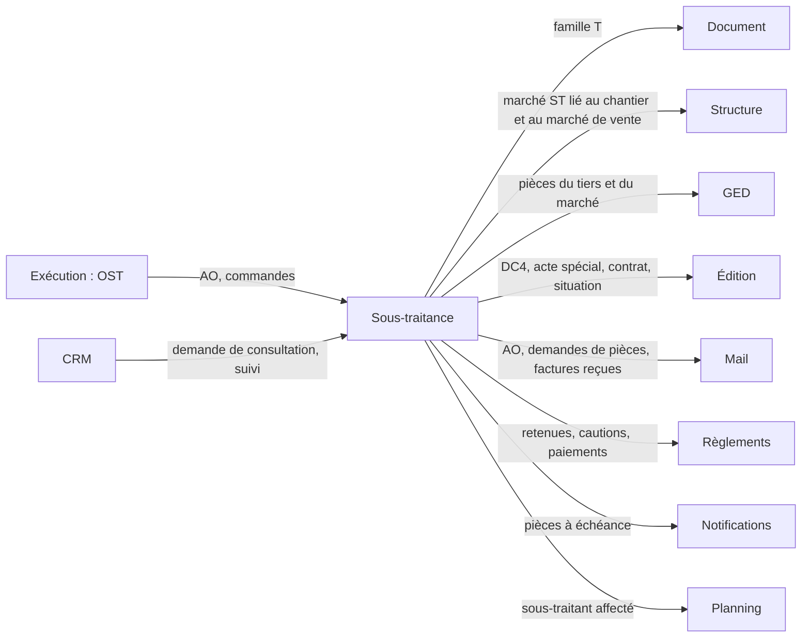

# LogiBTP – analyse du module Sous-traitance

> Analyse préalable (23/10/2026) à partir de la note « Module sous-traitance ». Socle commun :
> [ANALYSE-MODULES-TRANSVERSE.md](ANALYSE-MODULES-TRANSVERSE.md). Analyses liées : [Exécution](ANALYSE-MODULE-EXECUTION.md)
> (ordre de sous-traitance OST) · [CRM](ANALYSE-MODULE-CRM.md) (C8, C20 : analyse demandée) ·
> [Marchés et règlements](CONCEPTION-MARCHES-REGLEMENTS.md) (Q9 : paiement direct, sans décision) ·
> [Achats et marchés](CONCEPTION-ACHATS-MARCHES.md) · [Mail](ANALYSE-MODULE-MAIL.md) · [Édition](CONCEPTION-EDITION.md).
>
> **État** : toutes les questions sont tranchées (ST1 à ST20 : § 8.1 ; relecture ST21 à ST32 : § 8.2, 23/10/2026),
> décisions reportées dans les paragraphes. Le format et la plateforme de la facture électronique relèvent d'un module
> à part (ST22).
>
> **Réalisation** : lot 0 réalisé le 24/10/2026 (module Document `019i` : famille T, `f_famille_achat`, lot de consultation ; `db/210` : activation du module ; `Consultations.cs`). Lot 1 réalisé le 24/10/2026 (`db/211`, `marche-sous-traitance.js`, menu et listes) ; écart : une seule fiche « marché » avec un champ Sens (pas de fiche propre au marché de sous-traitance). Lot 2 réalisé le 24/10/2026 (`modules/sous-traitance`, GED `052`, `db/212`).

## 1. Note d'origine (résumé)

- Comme les achats, avec trois types de documents : **appel d'offres**, **commande**, **facture d'avancement**.
- Les commandes s'inscrivent dans un **marché de sous-traitance**, lié à un **chantier** et, au choix, à un **marché
  de vente**.
- Le marché porte des **pièces annexes du sous-traitant** (extrait Kbis…) et des **documents propres au marché**
  (DC4…) ; des **éditions** complètent ces documents avec les informations saisies dans le marché.
- La **liste des pièces** est paramétrable (pièces obligatoires et facultatives) avec des **dates de validité**.
- Deux saisies de la facture : **à l'avancement** (le sous-traitant n'a pas de logiciel, on établit sa situation pour
  lui) ou **facture reçue** (on saisit ses montants).
- Une facture de sous-traitance peut être **rattachée à une vraie facture** (notre facture au client) pour le
  **paiement direct**.

## 2. Ce qui existe déjà

| Besoin | Déjà dans l'application |
|---|---|
| Chaîne de documents d'achat | Famille A : `A_DEVIS` (demande de prix), `A_COMMANDE`, `A_FACTURE_AVT` (« Situation fournisseur », avancement F : cumul − précédent), `A_AVOIR` (avoir d'avancement d'une période négative), transformations, restes, soldes |
| Avancement en % / quantité / montant cumulés, précédent, dépassement | Lots 6a et 6b (`lig_avt_*`, `DocumentService.Precedents`, `LIGNE_DEPASSEE`, `ent_rang_avancement`), répliqués entre les deux `MoteurDocument` |
| Marché : commande de base et avenants, montant calculé | `marche`, `marche_document` (BASE, AVENANT), `f_marche_recalculer`, `f_marche_commande` (`db/170`) |
| Postes de pied du marché (retenue de garantie), acomptes, échéancier | `marche_poste`, `marche_acompte`, `condition_paiement`, `document_echeance` (`db/173`, `174`, module Document `019b`) |
| Règlements, cautions | Module Règlements (décaissements `sens=D`, cautions, reste à payer) |
| Intervenant sous-traitant, paiement direct (information) | `fonction_intervenant` SOUS_TRAITANT (`fin_paiement_direct`), `intervenant.itv_paiement_direct`, `ent_intervenants` (`db/162`) |
| Pièces des tiers | Catégories GED `kbis`, `attestation_urssaf` (coffre), `attestation_assurance` (coffre), `rib` (`db/140`) |
| Éditions alimentées par les données | Module Édition (sources, dictionnaire, sources annexes, PDF rangé en GED) |
| Ordre de sous-traitance | Prévu par l'Exécution (OST : « anticipe et suit une ou plusieurs demandes ou commandes de sous-traitance ») |
| Réception des factures par courriel | Module Mail lots 3 et 4 (relève IMAP, reconnaissance, rattachement) |
| Données de démonstration | `demo_sous_traitant` (`db/120`, ancienne table de démo des ressources : code, raison, métier, taux horaire, agréé) |

**Ce qui manque** : un marché côté **dépense** (le `marche` actuel est un marché de vente : montant = commandes
clients), les **pièces exigées** avec validité et contrôle de conformité, la **saisie d'une facture reçue** sans
avancement ligne à ligne, le **lien de paiement direct** entre une facture de sous-traitance et notre facture au client,
les éditions DC4 / acte spécial / contrat.

## 3. Cadre réglementaire à couvrir (rappel, à valider)

| Sujet | Règle (France) | Effet dans le logiciel |
|---|---|---|
| Acceptation et agrément | Loi 75-1334 : le sous-traitant est accepté et ses conditions de paiement agréées par le maître d'ouvrage. Marchés publics : déclaration **DC4** (ou acte spécial) | Pièce du marché obligatoire, état « agréé » du marché, montant agréé |
| Paiement direct | Marchés publics : obligatoire pour le sous-traitant de 1er rang au-delà de 600 € TTC ; le titulaire a **15 jours** pour accepter ou refuser la demande de paiement. Marchés privés : **délégation de paiement** ou **caution** (art. 14) | Mode de garantie du marché (paiement direct, délégation, caution), délai d'acceptation suivi, plafond = montant agréé |
| Obligation de vigilance | Code du travail L8222-1 et D8222-5 : au contrat puis **tous les 6 mois** : attestation de vigilance URSSAF, Kbis (ou D1), liste des salariés étrangers (LNTE) ; assurances (RC, décennale) | Pièces à validité, échéances, blocage paramétrable |
| Autoliquidation de la TVA | CGI art. 283-2 nonies : travaux de construction sous-traités : le sous-traitant facture HT, le preneur autoliquide | Indicateur du marché, TVA nulle sur la pièce, mention ; écriture comptable plus tard (module Comptabilité) |
| Retenue de garantie | Loi 71-584 : 5 % au plus, remplaçable par une caution | Poste de pied du marché (déjà prévu pour les ventes), caution du module Règlements |
| Autofacturation | CGI art. 289 I-2 : une facture établie par le client au nom du fournisseur exige un **mandat** préalable et l'acceptation de chaque facture | Saisie à l'avancement : soit « proposition de situation » à faire facturer par le sous-traitant, soit autofacturation sous mandat (ST7) |

## 4. Décisions structurantes

### 4.1 Une famille de documents propre : T (sous-traitance)

Décision ST1 : une **famille T**, pour gérer simplement les types, les listes, les droits et l'activation du module
(documents masqués quand il est désactivé, règle E24). Elle se comporte comme les achats (sens 2 : tiers fournisseur,
décaissement, comptes d'achat) : les endroits qui testent aujourd'hui la famille A passent par une fonction commune
« famille d'achat » (A ou T) plutôt que par une comparaison en dur — `comptes.js`, `documents/transformation.js`,
`pages/document.js`, `panneaux-btp.js`, `structure/graphe-structure.js`, `panneaux.js` du module Document,
`SpecialisationBtp.cs`, `SpecialisationReglementBtp.cs`, `MailBtp.cs`, les vues SQL (`v_liste_documents`, facturé
des marchés) et les règles des documents par famille (`regle_document.rdo_famille`, `db/178`).

| Code | Libellé | Préfixe | Avancement | Remarque |
|---|---|---|---|---|
| `T_AO` | Appel d'offres de sous-traitance | AOS | — | Un par sous-traitant consulté, regroupés par lot de consultation (ST3, § 5.1) |
| `T_COMMANDE` | Commande de sous-traitance (contrat) | CST | — | Toujours dans un marché de sous-traitance (`MARCHE_ST_OBLIGATOIRE`) ; avenants |
| `T_FACTURE_AVT` | Facture d'avancement de sous-traitance | FST | F (cumul − précédent) | Saisie à l'avancement ou facture reçue (§ 5.4) ; période négative → avoir (ST11, ST21) |

Transformations : `E_OST` → `T_AO`, `T_COMMANDE` ; `V_COMMANDE`, `V_DEVIS` → `T_AO` ; `T_AO` → `T_COMMANDE` ;
`T_COMMANDE` → `T_FACTURE_AVT`. Liste et menu propres (thème « Sous-traitance ») ; les règles des documents s'appliquent
par type et par famille T.

### 4.2 Le marché de sous-traitance est un marché « dépense »

Décision ST2 : la table `marche` gagne un sens (`mar_sens` : V vente, ST sous-traitance), le sous-traitant
(`mar_tiers_id`) et le marché de vente lié (`mar_marche_vente_id`, facultatif), plutôt qu'une seconde table : la
fiche, la liste, les avenants (`marche_document`), le montant calculé (`f_marche_recalculer` sur les commandes de
sous-traitance validées), les postes de pied, les acomptes, l'échéancier, l'avancement (précédent, dépassement
`mar_depassement_autorise`) et le filtre des listes par rattachement servent tels quels. Code `MST-<chantier>-<rang>`.
Le marché de vente lié, s'il est renseigné, reçoit d'office l'**intervenant** SOUS_TRAITANT (paiement direct selon le
mode de garantie).

Décision ST4 : un marché = **un axe de facturation** du sous-traitant sur le chantier. Un sous-traitant qui facture
tout ensemble a un seul marché (avenants) ; s'il facture par lots distincts (plusieurs situations parallèles), il a
plusieurs marchés sur le même chantier.

## 5. Synthèse fonctionnelle

### 5.1 Appel d'offres

- Créé depuis un ordre de sous-traitance (Exécution, OST), une commande client, un devis, une demande du CRM ou à vide,
  rattaché à un chantier (ou un projet en phase de chiffrage).
- Envoyé à plusieurs sous-traitants (copie par sous-traitant, courriel par le module Mail, pièces du dossier de
  consultation depuis la GED) ; réponses saisies ou importées ; **comparatif** des offres (lignes en regard, totaux,
  écarts au budget de l'OE ou au déboursé du devis).
- **Lot de consultation** (ST3) : les copies d'une même consultation partagent un code de lot ; le comparatif les lit
  ensemble. Le principe est **générique** (module Document) et sert aussi aux **demandes de prix d'achat** (`A_DEVIS`)
  envoyées à plusieurs fournisseurs.
- Offre retenue → commande de sous-traitance (transformation) ; les autres passent « non retenues » (motif).

### 5.2 Marché et commande

- À la validation d'une commande de sous-traitance : fenêtre « marché » comme pour les ventes : marchés existants du
  sous-traitant sur le chantier (un par axe de facturation, ST4) → avenant, sinon nouveau marché ; marché de vente lié
  (facultatif, ST5) ; nature du marché (**public** ou **privé**, reprise du marché de vente s'il existe) et mode de
  garantie selon la nature (ST14) : public → paiement direct (ou paiement par le titulaire sous le seuil) ; privé →
  délégation de paiement ou caution.
- Fiche du marché : sous-traitant, chantier, marché de vente, nature publique ou privée, montant HT (commande +
  avenants), **montant agréé** (DC4), autoliquidation, retenue de garantie et postes, pénalités, conditions de
  paiement, onglets Pièces (liste des pièces à fournir et leur état, ST18), Documents, Factures, Paiements, Suivi (CRM).
- Pas de sous-traitance de 2e rang (ST6) : à revoir à l'usage.

### 5.3 Pièces exigées

Deux portées, une même mécanique :

| Portée | Rangée dans la GED de | Exemples | Validité |
|---|---|---|---|
| **Sous-traitant** (pièces annexes) | la fiche du tiers (servent à tous ses marchés) | Kbis, attestation de vigilance URSSAF, LNTE, attestation de régularité fiscale, RC, décennale, RIB, carte d'identification BTP | Durée par défaut (6 mois, 3 mois, annuelle) ou date saisie, rappel avant échéance |
| **Marché** (documents propres) | la fiche du marché | DC4 / acte spécial, contrat de sous-traitance, agrément du maître d'ouvrage, caution, délégation de paiement, PPSPS, plan de prévention | Souvent sans échéance ; la caution a la sienne |

- **Paramétrage** (`/parametres/sous-traitance`) : liste des pièces (code, libellé, portée, catégorie GED,
  obligatoire ou facultative, durée de validité, délai de rappel, **bloquante pour** : commande, facture, paiement ;
  conditions : marché public ou privé, paiement direct, montant), **modèle d'édition** associé (la pièce se génère
  depuis le marché) ; pièces fournies par défaut (ST12) complétées librement ; une pièce peut être ajoutée ou dispensée
  sur un marché (motif).
- **État de conformité** par pièce et par marché (règle répliquée JS ↔ C#, jeu `modules/sous-traitance/tests/cas`) :
  fournie, à échéance (dans le délai de rappel), expirée, manquante, dispensée ; marché **conforme** quand aucune pièce
  obligatoire n'est manquante ou expirée.
- **Contrôles** : validation de la commande refusée sans les pièces bloquantes « commande » (`ST_PIECES`), bon à payer
  refusé sans les pièces bloquantes « paiement » ; forçage par droit, journalisé.
- **Rappels** : source du module Notifications (pièces à échéance au service achats ou au conducteur), demande de pièce
  par courriel au sous-traitant (module Mail, modèle à variables), dépôt d'une pièce reçue par courriel (reconnaissance
  du Mail : rattachement au tiers).

### 5.4 Factures

| Mode | Usage | Saisie | Contrôles |
|---|---|---|---|
| **À l'avancement** | Le sous-traitant n'a pas de logiciel : on établit sa situation | Comme une situation fournisseur : avancement par ligne de la commande (%, quantité, montant cumulés), précédent repris, postes de pied du marché (retenue, prorata, pénalités) | Moteurs existants (jeux 10 à 12) ; édition « situation de sous-traitance » à faire signer ou facturer par le sous-traitant (ST7) |
| **Facture reçue** | Le sous-traitant envoie sa facture | Entête de la facture : numéro et date du sous-traitant, montant HT de la période (ou cumulé), TVA ou autoliquidation, TTC, **saisis librement** (ST22 : aussi pour une plateforme qui ne fait qu'afficher la facture, sans export) ; PDF rangé dans la GED (glissé ou reçu par courriel) ; ventilation sur les lignes facultative (au prorata du reste par défaut) ; import structuré (Factur-X, UBL) et connexion à la plateforme : futur module Facturation électronique | Montant ≤ reste du marché (avertissement, `mar_depassement_autorise`), cumul ≤ montant agréé en paiement direct, écart avec l'avancement constaté signalé |

Dans les deux cas : un numéro de situation par marché (`ent_rang_avancement`), la facture devient « bon à payer » à
la validation (pièces conformes), le module Règlements suit le paiement (par nous) ou le paiement direct (par le maître
d'ouvrage, § 5.5).

### 5.5 Paiement direct (marchés publics)

- Une facture de sous-traitance en paiement direct se **rattache** à une de nos factures au client (lien
  `PAIEMENT_DIRECT` dans `document_lien`) : facture d'avancement du marché de vente lié, ou **facture directe** du
  chantier quand il n'y a pas de marché de vente (ST5) ; choisie parmi les factures de la période ou proposée d'office.
- Notre facture porte un **poste de déduction** « Paiement direct — <sous-traitant> » (Q9 de
  `CONCEPTION-MARCHES-REGLEMENTS.md`) : le net à payer du client baisse d'autant ; la facture de sous-traitance n'entre
  pas dans nos décaissements.
- Suivi : demande reçue → acceptée (dans les 15 jours, total ou partiel avec motif) → transmise au maître d'ouvrage →
  payée par le maître d'ouvrage (règlement saisi au module Règlements, pointage de l'échéance) ; cumul payé ≤ montant
  agréé.
- Montant déduit (ST15) : celui que le maître d'ouvrage paie au sous-traitant ; en autoliquidation, le HT, la TVA
  restant à notre charge.
- **Marchés privés** (ST14) : délégation de paiement ou caution, traitées à part du paiement direct (pas le même lien
  ni la même déduction) ; la caution suit le module Règlements. Écritures comptables du paiement direct, de la
  délégation et de l'autoliquidation : à préciser avec le module Comptabilité.

## 6. Liens avec les autres modules

| Module | Avec lui | Sans lui |
|---|---|---|
| Document, Structure, Annuaire, GED | Prérequis | — |
| Édition | DC4, acte spécial, contrat, situation à faire signer | Pièces du marché déposées à la main |
| Règlements | Paiements, retenues, cautions, paiement direct suivi | Factures sans suivi de paiement |
| Mail | AO envoyés, demandes de pièces, factures reçues rapprochées | Impression, dépôt manuel |
| Notifications | Rappels des pièces à échéance | Colonne « échéance » des listes |
| Exécution | OST → AO / commande ; heures et avancement de l'ordre | AO depuis la commande client ou à vide |
| CRM | Tâches (pièce manquante, acceptation à faire), suivi | — |
| Planning | Affectation du sous-traitant (type existant), dates du marché | — |

## 7. Ajouts au module Document et au cœur

| Ajout | Où | Remarque |
|---|---|---|
| Famille T (`tyd_famille`), fonction commune « famille d'achat » (A ou T) en JS et en C# | Module Document | Remplace les tests en dur de la famille A (§ 4.1) |
| Types `T_*`, statuts, transformations, droits, vues de colonnes, règles par famille, `module_societe` « sous_traitance » | Cœur (`db/2xx`) | Vues d'avancement reprises de `A_FACTURE_AVT` |
| Lot de consultation (`ent_consultation` : code commun aux copies) | Module Document | Sert aussi aux demandes de prix d'achat (ST3) |
| `mar_sens`, `mar_tiers_id`, `mar_marche_vente_id`, `mar_montant_agree`, `mar_garantie`, `mar_autoliquidation`, `mar_public` | Cœur (`marche`) | `v_liste_marches` séparée par sens |
| Facture reçue : `ent_ref_tiers_numero`, `ent_ref_tiers_date`, mode de saisie (`ent_st_saisie` : AVANCEMENT / RECUE), totaux saisis | Module Document (référence externe déjà présente) ou cœur | Le moteur ne recalcule pas un total saisi : ventilation sur les lignes ou ligne unique |
| Lien `PAIEMENT_DIRECT` et poste de déduction (HT en autoliquidation, ST15) | Module Document (`document_lien.lie_type`) ; cœur (poste) | Q9 à décider |
| Autoliquidation : TVA nulle et mention | Cœur (taux « autoliquidation ») | Écritures : module Comptabilité |
| Validité des pièces : `dge_valide_du`, `dge_valide_au` | Module GED (générique) | Utile aussi hors sous-traitance (habilitations, assurances des véhicules) |

**Module Sous-traitance** (`modules/sous-traitance`, sans dépendance au Document) : pièces exigées (`stt_piece_type`,
conditions, bloquant pour), pièces dispensées ou ajoutées par élément (`stt_piece_element`), état de conformité
(`conformite.js` ↔ `ReglesConformite.cs`), suivi du paiement direct (`stt_paiement_direct` : demande, délais,
acceptation, transmission, paiement), comparatif des offres ; le cœur fournit tiers, marchés, documents et GED
(`SpecialisationSousTraitanceBtp`).

## 8. Questions et propositions

### 8.1 Première lecture (décidée le 23/10/2026)

| N° | Question | Proposition | Décision |
|---|---|---|---|
| ST1 | Famille propre (T) ou types d'achat marqués ? | Types de la famille A marqués `tyd_sous_traitance` (§ 4.1) | Famille propre pour les gérer simplement | 
| ST2 | Marché de sous-traitance : même table que le marché de vente ? | Oui, `mar_sens` (§ 4.2) | Ok |
| ST3 | Appel d'offres : un document par sous-traitant, ou un dossier avec plusieurs offres ? | Un document par sous-traitant, regroupés par un « lot de consultation » (code commun) pour le comparatif | Ok il faut aussi ajouter ce principe de lot pour les demmande d'achat pour plusieurs fournisseur |
| ST4 | Un marché par sous-traitant et par chantier, ou plusieurs (lots distincts) ? | Plusieurs possibles ; le marché existant est proposé, avenant par défaut | Cela dépend de la facturation soit tout dans une facturation donc un marché soit plusieurs axe de facturation donc plusieurs marché. |
| ST5 | Le marché de vente lié est-il obligatoire ? | Non ; obligatoire seulement en paiement direct (la déduction se fait sur ses factures) | Non mêmes pour le paiement direct on peut déduire sur une facture direct. |
| ST6 | Sous-traitance de 2e rang (sous-traitant d'un sous-traitant) à gérer ? | Rang et sous-traitant « titulaire » renseignés pour le DC4, sans chaîne de documents | non a voir à l'usage si nécessaire |
| ST7 | Saisie à l'avancement : document que le sous-traitant facture, ou autofacturation sous mandat ? | « Proposition de situation » imprimée et signée par le sous-traitant, qui vaut facture seulement si un mandat d'autofacturation est coché sur le marché (pièce du marché) | Ok |
| ST8 | Facture reçue : ventiler sur les lignes de la commande ? | Facultatif ; sans ventilation, une ligne « Période » au prorata du reste par ligne (avancement en montant) pour que le précédent et le reste restent justes | Ok |
| ST9 | Facture reçue en cumul ou en période ? | Les deux à la saisie (choix), stockée en cumul comme l'avancement | Ok |
| ST10 | Écart entre la facture reçue et l'avancement constaté par le conducteur ? | Avancement constaté facultatif (situation « à l'avancement » de contrôle) ; écart signalé, facture bloquée au-delà d'un seuil | Oui |
| ST11 | Avoir de sous-traitance : type propre ou `A_AVOIR` ? | `A_AVOIR` (nature avoir d'avancement), marqué par le marché | Oui |
| ST12 | Pièces : quelles valeurs par défaut fournies ? | Kbis (3 mois), URSSAF (6 mois), LNTE (6 mois), fiscale (6 mois, public), RC et décennale (annuelles), RIB ; marché : DC4 (public), acte spécial, contrat, agrément, caution | Ok et possibilité d'en ajouter en plus |
| ST13 | Pièce manquante : blocage ou alerte ? | Paramétrable par pièce (commande, facture, paiement) ; défaut : URSSAF et Kbis bloquent le paiement, le reste alerte | Ok |
| ST14 | Délégation de paiement : même lien que le paiement direct ? | Même lien, sans poste de déduction (le client paie le sous-traitant pour notre compte : la facture client garde son montant) — à valider avec l'expert-comptable | Non on fait la différence avec les marchés privé et public, et on fera un point plus préci avec le module compta |
| ST15 | Paiement direct : TTC ou HT (autoliquidation) déduit de notre facture ? | Montant que le maître d'ouvrage paie au sous-traitant ; en autoliquidation, HT, la TVA restant à notre charge — à valider avec l'expert-comptable | OK et on fera un point plus préci avec le module compta |
| ST16 | Acceptation de la demande de paiement (15 jours) : suivi automatique ? | Échéance = réception + 15 jours, tâche du CRM au conducteur, notification à J-3 | Ok |
| ST17 | DC4 : formulaire officiel rempli ou édition propre ? | Édition propre reprenant la mise en page du DC4 (le module Édition ne remplit pas un PDF existant) ; remplissage d'un PDF officiel à étudier plus tard | Ok |
| ST18 | Validité des pièces : dans la GED (générique) ou dans le module ? | Dans la GED (`dge_valide_au`) ; le module ne porte que la liste exigée et la règle de conformité | Ok et une liste des pièce à fournir dans le module |
| ST19 | `demo_sous_traitant` : à reprendre ? | Les sous-traitants de démo deviennent des personnes de l'annuaire (relation sous-traitant), la table est supprimée | Ok |
| ST20 | Portail sous-traitant (dépôt des pièces, des factures) ? | Plus tard (Exécution, possibilité 7) ; en attendant, le courriel reçu | Ok on commence simple on ajoutera le portail plus tard |

### 8.2 Relecture (23/10/2026) : points manquants

| N° | Question | Proposition | Décision |
|---|---|---|---|
| ST21 | ST11 (avoir = `A_AVOIR`) reste-t-elle juste avec la famille T (ST1) ? | Non : un `A_AVOIR` sortirait de la liste et du marché de sous-traitance ; type **`T_AVOIR`** (avoir d'avancement de la facture de sous-traitance, `tyd_avoir_tyd_id`) | Ok |
| ST22 | Facturation électronique : depuis le 1er septembre 2026, toute entreprise doit **recevoir** ses factures par une plateforme agréée (Factur-X, UBL, CII) ; les sous-traitants y viennent à leur tour | La facture reçue s'importe d'abord depuis le **Factur-X** (XML embarqué dans le PDF : numéro, date, montants, TVA, mention d'autoliquidation) avant toute lecture du PDF ; branchement à une plateforme : sujet commun aux achats (module Facturation électronique à analyser) ; l'autofacturation (ST7) passe aussi par la plateforme | On garde une saisie libre pour les entreprises qui auront une PA qui ne fait qu'afficher la facture sans export. On attend on va créer un module spécifique pour la Facturation électronique avec la gestion des format et connexion au PA. |
| ST23 | Réception des travaux du sous-traitant, réserves, libération de la retenue de garantie et mainlevée de la caution | Date de réception sur le marché (`mar_date_reception`, déjà présente), réserves en notes du CRM (levée datée), échéance de libération à réception + 1 an sauf réserves (module Règlements, comme Q21 des ventes) | Ok |
| ST24 | Fin du marché : décompte final du sous-traitant | Dernière facture marquée « définitive » (solde), marché soldé : plus d'avancement ni d'avenant sans le rouvrir (droit, motif) | Ok |
| ST25 | Révision de prix (indices BT) | Poste de pied « révision » saisi sur la facture ; calcul par indices plus tard, commun avec les ventes (Q22) | Ok |
| ST26 | Pénalités, compte prorata, refacturations au sous-traitant (benne, nettoyage, consommations) | Postes de pied du marché déduits de chaque situation (pénalités, prorata, refacturations en montant ou en %) ; une refacturation importante se fait par une facture de vente au sous-traitant | Ok |
| ST27 | Qui valide une facture de sous-traitance (bon à payer) ? | Deux temps du cycle existant : **approbation** par le conducteur (avancement constaté, ST10), **validation** (bon à payer) par la comptabilité ou un administrateur ; droits fins au module de droits | Ok |
| ST28 | Avance et acomptes au sous-traitant (avance des marchés publics, acompte à la commande) | Acomptes du marché (`marche_acompte`) repris tels quels, déduits des situations | Ok |
| ST29 | Délais contractuels et ordres de service | Dates de début et de fin contractuelles sur le marché (jalons du planning, comme les fins de chantier) ; ordre de service = édition du marché rangée en GED | Ok |
| ST30 | Budget et rentabilité | Commande de sous-traitance validée = **engagé** ; factures = **réalisé** ; comparés au budget planifié de l'OE (Exécution E16) dans la rentabilité continue (possibilité 1 de l'Exécution) | Ok |
| ST31 | Activation du module | `module_societe` « sous_traitance » ; désactivé : famille T, menus, onglets et marchés de sous-traitance masqués (règle E24) | Ok |
| ST32 | Règles répliquées JS ↔ C# | Jeux du module : `01_conformite` (états des pièces, marché conforme), `02_ventilation` (facture reçue ventilée au prorata du reste, ST8), `03_plafonds` (reste du marché, montant agréé, cumul du paiement direct) | Ok |

## 9. Faisabilité

**Faisable**, en s'appuyant sur les achats et les marchés existants. Points d'effort :

- **Famille T** (ST1) : une vingtaine de tests de la famille A à remplacer par la fonction commune « famille
  d'achat » (§ 4.1), règles par famille et vues SQL à compléter ; à faire en premier, avec un test qui vérifie qu'un
  document T se comporte comme un achat (comptes, contacts, règlements).
- **Marché à deux sens** : `f_marche_recalculer`, `f_marche_commande`, la fiche et les listes supposent la vente ; à
  revoir partout où le marché est lu (restes, facturé, acomptes, postes).
- **Facture reçue** : nouveau mode de saisie à totaux imposés ; la ventilation sur les lignes garde le moteur
  d'avancement intact (pas de règle de calcul nouvelle dans `MoteurDocument`).
- **Conformité des pièces** : règle simple mais répliquée JS ↔ C# ; rappels par le planificateur des notifications.
- **Paiement direct** : touche la facture client (poste de déduction, net à payer) : à décider avec Q9 et le module
  Règlements.
- **Éditions** : DC4, acte spécial, contrat, situation : modèles fournis, source « marché » du module Édition.

**Risques** : exactitude juridique (vigilance, autoliquidation, paiement direct : relecture par l'expert-comptable ou
un juriste), confusion achats / sous-traitance dans les listes (thème séparé), données des marchés publics (DC4 : de
nombreux champs : à saisir dans le marché ou dans l'édition).

## 10. Simplification d'utilisation

- **Assistant « Sous-traiter »** depuis l'OST, la commande client ou le marché de vente : lignes choisies, sous-traitants
  proposés par métier, appel d'offres envoyé en un écran. Ok
- **Pastille de conformité** du sous-traitant partout où il apparaît (intervenants, planning, listes) ; clic = pièces. Ok
- **Demande de pièces en un clic** : courriel listant les pièces manquantes ou à échéance. Ok
- **Glisser la facture** (PDF) sur le marché : facture reçue créée, numéro, date et montants proposés par la
  reconnaissance du module Mail. Ok
- **Tableau du marché** : commandé, agréé, facturé, payé (nous / maître d'ouvrage), retenu, reste. Ok

## 11. Découpage en lots proposé

| Lot | Contenu | Prérequis |
|---|---|---|
| 0 | Famille T dans le module Document (fonction « famille d'achat »), activation du module, lot de consultation (aussi pour les demandes de prix d'achat) | — |
| 1 | Types `T_*`, marché à deux sens (fiche, liste, avenants, axes de facturation, public / privé), commande dans un marché, appel d'offres, transformations depuis l'OST et la commande client, sous-traitants de démo repris dans l'annuaire | Lot 0 |
| 2 | Pièces exigées (paramétrage, validité GED, liste à fournir, conformité répliquée, contrôles, rappels, demandes par courriel) | Lot 1 ; Notifications, Mail |
| 3 | Factures : à l'avancement, facture reçue (saisie libre, ventilation), avoir `T_AVOIR`, approbation et bon à payer, postes du marché, édition de la situation | Lot 1 ; ST21 à ST27 |
| 4 | Paiement direct (marchés publics : lien, déduction, suivi des 15 jours, paiements du maître d'ouvrage) ; marchés privés : délégation, cautions ; réception et libération des retenues | Lot 3 ; Règlements ; Q9 ; point Comptabilité |
| 5 | Éditions du marché (DC4, acte spécial, contrat, ordre de service), comparatif des offres, assistant « Sous-traiter », engagé dans la rentabilité | Lots 1–2 ; Édition ; Exécution |
