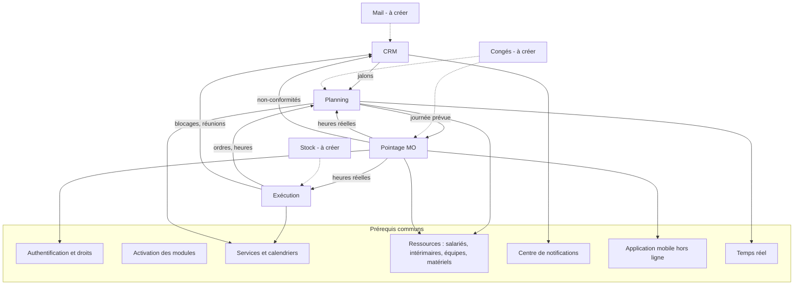

# LogiBTP – CRM, Exécution, Planning, Pointage MO : socle commun

> Analyse préalable (20/10/2026). Ce qui est commun aux quatre modules analysés et doit exister avant eux.
> Analyses par module : [CRM](ANALYSE-MODULE-CRM.md) · [Exécution](ANALYSE-MODULE-EXECUTION.md) ·
> [Planning](ANALYSE-MODULE-PLANNING.md) · [Pointage MO](ANALYSE-MODULE-POINTAGE.md).

## 1. Vue d'ensemble des liens

Chaque module fonctionne **seul** (avec les modules existants) ; chaque lien entre eux n'est actif que si les deux
modules le sont. Les liens passent par le cœur (règle d'architecture) : aucun des quatre modules ne référence un autre.

| Module | Fonctionne seul ? | Gagne avec |
|---|---|---|
| CRM | Oui | Exécution (blocages), Planning (jalons), Pointage (mobile), Mail |
| Exécution | Oui (Document, Structure, GED) | Planning (dates), Pointage (temps réels), CRM (motifs → tâches), Stock |
| Planning | Oui (chantiers, ressources) | Exécution (ordres, parcours), Pointage (réel), Congés, CRM |
| Pointage MO | Oui (chantiers, salariés) | Planning (pré-remplissage), Exécution (ordres), CRM (non-conformités) |

## 2. Authentification et droits (prérequis bloquant)

**Constat** : l'utilisateur courant est lu dans les en-têtes `X-Utilisateur`, `X-Profil`, `X-Groupe`
(`socle/dotnet/LogiBTP.Socle.Web/Web.cs`, « en attendant l'authentification »). Le Pointage personnel (connexion du
salarié), la borne (appareil enregistré), les notes privées et les mentions du CRM, les vues personnelles du Planning
en ont besoin.

**Proposition** : module d'authentification (comptes liés à un individu de l'annuaire, mot de passe haché ou
fournisseur d'identité de l'entreprise, jetons pour le mobile et les bornes, révocation), profils et groupes de droits
(administrateur, chargé d'affaires / conducteur, chef d'équipe, salarié, RH, consultation), droits par module et par
action dans la ligne de `droit_document` / `droit_fiche`. À rapprocher du **module d'installation** déjà prévu
(TACHES.md).

**Première étape** (analyse détaillée : [ANALYSE-MODULE-AUTHENTIFICATION.md](ANALYSE-MODULE-AUTHENTIFICATION.md)) : une
session utilisateur pour la saisie, liée à un **salarié** ou à un **intérimaire** (compte rattaché à son individu,
cookie de session, profils existants) ; le module complet des droits suit (groupes, comptes de service, bornes,
fournisseur d'identité).

## 3. Activation et désactivation des modules

**Constat** : un module facultatif (Règlements) est aujourd'hui détecté par **l'existence de ses tables**
(`SpecialisationAnnuaireBtp.ReportsFacultatifs`, `SuppressionFiches`, `EditionsBtp`). Ce mécanisme ne permet pas de
désactiver un module installé, ni de régler l'activation par société.

**Proposition** :

- Table `module_societe` (socle, une ligne par module et par base) : `mod_code`, `mod_actif`, `mod_installe_le`,
  `mod_version`, `mod_parametres` (JSONB : sous-options, par exemple types d'ordres actifs de l'Exécution).
- Les scripts SQL de tous les modules sont toujours appliqués (schéma complet, migrations simples) ; **l'activation est
  un drapeau**, pas une présence de tables. Les contrôles « table existe » actuels passent par le même service.
- Service serveur `ModulesSociete` (cache par base, comme les autres caches dépendant du schéma) : filtre de point
  d'accès `ExigeModule("planning")` → `409 MODULE_INACTIF` ; les points d'accroche du cœur ne s'exécutent que si les
  modules concernés sont actifs (un lien Exécution → Planning exige les deux).
- Client : `app.modules.actif(code)` lu au démarrage ; menus du bandeau (`navigation/menus.js`), widgets, onglets de
  fiches, colonnes de listes et raccourcis filtrés ; page `/parametres/modules` (administrateur).
- **Désactiver** = masquer tout (menus, onglets, données dans les listes) et refuser les écritures ; un module se
  désactive plutôt à l'initialisation du dossier, les données restantes étant des essais (Exécution, E15 / E24) ;
  réactiver restitue tout. Pas de suppression de données par la désactivation.
- **Dépendances déclarées** : chaque module déclare ses prérequis (le Pointage exige l'authentification et le
  référentiel des ressources) ; la page de paramétrage refuse une activation incomplète et explique pourquoi.

## 4. Référentiels communs

### 4.1 Services

Aujourd'hui `demo_salarie.sal_service` est un texte libre. Les quatre modules ont besoin d'un **référentiel des
services** : code, libellé, parent (sous-service, deux niveaux), nature (production, étude, logistique, administratif :
Vente, Achat), calendrier par défaut, seuil de sous-occupation, actif / en sommeil, responsable.

**Liaison nature MO → service** (demandée par le Planning) : chaque nature de main-d'œuvre de la bibliothèque (ou
regroupement de natures `MO`) pointe vers un service ; les heures budget d'un chantier par service = somme des
quantités en heures des composantes de ces natures dans les commandes validées.

### 4.2 Ressources

Aujourd'hui des tables **de démonstration** (`demo_salarie`, `demo_equipe`, `demo_materiel`, `demo_sous_traitant`,
`db/120`), seul le salarié est lié à l'annuaire (`sal_ind_id`). À remplacer par un référentiel réel :

| Ressource | Source | Compléments |
|---|---|---|
| Salarié | Individu de notre société | Matricule, un ou plusieurs services dont un principal (CRM C18), qualification, profil de paie, calendrier, coût horaire, dates d'entrée / sortie, habilitations |
| Intérimaire | Individu rattaché à une agence (tiers fournisseur) | Période de mission, coût horaire facturé |
| Équipe | Planning | Compositions datées, chef, sommeil |
| Matériel | Fiche matériel | Identifié (véhicule, engin) ou par nombre (échafaudage), service, dépôt, compteur |
| Location | Commande de location (Exécution / achats) | Période, fournisseur |
| Sous-traitant | Tiers (casquette sous-traitant) | Agrément, attestations |
| Théorique | Planning | « 2 poseurs », « 1 grutier » : sans identité |

### 4.3 Calendriers et jours fériés

Utilisés par le Planning (capacité, calcul des dates) et le Pointage (journée prévue, heures supplémentaires). Défini
une fois (plages, cycles de semaines, jours fériés par zone), affecté au service, surchargé par ressource.

### 4.4 Motifs

Motifs de blocage (Exécution), de non-conformité (Pointage), d'écart de planning : une table commune typée, chaque
motif désignant le service à prévenir (tâche CRM si le module est actif).

## 5. Centre de notifications

Rappels du CRM, incohérences du Planning, ordres bloqués de l'Exécution, pointages manquants : une même **boîte de
notifications** par utilisateur (bandeau : cloche avec compteur ; dock des notifications existant sur la page document
comme modèle), un planificateur de fond par base (déclenchement des rappels et contrôles périodiques, sur le modèle
d'`ArchivageGed`), et des canaux (écran ; courriel par le module Mail ; notification du mobile plus tard). Chaque
module publie ses notifications par le cœur ; chaque utilisateur choisit ce qu'il reçoit (préférence en base ici,
puisqu'elle sert au serveur).

## 6. Application mobile et hors ligne

Pointage personnel, borne, SAV de l'Exécution, photos du fil d'actualité, partie mobile des tâches du Planning :
**une seule application web installable (PWA)** distincte de l'interface de bureau, écrans tactiles simplifiés,
service worker, IndexedDB, file d'envoi, jeton d'appareil. Le client actuel (pages à routes, `PageBase`) reste la
base technique ; les écrans mobiles sont des pages dédiées.

## 7. Temps réel

Le Planning exige une synchronisation rapide entre utilisateurs ; le fil du CRM et la synthèse de l'Exécution en
profitent. Aujourd'hui la diffusion n'existe qu'entre fenêtres d'un même navigateur (`app.publier`, canal
`logibtp-fenetres`). Proposé : SignalR côté ASP.NET Core, groupes par base de société, messages « élément modifié »
relayés au client par le même `app.publier` (les listes et pages se rafraîchissent déjà sur ce signal).

## 8. Modules à créer en dehors des quatre

| Module | Attendu par | Remarque |
|---|---|---|
| Mail | CRM, Édition, GED (`dge_a_envoyer`) | Déjà inscrit dans TACHES.md |
| Stock | Exécution (réservation, colisage, emplacements) | Types S_* présents, `tyd_mouvemente_stock` non utilisé |
| Congés / absences | Planning, Pointage | À cadrer ; en attendant, tâches d'absence |
| Sous-traitance | Exécution (ordre de sous-traitance), CRM (liens) | Analyse à faire (CRM C20) : marchés de sous-traitance (demandes, commandes), documents obligatoires (attestations, agréments), paiement direct |
| Archivage | CRM (conservation des notes liée au tiers, C25 / C29), tous les modules à terme | Module complet à analyser ; aujourd'hui l'Annuaire n'a que `per_actif` |
| Authentification | Pointage, CRM, Planning | § 2 |

## 9. Ordre de réalisation proposé

| Étape | Contenu | Pourquoi dans cet ordre |
|---|---|---|
| 0 | Activation des modules, authentification, référentiels services / ressources / calendriers / motifs, centre de notifications | Prérequis de tous |
| 1 | CRM lots 1–3 (notes, demandes, suivi des validations) | Indépendant, peu risqué, valeur immédiate ; installe les notifications |
| 2 | Exécution lots 1–2 (ordres = documents E, parcours, synthèse) | S'appuie sur l'existant documentaire ; produit les heures et dates que le Planning consomme |
| 3 | Pointage MO lots 1–3 (saisie bureau, synthèse, variables de paie) | Valeur forte (paie, coût réel) sans attendre le Planning |
| 4 | Planning lots 1–5 (prototype du composant d'abord) | Le plus lourd ; profite des ordres et des ressources déjà en place |
| 5 | Mobile : borne, Pointage hors ligne, SAV, photos | Une fois les écrans bureau stabilisés |
| 6 | Liaisons croisées (Planning ↔ Pointage ↔ Exécution ↔ CRM), possibilités avancées | Quand les modules existent |

Le prototype du composant de planning (Planning lot 1) peut démarrer en parallèle dès l'étape 0 : c'est le principal
risque technique de l'ensemble.
