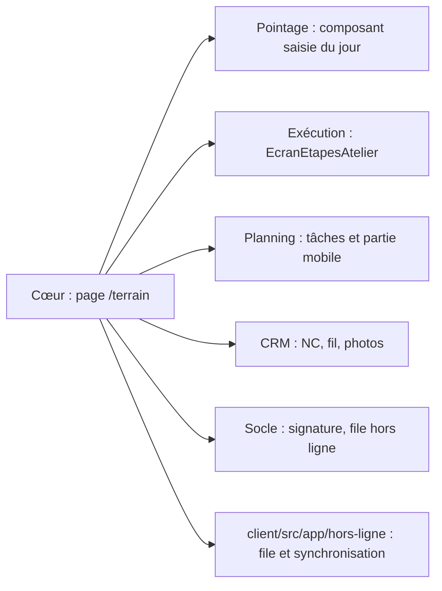

# LogiBTP – analyse de l'application de terrain (poseurs, chefs d'équipe)

> Analyse préalable (30/10/2026). Questions T1 à T22 tranchées le 30/10/2026 (§ 6).
>
> **Réalisation** : lot 1 réalisé le 30/10/2026 (`Btp/TerrainBtp.cs`, `client/src/app/pages/terrain.js`, `terrain/terrain.js`,
> `modules/ged/db/053`, `db/242`). Écarts : la partie mobile était déjà saisie au planning (constat du § 2 erroné) :
> le lot y ajoute le téléphone et les repères du chantier ; plans au dernier indice validé du CRM (T6) non repris
> (pièces cochées « Terrain » seulement) ; nœud de droits `terrain` (consultation) donné aux profils MOBILE et SAISIE ;
> bandeau du haut trop large sur un téléphone (défaut commun à l'application, à traiter avec le gabarit du lot 2).
>
> Lot 2 réalisé le 30/10/2026 (`Btp/TerrainPointageBtp.cs`, `client/src/app/terrain/pointage-terrain.js`, `db/243`, portée
> EQUIPE du module Droits). Écarts : tâche libre repérée par son origine `terrain` (pas de colonne `tac_libre`) ; nœud
> `pointage/saisie_libre` (les nœuds n'admettent pas le tiret) ; équipiers d'une saisie libre en équipe = membres de
> ses équipes du jour et salariés de son service principal, choisis par recherche ; pointage à la ligne d'ordre
> (`poi_lig_id`, tâche d'origine « ligne ») non repris : niveau chantier et ordre ; route `/api/terrain/journee` rattachée
> au droit MODIFIER du pointage ; bandeau : menus défilant dans le bandeau sous 700 px. Reprend les parties restées
> ouvertes de trois analyses : [Pointage](ANALYSE-MODULE-POINTAGE.md) § 2.3 et lots 5 et 6, [Planning](ANALYSE-MODULE-PLANNING.md)
> § 2.3 (partie mobile des tâches) et possibilité 10 (avancement réel), [Exécution](ANALYSE-MODULE-EXECUTION.md) lot 5
> (signature) et E50 à E53 (étapes hors de l'atelier). Socle commun : [transverse](ANALYSE-MODULES-TRANSVERSE.md) § 6
> (application mobile et hors ligne).

## 1. Objet

Donner au personnel de chantier (poseurs, intérimaires, chefs d'équipe) un écran **personnel, sur téléphone ou
tablette, utilisable sans réseau**, qui réunit ce dont il a besoin dans la journée :

- **où aller et quoi faire** : ses tâches du planning (jour, semaine), l'adresse, le contact sur place, les consignes,
  les plans et le raccourci de navigation ;
- **ce qu'il a fait** : ses pointages (ou ceux de son équipe), pré-remplis depuis le planning, sur le chantier et
  l'ordre de pose ;
- **où en est la pose** : étapes de l'ordre à valider, avancement, photos, non-conformités, réception signée.

Aujourd'hui, ces fonctions n'existent qu'à l'**atelier** (borne fixe `/borne`, page tablette `/execution/atelier`) ou
au **bureau** (`/pointage/saisie`, `/pointage/groupe`). Le poseur sur chantier n'a aucun écran adapté.

## 2. Existant

| Élément | État | Où |
|---|---|---|
| Comptes personnels (salarié, intérimaire), profil par défaut MOBILE (pointage SOI) | Fait | Modules Authentification et Droits (`009_droits.sql`) |
| Machines connues, « Rester connecté » 7 jours, JWT rafraîchi | Fait | Module Authentification, lot 3 |
| Saisie des pointages au bureau, saisie d'équipe, contrôles, congés, repas | Fait (écran de bureau) | `/pointage/saisie`, `/pointage/groupe` |
| Borne : salarié → chantier du jour (planning) ou ordre par numéro → type → activité ; NC → tâche CRM ; saisie d'équipe (`poi_groupe`) | Fait (atelier, appareil partagé) | `pages/borne.js`, `SpecialisationPointageBtp` |
| Chantiers du jour d'un salarié = tâches du planning qui l'affectent | Fait | `LiaisonsBtp.SqlChantiersDuJour` |
| Étapes des ordres validées hors bureau (ordres dont il est la ressource, ou de son service sur ses chantiers du jour) | Fait (atelier) | `EcranEtapesAtelier` (module Exécution), `AtelierBtp`, `/execution/atelier`, 🧩 de la borne |
| Type d'ordre de pose `E_PO` (étapes de démonstration : préparation, pose, réception) | Fait | `db/197`, `db/209` |
| Pointage rattaché à une tâche (`poi_tac_id`) | **Colonne seule** : jamais écrite | `modules/pointage/db/086` |
| Partie mobile de la tâche (`tac_mobile` : adresse, contact, commentaire, liens) | Saisie dans le détail de la tâche (groupe Mobile), lue par personne | `modules/planning/db/089`, `pages/planning.js` |
| Avancement de la tâche (`tac_avancement`) | Saisi au bureau (théorique) | Détail de la tâche du planning |
| Hors ligne : consultation des lectures de l'API, saisie des documents (IndexedDB, envoi au retour, fusion) | Fait pour les documents seulement ; écriture des pointages hors ligne = 503 `HORS_LIGNE` | `client/src/pwa/`, `client/src/app/hors-ligne/` |
| Photos dans le fil du chantier (GED, images) | Fait (dépôt depuis le bureau) | Module CRM, fil d'actualité |
| Signature | Papier seulement (fiche de dotation imprimée) | `stock/magasin.js` |
| SAV sur tablette, signature électronique, courriel du bon signé | Non fait | Exécution, lots 5 et 5b |

## 3. Synthèse fonctionnelle proposée

### 3.1 Accueil « Aujourd'hui »

- Une carte par tâche du jour où la personne est affectée (elle ou son équipe) : chantier, libellé, horaires, ordre
  d'origine, équipiers, état. Tâches de la semaine en second onglet.
- Partie mobile de la tâche : adresse des travaux (reprise du chantier si vide), contact sur place (appel en un
  toucher), consignes, pièces de la GED marquées pour le terrain (plans, photos), liens.
- Raccourci **navigation** (ouvre l'application de navigation du téléphone vers l'adresse ; aucune position enregistrée,
  décision M15 du Pointage).

### 3.2 Pointage

- Journée pré-remplie depuis les tâches du jour : une ligne par tâche, heures vides, « Compléter la journée » (T7 ;
  option de présaisie plus tard). Le pointage porte sur la **tâche** (`poi_tac_id`) et reprend son niveau de détail
  planifié : chantier, ordre ou ligne d'ordre selon l'origine de la tâche (T8).
- **Saisie libre** (travail non planifié) : l'utilisateur choisit le niveau de détail dans une liste (chantier, puis
  ordres de ce chantier) (T8) ; selon son droit (T4, T22) :
  - **salarié** : saisie solo, pour lui seul ;
  - **chef d'équipe** : saisie avec création d'une équipe à la tâche (il choisit ses équipiers), pointages groupés.
- Mêmes contrôles que la saisie de bureau (`controles.js`), même pas de saisie, repas au restaurant, commentaire.
- **Chef d'équipe sur une tâche planifiée** : le chef de l'équipe affectée saisit pour les membres de l'équipe de la
  tâche, modifiable ensemble tant que les pointages sont identiques (règle `poi_groupe` de la borne).
- Journée validée par le RH ou le chef : consultation seulement.

### 3.3 Ordres de pose

- Ordres de la personne (règle E51 d'`AtelierBtp`) ; étape en cours proposée, « ✓ … terminé » (composant
  `EcranEtapesAtelier` repris) ; après un pointage sur un ordre, « Étape terminée ? » (E52).
- Avancement réel de la tâche en %, daté (possibilité 10 du Planning) ; pas de moyenne calculée à l'ordre (T12).
- Non-conformité (motif, photo) → tâche du CRM au service du motif, comme à la borne.
- Photos de chantier → GED de l'ordre (sinon du chantier), visibles dans le fil : prise de vue ou **lot d'images de la
  galerie**, réduites par défaut, option « qualité d'origine » (T17).
- **Réception** : procès-verbal de fin de pose (réserves, signature du client sur l'écran, horodatage, empreinte du PDF
  en GED) ; réserves → notes du CRM ; PV envoyé au client par le serveur (T16). Composant de signature commun avec le
  SAV (Exécution, lot 5).
- **SAV** dans la même application, réservé aux utilisateurs qui ont le droit SAV (refusé par défaut, T20).

### 3.4 Hors ligne

- Données de la période gardées sur l'appareil : tâches, chantiers (adresse, contact), ordres et étapes, pointages,
  listes de référence (types de MO, sous-types, motifs, restaurants proches).
- Écritures mises en file (pointages, étapes, photos, NC, avancement, réception signée), envoyées au retour du réseau
  comme la saisie des documents hors ligne ; refus du serveur (journée validée entre-temps, contrôle) gardés et
  signalés sur l'appareil.

## 4. Architecture proposée

- Comme la borne, la page appartient au **cœur**, qui assemble des composants génériques des modules (aucun module ne
  dépend d'un autre ni du cœur). Chaque composant reçoit un fournisseur `{ charger, enregistrer… }`.
- Gabarit tactile pour tablette et smartphone d'abord (T1) : grandes cibles, une colonne sur téléphone, deux sur
  tablette ; utilisable au bureau mais sans y être optimisé.
- Routes de l'API sous session ordinaire (pas de jeton d'appareil) ; droits par les nœuds existants (`pointage`,
  `documents/E/E_PO`, `crm`) plus la saisie libre solo ou en équipe et le SAV (T4, T20, T22).
- File hors ligne : celle des documents (`hors-ligne/`) généralisée en file d'opérations typées (T9).

## 5. Esquisse du modèle de données

| Table / colonne | Module | Contenu |
|---|---|---|
| `pla_tache.tac_libre` | Planning | Tâche créée par une saisie libre du terrain (réalisée non planifiée, T21) |
| Nœuds `pointage/saisie_libre` (portées SOI, EQUIPE), `execution/sav` ; profil CHEF_EQUIPE | Droits | T4, T20, T22 |
| `pla_tache.tac_mobile` (existante) | Planning | { adresse, contact, telephone, consignes, liens[], ged[] } ; vide = reprise du chantier par la spécialisation |
| `pla_avancement` | Planning | `pav_tac_id`, `pav_le` (date), `pav_pourcent`, `pav_par`, `pav_commentaire` : avancement réel daté (T12) |
| `poi_pointage.poi_tac_id` (existante) | Pointage | Tâche d'origine, enfin renseignée |
| `poi_pointage.poi_hors_ligne_le` | Pointage | Date de saisie sur l'appareil quand elle diffère de l'envoi (traçabilité, T10) |
| `dge_terrain` | GED | Pièce visible sur le terrain (T6) |
| `signature` | Socle (table du cœur) | `sig_id`, élément (`type_element`, `id_element`), signataire (nom, qualité), image, `sig_le`, empreinte du PDF, `sig_dge_id` |
| `reception_pose` | Cœur | Ordre, date, réserves (JSONB → notes CRM), `rec_sig_id`, état (SANS_RESERVE, AVEC_RESERVES, REFUSEE) |

## 6. Questions et propositions

| N° | Question | Proposition | Décision |
|---|---|---|---|
| T1 | Une page unique de terrain ou une page par module ? | Page unique du cœur `/terrain` (onglets Aujourd'hui, Semaine, Pointages, Ordres), composants des modules ; installable (PWA) comme le reste du client | ✔ Page unique, pensée d'abord pour la **tablette et le smartphone** (gabarit tactile, une colonne sur téléphone, deux sur tablette) |
| T2 | Pour qui ? | Salariés et intérimaires ayant un compte (profil MOBILE) ; chefs d'équipe ; conducteurs en consultation de leurs chantiers (second temps) | ✔ |
| T3 | Téléphone personnel ou appareil de l'entreprise partagé (tablette du camion) ? | Connexion personnelle seulement (« Rester connecté » sur une machine connue) ; l'appareil partagé reste la borne | ✔ |
| T4 | Qui est chef d'équipe ? | Le chef de la composition du jour (`eqc_chef`, sinon `equ_chef_sal_id`) : droit de saisie pour ses équipiers du jour étendu dans `SpecialisationPointageBtp.PeutSaisirAsync`, sans nouvelle portée de droits | ✘ **Deux niveaux** : sur une tâche planifiée, le chef de l'équipe affectée a les droits de chef d'équipe sur cette tâche ; pour la **saisie libre** (travail non planifié), un **droit** décide : **salarié** (saisie solo, pour lui seul) ou **chef d'équipe** (saisie avec création d'une équipe à la tâche : il choisit ses équipiers) (§ 3.2) |
| T5 | Partie mobile de la tâche : qui la saisit, d'où viennent les valeurs ? | Le planificateur, dans le détail de la tâche ; valeurs par défaut du chantier (adresse des travaux, `cha_contact_ind_id`) affichées en grisé ; héritée par les tâches liées et répétées | ✔ |
| T6 | Quelles pièces de la GED sur le terrain ? | Pièces cochées « Terrain » (`dge_terrain`) du chantier, du marché et de l'ordre, plus les plans au dernier indice validé du suivi des validations (CRM) ; téléchargées pour le hors ligne dans une limite de taille | ✔ |
| T7 | Pré-remplissage : heures proposées ou vides ? | Lignes proposées sans heures ; « Compléter la journée » répartit les heures du calendrier du salarié entre les tâches du jour au prorata de leurs heures planifiées | ✔ ; plus tard : option de **présaisie** (heures proposées d'office) |
| T8 | Pointage sur l'ordre : à l'ordre ou à la ligne (`poi_lig_id`) ? | À l'ordre par défaut ; à la ligne quand la tâche vient d'une ligne d'ordre (`tac_origine_type` = ligne) | ✘ On pointe **sur la tâche du planning**, donc au niveau de détail planifié (chantier, ordre, ligne : origine de la tâche). En **saisie libre**, l'utilisateur choisit le niveau de détail dans une liste (chantier, puis ordres du chantier) |
| T9 | File hors ligne : réutiliser celle des documents ? | Généraliser `hors-ligne/` en file d'opérations typées (document, pointage, étape, photo…), chaque type ayant son envoi et sa résolution d'erreur ; pas de fusion à trois voies pour les pointages (refus signalé, saisie gardée) | ✔ (§ 6.1) |
| T10 | Période gardée hors ligne ? | Semaine en cours et semaine suivante (tâches), semaine en cours (pointages) ; purge au changement de compte (règle actuelle) | ✔ |
| T11 | Navigation GPS ? | Lien vers l'adresse (`geo:` sur Android, Plans sur iOS, choix Waze / Google Maps en préférence du navigateur) ; coordonnées du géocodage existant (`GeocodageBtp`) si l'adresse est ambiguë | ✔ |
| T12 | Avancement réel : sur la tâche ou sur l'ordre ? | Sur la tâche, daté (`pla_avancement`) ; l'ordre affiche la moyenne pondérée de ses tâches ; comparaison aux situations de travaux au second temps | ✔ sur la tâche, daté ; **pas de moyenne calculée à l'ordre** |
| T13 | Validation d'étape depuis le terrain : mêmes règles qu'à l'atelier ? | Oui (E46, E51 ; jamais de contrôle du N+1) ; même composant, même route que `/execution/atelier` | ✔ |
| T14 | Réception de pose : étape de l'ordre ou document à part ? | L'étape « Réception » (jalon de `E_PO`) se valide par un PV signé : PDF édité (module Édition), signature et empreinte en GED ; réserves → notes du CRM au service de l'ordre ; refus = blocage de l'ordre avec motif | ✔ |
| T15 | Signature électronique : valeur et forme ? | Signature simple (image tracée, nom et qualité du signataire, horodatage serveur, empreinte SHA-256 du PDF), sans coffre-fort ; composant du socle commun avec le SAV et la fiche de dotation | ✔ |
| T16 | Courriel du PV signé au client ? | Oui par le module Mail (usage « reception_pose »), comme le bon de SAV prévu (E22) | ✔ envoyé **par le serveur** (envoi automatique, `EnvoyerAutomatiqueAsync`) |
| T17 | Photos : où et quelle taille ? | GED de l'ordre (sinon du chantier), réduites sur l'appareil (côté le plus long 2 000 px) ; visibles dans le fil ; envoi différé hors ligne | ✔ réduites **par défaut**, avec une option « qualité d'origine » au dépôt (détails à garder) ; **dépôt d'un lot d'images** choisies dans la galerie de l'appareil, en plus de la prise de vue |
| T18 | Passerelles du lot 6 du Pointage (réception de livraison fournisseur, demande d'approvisionnement, bibliothèque simplifiée) : dans ce périmètre ? | Demande d'approvisionnement `E_DAP` (texte, photo, chantier du jour) au premier temps ; réception de livraison simplifiée et bibliothèque au second temps | ✔ |
| T19 | Pointage des matériels (lot 6 du Pointage) ? | Second temps, avec les relevés de compteurs à la borne (TODO matériel) | ✔ |
| T20 | SAV (`E_SAV`, Exécution lot 5) : même application ? | Oui, même page et mêmes composants (signature, photos, étapes), lot à part après la pose | ✔ même application, avec un **droit SAV** en plus, **refusé par défaut** (profil MOBILE sans SAV) |

Questions nées des décisions :

| N° | Question | Proposition | Décision |
|---|---|---|---|
| T21 | Saisie libre : crée-t-elle une tâche dans le planning ? | Oui : une tâche **réalisée non planifiée** (`tac_etat` TERMINEE, marquée `tac_libre`) sur le chantier ou l'ordre choisi, affectée au saisissant et à l'équipe qu'il a composée ; les pointages y sont rattachés (`poi_tac_id`) ; le planificateur la voit dans le planning (couleur propre) et le réalisé reste cohérent | ✔ |
| T22 | Droit de saisie libre : où se règle-t-il ? | Nœud `pointage/saisie_libre` du module Droits, action CREER à portée **SOI** (salarié : solo) ou **EQUIPE** (chef d'équipe : nouvelle portée, entre SOI et SERVICE) ; profil MOBILE = SOI, nouveau profil CHEF_EQUIPE = EQUIPE ; nœud `execution/sav` pour T20 | ✔ (la portée EQUIPE s'ajoute aux règles répliquées `regles.js` ↔ `ReglesDroits.cs`, jeu `01_droits.json`) |

### 6.1 T9 : la saisie sans réseau (proposition retenue)

Sur un chantier sans réseau, le poseur saisit quand même ses heures, valide une étape, prend des photos. Ces saisies
doivent être **gardées sur l'appareil** puis **envoyées au serveur** quand le réseau revient. Le client sait déjà le
faire pour les **documents** (devis, commandes : `client/src/app/hors-ligne/`), avec une page de fusion quand quelqu'un
a modifié le même document entre-temps.

La question est de savoir **comment** le faire pour le terrain :

- **Retenu** : agrandir ce mécanisme existant pour qu'il accepte d'autres sortes de saisies (pointage, étape,
  photo, non-conformité, avancement, PV signé), chacune envoyée dans l'ordre de saisie.
- **Conflit** : si le serveur refuse une saisie au retour du réseau (par exemple la journée a été validée par le RH
  pendant ce temps), on ne fait pas de fusion compliquée comme pour les documents : la saisie reste sur l'appareil,
  marquée « refusée » avec la raison, et l'utilisateur la corrige ou l'abandonne.
- **Écarté** : une seconde file propre au terrain, indépendante de celle des documents (plus simple à écrire, mais
  deux mécanismes à maintenir).

## 7. Faisabilité

**Faisable sans nouvelle technique** : comptes, droits, PWA, hors ligne des documents, composants de la borne et de
l'atelier, géocodage et édition existent. Points délicats :

- la **file hors ligne** générale (T9) : la plus grosse part, à tester sur appareil réel (iOS limite le stockage et le
  travail en arrière-plan : envoi au retour au premier plan) ;
- l'**ergonomie téléphone** : la borne est pensée pour une tablette fixe, il faut un gabarit étroit (une colonne,
  grandes cibles) ;
- la **signature** : valeur juridique d'une signature simple à faire confirmer (comme le cadre de la sous-traitance).

## 8. Découpage proposé

| Lot | Contenu | Prérequis |
|---|---|---|
| 1 | Page `/terrain` en ligne : tâches du jour et de la semaine, partie mobile de la tâche (saisie au planning, défauts du chantier), pièces « Terrain », navigation | Planning lot 2 |
| 2 | Pointage sur les tâches du jour (`poi_tac_id`, niveau de détail de la tâche), « Compléter la journée », chef d'équipe sur une tâche planifiée, saisie libre solo ou en équipe (droits, choix chantier / ordre, tâche libre), repas | Lot 1 ; module Droits (portée EQUIPE, profil CHEF_EQUIPE) |
| 3 | Ordres : étapes (composant de l'atelier), « Étape terminée ? », avancement réel daté de la tâche, NC, photos (lot de la galerie, qualité au choix) | Lot 2 |
| 4 | Hors ligne : file des saisies du terrain, données de la période sur l'appareil, refus signalés | Lots 1 à 3 |
| 5 | Réception de pose : PV édité, signature du socle, réserves au CRM, courriel au client par le serveur ; demande d'approvisionnement | Lot 3 ; modules Édition, Mail |
| 6 | SAV dans la même application (droit SAV refusé par défaut, Exécution lot 5) | Lot 5 |
| 7 | Second temps : présaisie des heures, réception de livraison simplifiée, pointage des matériels, avancement comparé aux situations | Lot 5 |
