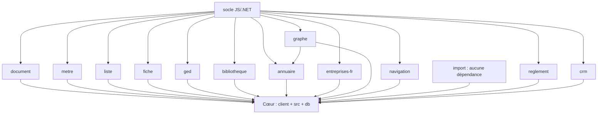

# Documentation Développeur LogiBTP

> **Version :** 1.0 — **Dernière mise à jour :** Octobre 2026  
> **Projet :** LogiBTP — Module de saisie des documents BTP  
> **Stack :** Client (JS/TS, Vite, CodeMirror, Immer) · API (.NET 10, ASP.NET Core, EF Core) · BDD (PostgreSQL 17)

---

Guide de connexion des agents IA : [GUIDE-AGENTS-MCP.md](GUIDE-AGENTS-MCP.md).

## 🎯 Objectif de cette documentation

Fournir une référence complète, structurée et maintenable pour tout développeur rejoignant le projet ou devant intervenir sur une partie spécifique (Client, API, BDD). La documentation suit l'architecture du projet : **Socle → Modules → Cœur**.

---

## 📚 Sommaire par domaine

### 🖥️ [Client (Frontend)](client/)
| Document | Description |
|----------|-------------|
| [ARCHITECTURE.md](client/ARCHITECTURE.md) | Arborescence, pattern workspace npm, chargement dynamique |
| [MODULES.md](client/MODULES.md) | Modules `@logibtp/*`, dépendances, spécialisation cœur |
| [NAVIGATION.md](client/NAVIGATION.md) | Routeur, fenêtres multiples, BroadcastChannel, restauration session |
| [ETAT_UI.md](client/ETAT_UI.md) | Immer (magasin), signaux, composants UI réutilisables |
| [CALCUL.md](client/CALCUL.md) | `MoteurDevisBtp` JS, colonnes BTP, métré, variables, parité C# |
| [PAGES.md](client/PAGES.md) | Inventaire pages : document, liste, fiche, GED, planning, pointage, CRM, stock |
| [PWA_HORS_LIGNE.md](client/PWA_HORS_LIGNE.md) | Service Worker, IndexedDB, synchronisation, démo hors-ligne |
| [TESTS.md](client/TESTS.md) | Vitest, jeux de cas partagés, `npm test` |
| [GUIDE_DEVELOPPEMENT.md](client/GUIDE_DEVELOPPEMENT.md) | Setup, commandes utiles, debug, contribution |

### ⚙️ [API (Backend .NET)](api/)
| Document | Description |
|----------|-------------|
| [ARCHITECTURE.md](api/ARCHITECTURE.md) | `Program.cs`, `LogiBtpContext`, middlewares, DI, multi-sociétés |
| [SPECIALISATIONS.md](api/SPECIALISATIONS.md) | Pattern Template Method : modules → cœur (`SpecialisationBtp`, `SpecialisationFicheBtp`, etc.) |
| [DOMAINE_CALCUL.md](api/DOMAINE_CALCUL.md) | `LogiBTP.Domaine` (entités), `LogiBTP.Calcul` (moteur, comparateur) |
| [AUTH_DROITS.md](api/AUTH_DROITS.md) | Session, en-têtes `X-*`, profils, `IDroits`, `SpecialisationDroitsBtp`, `SpecialisationAuthentificationBtp` |
| [MULTI_SOCIETES.md](api/MULTI_SOCIETES.md) | Résolution sous-domaine, `AddSocietes`/`UseSocietes`, bases séparées |
| [ROUTES_API.md](api/ROUTES_API.md) | Conventions REST, contrôleurs, DTOs, pagination, gestion erreurs |
| [MODULES_TRANSVERS.md](api/MODULES_TRANSVERS.md) | Mail, OAuth, Notifications, Edition (Jint), GED, Import, Sous-traitance |
| [TESTS.md](api/TESTS.md) | xUnit, jeux partagés, `LOGIBTP_TEST_PG`, parité JS/C# |
| [GUIDE_DEVELOPPEMENT.md](api/GUIDE_DEVELOPPEMENT.md) | Setup, commandes, debug, migration EF, contribution |

### 🗄️ [BDD (Base de données PostgreSQL)](bdd/)
| Document | Description |
|----------|-------------|
| [SCHEMA_GLOBAL.md](bdd/SCHEMA_GLOBAL.md) | Diagramme ER simplifié, tables principales, relations clés |
| [SCRIPTS_ORDRE.md](bdd/SCRIPTS_ORDRE.md) | Manifeste `scripts.txt`, numérotation 0xx/1xx/2xx, `rejouable` vs `une fois` |
| [COEUR_BTP.md](bdd/COEUR_BTP.md) | Scripts cœur 100-242 : colonnes BTP, références, listes, structure, marchés, ressources, exécution, stock, comptabilité |
| [MODULES_SQL.md](bdd/MODULES_SQL.md) | Scripts modules : Document (010-019), Métré (020), Liste (030-032), Fiche (040), GED (050-051), Bibliothèque (060-062), Annuaire (070), Auth (005), Calendrier (006), Mail (007), Notifications (008), Droits (009), OAuth (004), Règlements (080), Édition (090), CRM (095), Exécution (085), Pointage (086-088), Planning (089), Stock (093), Comptabilité (094), Sous-traitance (092) |
| [DONNEES_GENEREES.md](bdd/DONNEES_GENEREES.md) | Fichiers `.sql` générés depuis JS (116, 121, 131, 141, 150, 161, 163, 176, 191) — sources & commande `npm run generer-vues-liste` |
| [CONVENTIONS.md](bdd/CONVENTIONS.md) | Préfixes (`ent_`, `lig_`, `prj_`, `cha_`, `mar_`, `itv_`, `fin_`), snake_case, triggers GED, clés étrangères, index, vues `v_liste_*` |
| [INSTALLATION_MAJ.md](bdd/INSTALLATION_MAJ.md) | `docker-compose.yml`, `initialiser-developpement.sh`, `roles.sql`, commandes manuelles, mise à jour production |
| [DIAGRAMMES/](bdd/DIAGRAMMES/) | Diagrammes Mermaid/PlantUML (ERD, flux) |

### 🔄 [Transversal](transversal/)
| Document | Description |
|----------|-------------|
| [PARITE_JS_CS.md](transversal/PARITE_JS_CS.md) | Règles répliquées JS ↔ C#, jeux de cas partagés, table de correspondance |
| [DEPENDANCES.md](transversal/DEPENDANCES.md) | Dépendances npm/NuGet (généré par `npm run rapport-dependances`) |
| [GLOSSAIRE.md](transversal/GLOSSAIRE.md) | Termes métier : métré, déboursé, PV, ventilation, prorata, autoliquidation, etc. |
| [WORKFLOWS.md](transversal/WORKFLOWS.md) | Cycles de vie : document, fiche, commande, marché, avancement, sous-traitance, pointage |
| [FAQ_DEPANNAGE.md](transversal/FAQ_DEPANNAGE.md) | Problèmes courants, solutions, pièges à éviter |

---

## 🚀 Démarrage rapide

### Prérequis
- **Docker Desktop** (PostgreSQL 17 sur port 5433)
- **.NET 10 SDK**
- **Node.js 20+** + **npm 10+**

### Lancement en développement
```bash
# 1. Base de données
docker compose up -d

# 2. API (.NET)
dotnet run --project src/LogiBTP.Api --launch-profile http

# 3. Client (Vite)
npm install && npm run dev
```

### Accès
- **Société principale :** http://localhost:5173 (base `logibtp`)
- **Société démo :** http://demo.localhost:5173 (base `logibtp_demo`)

### Tests
```bash
# Client
npm test

# API (nécessite variable d'env)
LOGIBTP_TEST_PG="Host=localhost;Port=5433;Database=logibtp;Username=logibtp;Password=logibtp" \
dotnet test LogiBTP.slnx

# Parité JS/C#
npm run exporter-resultats && dotnet test LogiBTP.slnx
```

---

## 🏗️ Architecture globale (rappel)



**Règle d'or :** Un module ne dépend **jamais** du cœur ni d'un autre module (sauf exceptions documentées). Les liens entre modules passent par le cœur.

---

## 📖 Ressources complémentaires

| Ressource | Lien |
|-----------|------|
| README projet principal | [../../README.md](../../README.md) |
| Carte des modules | [../../MODULES.md](../../MODULES.md) |
| Scripts SQL cœur | [../../db/CLAUDE.md](../../db/CLAUDE.md) |
| Client CLAUDE | [../../client/CLAUDE.md](../../client/CLAUDE.md) |
| API CLAUDE | [../../src/CLAUDE.md](../../src/CLAUDE.md) |
| Dépendances | [../../documentation/DEPENDANCES.md](../../documentation/DEPENDANCES.md) |
| Conceptions modules | [../../documentation/conception/](../../documentation/conception/) |

---

## 🤝 Contribution à la documentation

1. **La doc vit dans le repo** — elle évolue avec le code
2. **Format :** Markdown + diagrammes Mermaid (rendus sur GitHub/GitLab)
3. **Génération auto :** Schéma BDD, routes API, dépendances → scripts CI
4. **Revue :** Toute modification de code impactante doit mettre à jour la doc correspondante
