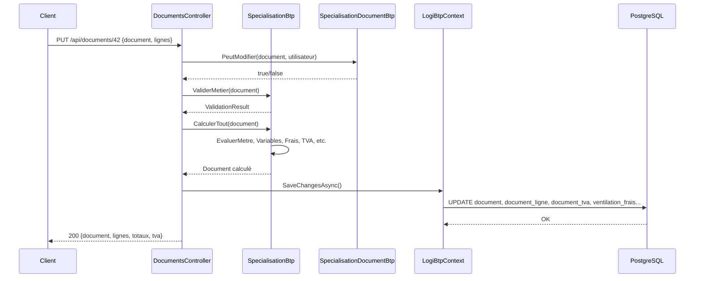

# Spécialisations Modules → Cœur (API)

> **Pattern :** Template Method — Classes mères dans modules (`LogiBTP.Documents`, `LogiBTP.Fiches`...) → Spécialisations dans `src/LogiBTP.Api/Btp/`
> **Règle :** Un module ne dépend JAMAIS du cœur. Le cœur spécialise via héritage/composition.

---

## 🎯 Principe général

```csharp
// Module : Classe mère (abstract, méthodes virtuelles = points d'accroche)
// modules/document/dotnet/LogiBTP.Documents/MoteurDocument.cs
public abstract class MoteurDocument
{
    protected Document Document { get; }
    
    public MoteurDocument(Document document) { Document = document; }
    
    // Template Method
    public void CalculerTout()
    {
        CalculerLignes();           // Virtuel - point d'accroche
        CalculerTotaux();           // Virtuel
        CalculerTVA();              // Virtuel
        AppliquerReglesMetier();    // Virtuel - vide par défaut
    }
    
    protected virtual void CalculerLignes() { /* logique générique */ }
    protected virtual void CalculerTotaux() { /* logique générique */ }
    protected virtual void CalculerTVA() { /* logique générique */ }
    protected virtual void AppliquerReglesMetier() { } // Point d'extension
}

// Cœur : Spécialisation (override des points d'accroche)
// src/LogiBTP.Api/Btp/SpecialisationBtp.cs
public class SpecialisationBtp : MoteurDocument
{
    public SpecialisationBtp(DocumentBtp document) : base(document) { }
    
    protected override void CalculerLignes()
    {
        // Logique BTP : métré, variables, déboursé, PV fixes, etc.
        base.CalculerLignes(); // Optionnel : appeler le parent
    }
    
    protected override void CalculerTVA()
    {
        // TVA BTP : ventilation par taux, autoliquidation, intracom
    }
    
    protected override void AppliquerReglesMetier()
    {
        // Règles spécifiques BTP : frais annexes, prorata, écarts arrondi
    }
}
```

---

## 📋 Tableau des spécialisations

| Module | Classe mère (Module) | Spécialisation Cœur (API) | Fichier | Rôle |
|--------|---------------------|---------------------------|---------|------|
| **Document** | `MoteurDocument` | `SpecialisationBtp` (→ `MoteurDevisBtp`) | `Btp/SpecialisationBtp.cs` | Calcul lignes, totaux, TVA, frais, prorata, métré |
| **Document** | `Document` | `DocumentBtp` | `Btp/DocumentBtp.cs` | Colonnes BTP : mode calcul ouvrage, coef FA, intervenants |
| **Document** | `DocumentLigne` | `DocumentLigneBtp` | `Btp/DocumentLigneBtp.cs` | Colonnes BTP : nature, poste, métré, PA/FG/PR/FA, blocs, PV affiché |
| **Document** | `SpecialisationDocument` | `SpecialisationDocumentBtp` | `Btp/SpecialisationDocumentBtp.cs` | Verrou, validation, transformation, origine, traçabilité |
| **Fiche** | `ValidationFiche` | `SpecialisationFicheBtp` | `Btp/SpecialisationFicheBtp.cs` | Validation métier fiches salarié/matériel/structure |
| **Liste** | `ConstructeurRequete` | `SpecialisationListeBtp` | `Btp/SpecialisationListeBtp.cs` | Sources, vues, filtres, saisie, contrôle empreinte |
| **GED** | `RegleVersions`, `ChaineCoffre` | `SpecialisationGedBtp` | `Btp/SpecialisationGedBtp.cs` | Catégories BTP, arborescence, éléments liés |
| **Bibliothèque** | `CalculElement` | `SpecialisationBibliothequeBtp` | `Btp/SpecialisationBibliothequeBtp.cs` | Prix, coefficients, unités, tarifs, composition ouvrages |
| **Annuaire** | `ServiceAnnuaire` | Via `SpecialisationFicheBtp` | `Btp/SalariesAnnuaire.cs` | Synchronisation salarié ↔ individu, casquettes |
| **Authentification** | `ReglesCompte` | `SpecialisationAuthentificationBtp` | `Btp/SpecialisationAuthentificationBtp.cs` | Salarié → individu, pseudo, profil par défaut MOBILE |
| **Droits** | `IDroits` (socle) | `SpecialisationDroitsBtp` | `Btp/SpecialisationDroitsBtp.cs` | Catalogue nœuds, table routes, profils |
| **Mail** | — | `SpecialisationMailBtp` | `Btp/MailBtp.cs` | Document → variables, destinataires, pièces GED, CRM |
| **OAuth** | — | `SpecialisationOAuthBtp` | `Btp/OAuthBtp.cs` | Services utilisateur, destinataires droits, notifications |
| **Calendrier** | `ReglesCalendrier` | `SpecialisationCalendrierBtp` | `Btp/CalendriersBtp.cs` | Calendrier effectif salarié/matériel, fermetures service |
| **Exécution** | `ReglesEtats` | `SpecialisationExecutionBtp` | `Btp/ExecutionBtp.cs` | Ordres, parcours, budgets, heures, états |
| **Pointage** | `ReglesPointage` | `SpecialisationPointageBtp` | `Btp/PointageBtp.cs` | Saisie hebdo, contrôles, paie, chantiers internes |
| **Planning** | `ReglesPlanning` | `SpecialisationPlanningBtp` | `Btp/PlanningBtp.cs` | Tâches, ressources, dépendances, charges, calendriers |
| **Règlement** | `ReglesReglement` | `SpecialisationReglementBtp` | `Btp/ReglementsBtp.cs` | Échéances, pointages, cautions, retenues |
| **Edition** | `SourceDocumentEdition` | `SpecialisationEditionBtp` | `Btp/EditionsBtp.cs` | Modèles, mentions, source document pour PDF |
| **Stock** | — | `SpecialisationStockBtp` | `Btp/StockBtp.cs` | Lieux=chantiers, articles=éléments, mouvements à validation |
| **Comptabilité** | `ReglesComptes` | `SpecialisationComptabiliteBtp` | `Btp/ComptabiliteBtp.cs` | Plan comptable, tiers, TVA, ventilation, export |
| **Sous-traitance** | — | `SpecialisationSousTraitanceBtp` | `Btp/SousTraitanceBtp.cs` | Marchés ST, pièces, factures, réception, paiement direct |
| **CRM** | `ReglesNote`, `ReglesRappel` | `SpecialisationCrmBtp` | `Btp/CrmBtp.cs` | Notes, demandes, suivis, validations, pièces GED |
| **Notification** | `ISourceNotifications` | `NotificationsBtp` | `Btp/NotificationsBtp.cs` | Sources : rappels CRM, habilitations, planificateur |

---

## 🔧 Points d'accroche principaux par spécialisation

### `SpecialisationBtp` (Cœur document)
```csharp
public class SpecialisationBtp : MoteurDocument
{
    // 1. Métré
    public virtual decimal? EvaluerMetre(Ligne ligne, string script, Dictionary<string, object> variables) { }
    
    // 2. Variables document (onglet Définition métré)
    public virtual void EvaluerVariablesDocument() { }
    
    // 3. Variables ligne (après qté)
    public virtual void EvaluerVariablesLigne(Ligne ligne) { }
    
    // 4. Frais annexes ventilés (montant uniquement)
    public virtual void CalculerFraisAnnexes() { }
    
    // 5. Prorata (lignes vendues)
    public virtual void CalculerProrata() { }
    
    // 6. Écarts d'arrondi (lig_ecart_arrondi)
    public virtual void CalculerEcartsArrondi() { }
    
    // 7. Lignes de pied (PIED_HT, PIED_TTC, TOTAL_HT, TOTAL_TTC)
    public virtual void CalculerPied() { }
    
    // 8. TVA (ventilation document_tva, autoliquidation, intracom)
    public override void CalculerTVA() { }
    
    // 9. Validation métier avant enregistrement
    public virtual ValidationResult ValiderMetier(Document doc) { }
    
    // 10. Verrou document (sans expiration)
    public virtual bool PeutDeverrouiller(Utilisateur u, Document doc) { }
}
```

### `SpecialisationFicheBtp`
```csharp
public class SpecialisationFicheBtp : ValidationFiche
{
    // Champs gérés par l'annuaire (coordonnées, rattachements)
    public override void AvantEcriture(Fiche fiche, Dictionary<string, object> valeurs) { }
    
    // Validation métier (règles champs + spécialisation)
    public override ValidationResult ValiderMetier(Fiche fiche) { }
    
    // Prix bibliothèque (élément article/ouvrage)
    public virtual void CalculerPrixElement(Element element) { }
    
    // Verrou fiche (renouvelé 30s, expire 2min)
    public virtual VerrouResult PrendreVerrou(int ficheId, string type, int utilisateurId) { }
}
```

### `SpecialisationListeBtp`
```csharp
public class SpecialisationListeBtp : ConstructeurRequete
{
    // Sources & Vues par défaut (générées depuis vues-liste.js)
    public static readonly SourceListe[] SOURCES_LISTE = ...;
    public static readonly VueListe[] VUES_LISTE = ...;
    
    // Contrôles avant modification en grille
    public virtual bool PeutModifierDonnees(SourceListe source, Dictionary<string, object> valeurs) { }
    public virtual ValidationResult ValiderModification(SourceListe source, Dictionary<string, object> anciennes, Dictionary<string, object> nouvelles) { }
    
    // Filtre rattachement (projet/affaire/chantier/marché)
    public virtual string ConstruireFiltreRattachement(Utilisateur u, string theme) { }
}
```

### `SpecialisationGedBtp`
```csharp
public class SpecialisationGedBtp : RegleVersions, ChaineCoffre
{
    // Catégories GED BTP (notice_technique, edition, crm, import, mail)
    public static readonly CategorieGed[] CATEGORIES_BTP = ...;
    
    // Arborescence : Projet > Affaire > Chantier > Marché > Ventes/Achats/Stock > Type doc
    public virtual IEnumerable<GedElement> GetDescendants(int elementId, string typeElement) { }
    
    // Vérification élément existe (pour f_ged_element_existe)
    public virtual bool ElementExiste(string typeElement, int idElement) { }
}
```

---

## 🔄 Cycle de vie d'une requête (ex: enregistrement document)



---

## ➕ Ajouter une nouvelle règle de calcul

### 1. Côté module (si règle générique réutilisable)
```csharp
// modules/document/dotnet/LogiBTP.Documents/MoteurDocument.cs
public abstract class MoteurDocument
{
    protected virtual void NouvelleRegleGenerique() { }
}
```

### 2. Côté cœur (spécialisation BTP)
```csharp
// src/LogiBTP.Api/Btp/SpecialisationBtp.cs
public class SpecialisationBtp : MoteurDocument
{
    protected override void NouvelleRegleGenerique()
    {
        // Implémentation BTP spécifique
    }
    
    // Ou ajout dans CalculerTout()
    public override void CalculerTout()
    {
        base.CalculerTout();
        NouvelleRegleGenerique(); // Nouveau point d'accroche
    }
}
```

### 3. Côté client (parité JS)
```javascript
// client/src/calcul/moteur-btp.js
class MoteurDevisBtp extends MoteurDocument {
  nouvelleRegleGenerique() {
    // Même logique que C#
  }
  
  calculerTout() {
    super.calculerTout();
    this.nouvelleRegleGenerique();
  }
}
```

### 4. Test partagé (JSON)
```json
// tests/cas/xx_nouvelle_regle.json
{
  "nom": "Nouvelle règle X",
  "document": { ... },
  "lignes": [ ... ],
  "attendu": { ... }
}
```

### 5. Vérification parité
```bash
npm run exporter-resultats && dotnet test LogiBTP.slnx
```

---

## 🔗 Liens vers autres docs

| Concept | Documentation |
|---------|---------------|
| Architecture API | [ARCHITECTURE.md](ARCHITECTURE.md) |
| Domaine & Calcul | [DOMAINE_CALCUL.md](DOMAINE_CALCUL.md) |
| Auth & Droits | [AUTH_DROITS.md](AUTH_DROITS.md) |
| Routes API | [ROUTES_API.md](ROUTES_API.md) |
| Modules transverses | [MODULES_TRANSVERS.md](MODULES_TRANSVERS.md) |
| Client Calcul | [client/CALCUL.md](../client/CALCUL.md) |
| Parité JS/C# | [transversal/PARITE_JS_CS.md](../transversal/PARITE_JS_CS.md) |
| BDD Scripts cœur | [bdd/COEUR_BTP.md](../bdd/COEUR_BTP.md) |